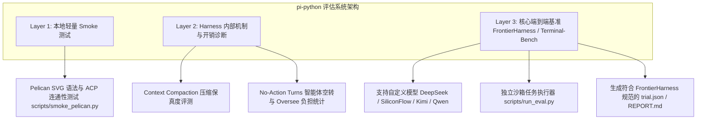

# FrontierHarness Eval 评估系统接入指南

`pi-python` 现已内置面向 **FrontierHarness Eval** 与 **Terminal-Bench** 的代码智能体（Code Agent Harness）端到端综合评估框架。

该评估框架能够评测固定模型（支持 DeepSeek / SiliconFlow / Qwen / Claude / Kimi 等自定义模型）在 `pi-python` Agent Harness 驱动下的**真实任务解决率（Pass Rate）**、**有效单题成本（Effective Cost per Pass）**、**Prompt Cache 命中率**、**交互轮次（Turns）**与**空转轮次（No-Action Turns）**。

---

## 1. 评估系统三层分级架构



- **Layer 1: 轻量连通性冒烟**：`scripts/smoke_pelican.py`，单轮验证 ACP 协议与工具链连通性。
- **Layer 2: Harness 内部开销诊断**：跟踪上下文压缩率、Prompt Cache 命中率、以及智能体思考未执行动作的空转轮次（No-Action Turns）。
- **Layer 3: 核心端到端任务基准**：直接兼容 `frontier-harness-eval`（30 个任务）与 `terminal-bench-2-1`，全自动完成“初始化环境 -> 启动 Harness 交互 -> 执行测试验证 -> 生成指标报告”。

---

## 2. 评测指标与记录规范（Contract）

本系统产出的结果与 [frontier-harness-eval/eval](https://github.com/frontier-harness-eval/eval) 的 `trial.json` 规范完全对齐：

| 字段 | 含义 | 说明 |
| :--- | :--- | :--- |
| `id` | 任务全称 | 如 `terminal-bench/regex-log` |
| `status` | 执行状态 | `success` / `failure` / `error` / `infra_invalid`（仅当 `total_turns == 0` 时允许标记为 `infra_invalid`） |
| `success` | 是否通过 | 基于任务对应的自动化验证器（Verifier）最终判定 |
| `duration_seconds` | 耗时（秒） | 任务从开始到完成的实际墙钟时间 |
| `turns` | 总交互轮数 | Harness 与模型交互的 Turn 总数 |
| `no_action_turns` | 无动作轮数 | 模型仅产生推理思考或文本而未调用任何文件/命令工具的轮数 |
| `cache_hit_rate_normalized`| Cache 命中率 | 排除首轮冷启动缓存后的归一化命中率 |
| `cost_first_cold_usd` | 单任务实际开销 | 首轮缓存按冷启动重新计费后的实际折算成本（USD） |
| `cost_kimi_k3_normalized_usd` | 官方标准对标开销 | 基于官方 Kimi K3 基准价格表（$3/$0.3/$15）折算的标准化成本 |
| `input_tokens` / `output_tokens` / `cached_tokens` | Token 计数统计 | 细分输入、输出与缓存 Token |

---

## 3. 快速上手

### 3.1 环境变量与模型配置

评估脚本默认使用 `~/.pi-python/agent.toml` 中的配置，并从环境变量中获取 API Key：

```powershell
# 引入本地密钥与配置（Windows PowerShell）
. $env:USERPROFILE\.pi-python\local.env.ps1

# 验证 Key 已注入
$env:REAL_LLM_API_KEY
```

支持的模型配置在 `~/.pi-python/agent.toml`：
```toml
[model]
provider = "deepseek"
id = "deepseek-ai/DeepSeek-V4-Flash"
base_url = "https://api.siliconflow.cn/v1"
api_key_env = "REAL_LLM_API_KEY"
```

### 3.2 运行评测任务

#### 运行单个内置任务（如 Terminal-Bench #1: regex-log）
```powershell
.venv\Scripts\python.exe scripts/run_eval.py --task regex-log
```

#### 运行所有内置任务
```powershell
.venv\Scripts\python.exe scripts/run_eval.py --all
```

#### 运行外部 FrontierHarness / Terminal-Bench 任务集
```powershell
# 指定外部任务目录
.venv\Scripts\python.exe scripts/run_eval.py --tasks-dir .cache/terminal-bench-2-1/tasks --task regex-log
```

#### 在 WSL 中使用 Docker 容器沙箱运行（支持 DeepSWE 与工业级环境）
```powershell
# 在 WSL 中使用 Docker 运行单个任务（自动拉取镜像并挂载沙箱）
wsl bash -lc "cd /mnt/d/work/pi-python && /tmp/pi-eval-venv/bin/python scripts/run_eval.py --frontier-30 --task regex-log"

# 运行 DeepSWE 开源仓库任务（自动在真实容器中运行 SWE-bench 完整测试套件）
wsl bash -lc "cd /mnt/d/work/pi-python && /tmp/pi-eval-venv/bin/python scripts/run_eval.py --frontier-30 --task fastapi-deprecation-response-headers"
```

#### 自定义参数与高级选项
```powershell
# 限制单任务最大轮次为 15，并指定自定义运行 ID
.venv\Scripts\python.exe scripts/run_eval.py --task calc-eval --max-turns 15 --run-id my-first-eval

# 显式禁用 Docker，使用宿主机本地执行（仅用于冒烟；没有验证器隔离，见 3.5，不要用它计分）
.venv\Scripts\python.exe scripts/run_eval.py --frontier-30 --task regex-log --no-docker

# 指定网络出站隔离模式（auto / no-network / allowlist / open）
.venv\Scripts\python.exe scripts/run_eval.py --frontier-30 --task regex-log --egress-mode allowlist
```

### 3.3 本地化黄金快照（Golden Checkpoint）机制

为了彻底消除测试间的跨任务文件污染、Page Cache 预热偏差与多次拉取解包带来的时间浪费，评测系统提供了本地化黄金快照与秒级还原体系：

#### 1. 一键固化构建黄金种子（Golden Seed Provisioning）
运行一次 `--provision`，评测系统会拉取所有评测任务 Docker 镜像并将其初始 `/app` 代码提取到只读种子目录中，同时生成环境指纹 `golden-manifest.json`：
```powershell
# 固化构建全部 FrontierHarness 30 题的工作区种子快照
wsl bash -lc "cd /mnt/d/work/pi-python && /tmp/pi-eval-venv/bin/python scripts/run_eval.py --frontier-30 --provision --seeds-dir /tmp/pi-golden-seeds"
```

#### 2. 秒级 CoW (Copy-on-Write) 纯净还原
当种子目录就绪后，每次执行评测任务时：
- 系统优先调用 Linux ext4 文件的 `cp -a --reflink=auto`，实现**零耗时、零额外磁盘占用**的秒级全新工作区初始化；
- 若未预先执行 `--provision`，系统会自动平滑降级至 `docker create` + `docker cp` 的即时提取路径。

### 3.4 网络出站隔离策略（Egress Policy Guard）

模式名称和域名清单对齐官方 `frontier-harness-eval`（PR #7 & PR #11）。执行强度和官方不同，见下。

- **`no-network` 断网（已执行）**：DeepSWE 任务的 `task.toml` 写明 `network_mode = "no-network"`。容器启动时附加 `--network none`，容器内没有任何网络。Agent 与 LLM 的交互由宿主机上的 `pi-python` 进行，不经过容器。2026-10-16 的 DeepSWE 重跑里，智能体至少 7 次想从 GitHub 抓上游实现（`git clone`、`curl api.github.com`、`curl raw.githubusercontent.com`），全部失败（`Could not resolve host`，或没有任何输出）。
- **`allowlist` 白名单（未执行）**：Terminal-Bench 任务用这个模式。代码只把代理的环境变量（`http_proxy`、`https_proxy` 等）传给容器。`EgressPolicy.allowed_hosts` 只写进 `run.json`，没有任何代码按它过滤。2026-10-16 实测：容器经代理访问不在清单里的 `example.org`、`huggingface.co`、`httpbin.org`，都返回 200。所以这个模式的实际效果是**开放互联网**（只要宿主机的代理不过滤）。
- **清单本身含 GitHub。** `OFFICIAL_ALLOWED_HOSTS`（14 项，在 `egress_policy.py`）包含 `github.com`、`*.github.com`、`*.githubusercontent.com`。就算清单被执行，智能体也能读 GitHub 上公开的 `terminal-bench` 仓库，里面有参考解和测试文件。有一次运行真的这样做了，见 [评估报告](FRONTIER-HARNESS-30-EVAL-REPORT.md) 的“数据有效性声明”。
- 用 `--egress-mode` 可手动覆盖（`auto`、`no-network`、`allowlist`、`open`）。要在 Terminal-Bench 任务上排除“抓取答案”，用 `--egress-mode no-network`。代价：需要联网装依赖的任务会失败（例如 `dna-insert` 要 `apt-get install primer3`）。

### 3.5 验证器隔离（Verifier Isolation）

验证器的测试文件（`tests/`：`test.sh`、`test.patch`、`grader.py`、`test_outputs.py` 等）**只在验证阶段**进入容器。智能体运行时看不到它们。

1. 容器启动时（`DockerContainerSession.setup`）不复制 `tests/`。智能体运行期间，容器里没有 `/tests`。
2. 智能体结束后，`run_verifier` 先执行 `rm -rf /tests`（清掉智能体可能自建的目录），再用 `docker cp` 复制 `tests/`，去除 CRLF，最后运行 `bash /tests/test.sh`。
3. 复制失败时，验证器直接返回失败和错误信息。它不会运行旧文件。
4. 对使用 `grader.py` 的 DeepSWE 任务，`run_verifier` 在运行 `test.sh` 之前，把 `/app` 的 HEAD 退回容器启动时的值（`git reset --mixed`：只移动 HEAD 和索引，工作区的文件不变）。原因：任务文字要求智能体“在新分支上提交”，而 `grader.py` 假定 HEAD 是基准提交。智能体若提交了与隐藏测试同名的文件，没有这一步，`git apply test.patch` 会失败，评分为 -1，一个测试也不运行。Terminal-Bench 任务不做这一步：`sanitize-git-repo` 的答案就是新的历史。

> **历史缺陷（2026-10-16 已修复）**：此前 `setup` 在容器启动时就复制了 `tests/`。智能体有 shell，可以读到这些文件。少数运行确实读了。受影响的结果见 [评估报告](FRONTIER-HARNESS-30-EVAL-REPORT.md) 的“数据有效性声明”。DeepSWE 的 `task.toml` 声明了 `[verifier] environment_mode = "separate"`，即验证器在单独的环境里运行，智能体看不到测试。

> **历史缺陷（2026-10-26 已修复）**：此前智能体的提交会留在验证器的仓库里。`httpx-multipart-response-parsing` 的一次运行因此被评为 -1。受影响的结果和重新评分的方法见 [评估报告](FRONTIER-HARNESS-30-EVAL-REPORT.md) 的“数据有效性声明”第 1b 点。

检查方法：

- **运行中**：`docker exec <容器名> ls /tests` 必须报 `No such file or directory`。
- **运行后**：在 `trajectory.json` 里查找工具调用参数中的**根目录** `/tests`。不要把仓库自带的 `/app/tests` 算进去。
- **运行后**：在 `verifier_output.txt` 里查找 `test.patch failed to apply`。DeepSWE 任务出现它，说明评分流程出错，这次结果不能用。

回归测试（用假的 `run_docker_sync`，不需要 Docker）：

- `packages/pi-agent-cli/tests/test_docker_runner_verifier_isolation.py`：验证器的测试文件只在验证阶段进入容器。
- `packages/pi-agent-cli/tests/test_docker_runner_verifier_head.py`：DeepSWE 任务的验证器在 HEAD 退回起点后运行。

**`--no-docker` 没有这种隔离。** 智能体和宿主机共享文件系统。它能列出整个任务目录（包括 `solution/` 和 `tests/`），实测有一次直接读了 `tests/`。该模式只用于冒烟。不要用它计分。

仍然存在的差异：验证器和智能体共用同一个容器（官方 DeepSWE 用独立的验证环境）。智能体理论上可以改动容器里的系统文件来影响验证。目前的轨迹里没有看到这种行为。

### 3.6 通过 LLM 网关在 WSL 中运行：常见问题

- **WSL 的环境变量与 Windows 分开。** 评测进程看到的 `REAL_LLM_API_KEY` 来自 WSL 的登录环境。`~/.bashrc`、`~/.profile` 里写死的旧 Key 会盖住 Windows 侧 `local.env` 里的新 Key。症状是网关返回 401。排查时只比较 Key 的指纹（`sha256sum` 的前 12 位）。不要打印 Key。
- **局域网网关要加入 `no_proxy`。** WSL 登录环境若设了代理（如 v2ray），网关流量会被送去代理。把网关的域名和 IP 加进 `no_proxy`。Docker 拉镜像用 `daemon.json` 里的代理，不受这个设置影响。
- **先启动 Docker 守护进程。** `docker version` 失败时，用 root 启动 `dockerd`。WSL 没有运行 systemd 时，`systemctl start docker` 无效。
- **网关返回 403 “weekly (7-day) usage limit”**：上游额度用完。这不是 harness 的问题。换模型，或等额度恢复。
- **`--model` 参数**：值里有 `:` 时，按 `provider:model` 解析。没有 `:` 时，只替换模型 ID，provider 沿用 `agent.toml`。
- **`/tmp/pi-ws-*`**：Docker 任务在 ext4 临时工作区里运行。评测结束后，这些目录不会自动删除，里面可能有 root 所有的文件。需要定期用 root 清理。
- **一个任务只走了十几轮，却跑满了 `agent_timeout_sec`（Terminal-Bench 常为 900 s）**：先看最后一条 `bash` 命令。Docker 的 `bash` 工具在智能体不传 `timeout` 时一直等，所以智能体写的全盘 `grep -r /` 或 `find /` 可能卡住。评测器在 `agent_timeout_sec` 到时结束这次运行，并记为失败。2026-10-16 的 `extract-elf` 断网重测就是这样结束的（13 轮，900 s）。用 `docker top <容器>` 可以看到卡住的进程。不要用删除容器的办法解除卡住：验证器还要用同一个容器，删了它，这次运行会直接判失败。

---

## 4. 产出报告与诊断证据

每次评测会在 `.pi-eval/runs/<run_id>/` 下输出完整证据链路：

```text
.pi-eval/runs/20260904-083153/
├── run.json                 # 官方规范环境指纹清单（记录 Git commit、Egress 策略、硬件规格与标准归一化成本）
├── eval-summary.json        # 汇总评测结果（含所有题目的聚合指标）
├── REPORT.md                # 格式化 Markdown 评测报告与数据表格
└── trials/
    └── regex-log/
        ├── trial.json       # 符合 FrontierHarness 规范的单题记录
        ├── trajectory.json  # 完整的智能体思考过程、工具调用与结果轨迹
        ├── verifier_output.txt # Pytest / Verifier 执行输出详细日志
        └── workspace/       # 智能体工作目录生成的代码与文件快照
```

### 真实模型运行实测样例

以下为在 `deepseek-ai/DeepSeek-V4-Flash` 模型下的实测运行报告：

```markdown
# Benchmark Evaluation Report: 20260904-083153

- **Harness**: `pi-python`
- **Model**: `deepseek-ai/DeepSeek-V4-Flash` (deepseek)
- **Time**: `2026-09-04T08:31:53Z` to `2026-09-04T08:35:24Z`
- **Tasks**: 1 / 1 passed (100.0%)

## Key Metrics

| Metric | Value | Meaning |
| :--- | :--- | :--- |
| **Pass Rate** | **100.0%** | Tasks successfully solved and verified |
| **Effective Cost / Pass** | **$0.1117** | Total amortized cost per passed task |
| **Tokens / Solved** | **319,794** | Amortized tokens consumed per passed task |
| **Total Cost** | $0.1117 | Total API spend for the run |
| **Typical Cache Hit Rate** | 45.8% | Prompt caching efficiency |
| **Mean Turns** | 13.0 | Average interaction turns per task |
| **Mean No-Action Turns** | 1.0 | Turns without file/shell operations (overhead) |
| **Median Duration** | 209.2s | Median elapsed time per task |

## Task Results

| Status | Task ID | Duration | Turns (No-Act) | Tokens | Cache | Cost |
| :---: | :--- | :---: | :---: | :---: | :---: | :---: |
| ✅ | `terminal-bench/regex-log` | 209.2s | 13 (1) | 319,794 | 46% | $0.1117 |
```
