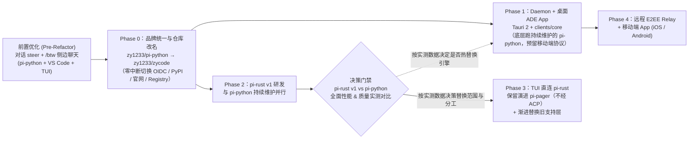
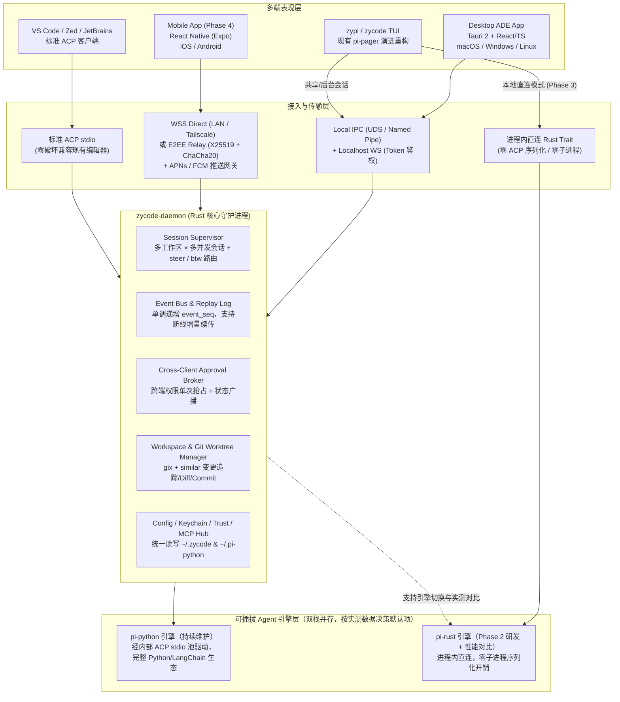
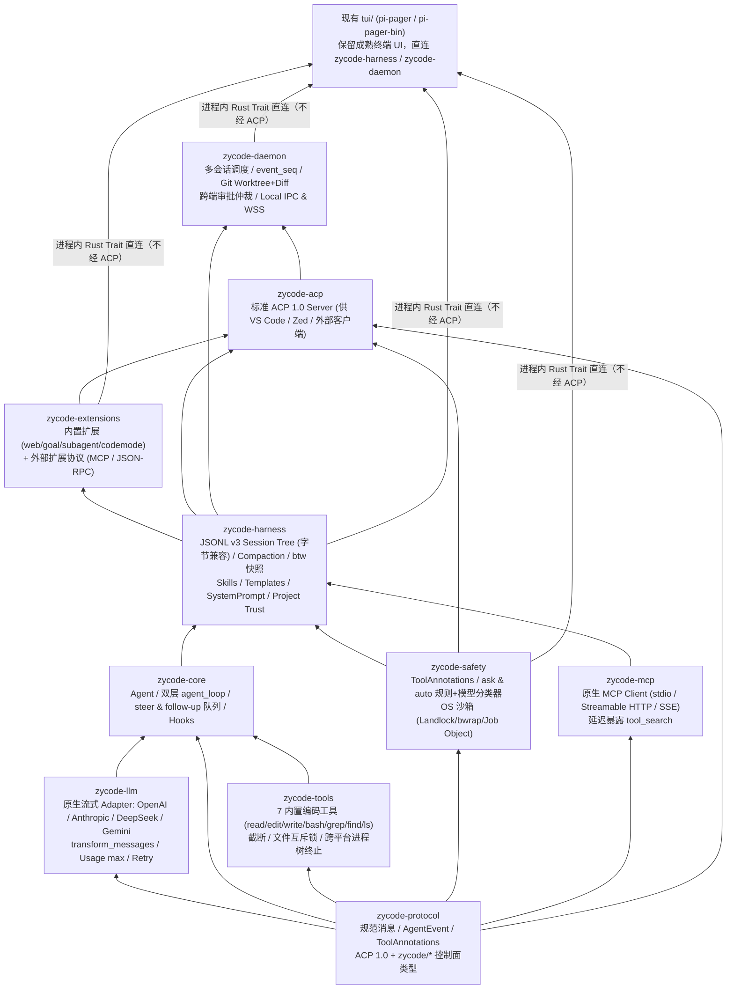
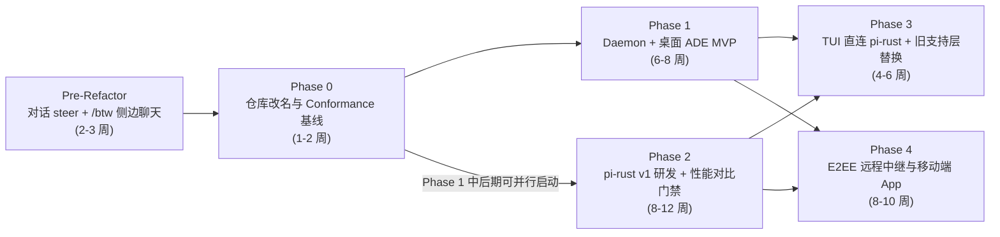

# zycode 全平台重构方案与 Roadmap

> **状态**：Pre-Refactor（`steer` + `/btw`）已在 PR #157 实现；Phase 0–4 为架构设计与演进路线图  
> **日期**：2026-11-25（2026-11-26 修订：同步 Pre-Refactor `steer` 与 `/btw` 最终落地协议与安全语义，明确 `pi-python` 持续维护及 `pi-rust` v1 性能对比决策门禁）  
> **基线事实**：`zy1233/pi-python` 当前 `main`（Python 包与 `zycode-agent` `1.1.0`，VS Code 插件 `zycode.zycode` `1.12.0`，Rust TUI `zypi` `1.1.0`）  
> **目标范围**：
> 0. **重构前置优化**：在启动架构重构之前，先在现有 `pi-python` + VS Code + TUI 体系上落地两项高频对话体验优化——**对话中途引导（`steer`）**与**无污染侧边聊天（`/btw`）**；
> 1. **仓库更名**：GitHub 仓库重命名为 `zy1233/zycode`，完整评估对 PyPI 发布、VS Code 插件发布及周边生态的影响，并提供可直接执行的 OIDC 更新指引与零中断迁移清单；
> 2. **全平台架构**：首期落地跨平台桌面端 ADE（Agentic Development Environment）应用（对标 Codex App / Antigravity / Claude Code Desktop，不做 IDE），架构原生预留移动端（iOS/Android）扩展能力；
> 3. **`pi-rust` 与 Rust TUI 深度集成**：持续维护 `pi-python`；并行研发 `pi-rust` v1，**待 `pi-rust` v1 稳定后与 `pi-python` 做全面性能与效果对比，再决定后续切换与双栈分工**；TUI 重构聚焦保留并演进现有 `pi-pager` UI，实现与 `pi-rust` 进程内紧耦合直连（不经 ACP）。

---

## 0. 执行摘要与现状诊断

### 0.1 量化现状（基于当前代码库实测）

| 维度 | 现状实测数据 | 核心痛点与机会 |
|---|---|---|
| **Python 核心与扩展 (`pi-python`)** | `pi_agent_core/` + 7 个 `packages/*` 非测试源码共 **35,101 行**，PyPI 发行 **8 个稳定包**（`1.1.0`），4,400+ 测试 | 语义完整、迭代效率高，**Pre-Refactor（PR #157）已贯通 `X9` `pi/session/steer` 与 `X10` `pi/session/btw` 的 ACP 协议、VS Code 插件与 Rust TUI**；需持续维护，并作为 `pi-rust` 的行为基线与性能对照对象 |
| **冻结二进制 `zycode-agent`** | 5 平台 PyInstaller one-file：`linux-x64` **77.0 MB**（VSIX **74.0 MiB**），`darwin-arm64` **41.3 MB**，`win32-x64` **42.7 MB**；冷启动解压约 **1.7 s** | 体积大、冷启动慢、仅内置 `langchain-openai`、缺 `windows-aarch64`（`tiktoken` 无 wheel）、沙箱需二次打包 `pi-sandbox-child` |
| **Rust TUI (`tui/`)** | 基于 `grok-build` 硬分叉的成熟终端 UI（`pi-pager` 家族功能丰富：全屏/行内、Markdown、Diff、Mermaid、主题、状态栏、快捷键等）；当前全 workspace **80 crates / 958,555 行 Rust**，`zypi-linux-x86_64` 二进制约 **407 MB** | ① TUI（Rust）与 Agent（Python）跨进程走 ACP stdio，存在冷启动、序列化与 X1–X10 协议折中；② 仍传递依赖旧支持层（`pi-tools` 130K 行、`pi-workspace` 81K 行、`pi-shell`、`pi-tools-api` 阻塞原生 Windows 编译） |
| **VS Code 插件 (`vscode/`)** | TypeScript **11,110 行**，其中 `vscode/src/core/` 有 **23 个零 `vscode` 依赖的纯核心模块**，548 单元测试 | 架构边界极佳，**可直接抽取为跨端共享 TS Client Core** 供桌面端与移动端复用 |
| **发布与品牌现状** | 产品品牌、官网（`zycode.dev`）、VS Code 插件 ID（`zycode.zycode`）、二进制名（`zycode-agent`）均已叫 `zycode`，仅 GitHub 仓库名、配置目录（`~/.pi-python`）和 PyPI 包名沿用历史名 | 仓库改名后 Open VSX 与 VS Marketplace 的 **OIDC Trusted Publishing** 需同步更新仓库名（操作简单，3–5 分钟零密钥完成） |

### 0.2 整体演进脉络



**核心架构判断**：
1. **先做高杠杆对话体验优化（`steer` + `/btw`）**：直接提升日常编码交互效率，且其协议与状态语义将无缝沉淀进后续桌面端与 `pi-rust`，零返工。
2. **`pi-python` 持续维护，不预设过早退场**：`pi-python` 继续迭代与维护；待 `pi-rust` 第一版稳定后，用客观基准（冷启动、内存、体积、工具吞吐、FrontierHarness 30、开发维护成本）做实测对比，再决定全量替换、按端分工还是长期双栈并行。
3. **保留并持续演进现有 `tui/`（`pi-pager`）**：TUI 重构的目标是与 `pi-rust` 紧耦合直连（默认不经 ACP），而非冻结或推倒重做 `grok-build` 的成熟终端 UI。

---

## 1. 重构前置优化：对话 `steer` 与 `/btw` 侧边聊天（PR #157 已落地）

> **详细实现规格**：[Pre-Refactor 前置体验优化设计规格：对话 `steer` 与 `/btw` 侧边聊天](2026-11-26-pre-refactor-steer-and-btw-design.md)（权威协议契约以 [2026-11-05-acp-extension-registry.md](2026-11-05-acp-extension-registry.md) 的 X9 / X10 条目为准）。

在启动仓库改名与全平台重构前，已在当前 `pi-python`（`pi_agent_harness` + `pi_agent_cli`）与两个现有交互端（VS Code 插件、`zypi` TUI）上落地两项高频能力。所有新增 ACP 协议项严格遵循 `docs/specs/2026-11-05-acp-extension-registry.md` 的五条准入规则（无标准等价、Python 侧带测试、登记入册、Rust 类型统一放 `pi-acp-lib`、经 `initialize` 能力协商且对 Zed 等第三方客户端无害）。

### 1.1 优化一：对话支持 `steer`（运行中即时引导）

#### 1.1.1 落地总览（改造前断点已全链路打通）

- **核心与 Harness 层（`packages/pi-agent-harness/pi_agent_harness/agent_harness.py`）**：基于内置 `self.steer_queue`（`steering_mode: "one-at-a-time"`）与 `agent_loop` 的 turn 边界消费回调 `get_steering_messages`，补齐内存级 `steer_id` 映射（不改动 JSONL v3 schema）、同步中止门控（`begin_abort()` / `is_aborting`），并在任意 run 结束出口（流错误、`max_turns`、stop hook 或 cancel）自动清理未送达的用户 steer（通过 `QueueUpdateEvent.undeliveredSteer` 通知客户端回填，避免泄漏到后续无关 prompt）。
- **ACP 协议与 Agent 层（`packages/pi-agent-cli/pi_agent_cli/agent.py`、`events.py`）**：已接入 `X9` 扩展方法 `pi/session/steer`、队列通知 `pi/queue_update`，以及被引导消息真正注入时的 `user_message_chunk` 投影（带 `_meta["pi/steered"] = true` 与 `_meta["pi/steerId"]`）。
- **客户端层（`vscode/` 与 `tui/`）**：VS Code 插件与 `zypi` 均已打通忙碌态 steer 排队、队列状态徽章、空闲回退、取消/异常结束草稿恢复；`pi-acp-lib/src/extensions/steer.rs` 统一定义 Rust 线类型。

#### 1.1.2 端到端协议与安全语义

1. **ACP 协议扩展（已登记项 `X9`：`pi/session/steer`）**：
   - **能力协商**：Agent 在 `initialize` 响应的 `_meta["pi/capabilities"]["steer"] = true` 宣告支持；opt-in 客户端（`zypi`、VS Code 插件）同步在 `clientCapabilities._meta["pi/capabilities"]["steer"] = true` 宣告（不支持该能力的旧 Agent 或第三方客户端不受影响）。
   - **请求**：client → agent，方法名 `pi/session/steer`（ACP wire 名 `_pi/session/steer`），参数 `{"sessionId": string, "steerId"?: string, "prompt": ContentBlock[]}`（复用 `_prompt_to_text_images`，同时支持文字与图片）。
   - **竞态、安全与清理语义**：
     - 当 `harness` 处于活跃 turn 且未进入中止流程时：调用 `await harness.steer(text, images, steer_id=steer_id)` 入队，返回 `{"sessionId": string, "steerId": string, "queued": true, "queueLength": N}`。
     - **Auto 安全不变量（S2，注入时生效）**：`AutoSession.note_user_message(text)` **绝不在入队时调用**，而**仅在被引导消息于 turn 边界真正被 `agent_loop` 消费注入（`message_start`）时调用**；若在消费前被 `session/cancel` 或异常结束清空，该文本不会进入 Auto 分类器上下文。
     - 当主 turn 已回到 `idle`、正在 `aborting`、或阻塞在 `waiting_for_trust` / `waiting_for_barriers` 时：返回 `{"sessionId": string, "steerId": string, "queued": false, "reason": "idle" | "aborting" | "waiting_for_trust" | "waiting_for_barriers"}`。若返回 `idle`，客户端自动无感回退为常规 `session/prompt`（VS Code 在本地尚未收到上一轮 `prompt` 返回时亦自动排队等待转 `ready` 后补发，确保不丢消息）。
   - **事件回显与草稿恢复语义**：
     - 队列变更通过通知 `pi/queue_update`（wire 名 `_pi/queue_update`，参数 `{"sessionId", "steer": [{"steerId", "preview"}], "clearedByAbort": boolean, "clearedSteerIds"?: string[]}`）推送。
     - 当 `agent_loop` 在当前工具批次结束后的 turn 边界真正消费该 steer 消息时，通过标准 `session/update` 发出 `user_message_chunk`（带 `_meta["pi/steered"] = true` 与可选 `_meta["pi/steerId"]`），让时间线按真实生效位置展示该条用户引导。
     - 无论因 `session/cancel` 还是流错误 / `max_turns` / stop hook 导致 run 结束，未消费的 steer 都会被清空并通过 `pi/queue_update`（`clearedByAbort: true` + `clearedSteerIds`）回报，客户端将其前置回填至输入框（保留用户已输入的草稿文本，不丢字）。
2. **VS Code 插件（`vscode/`）**：
   - `status === "busy"` 时保持输入框可输入；检测到 agent 支持 `steer` 能力时，回车 / 点击 **Steer** 发送 `_pi/session/steer`（保留显式 Stop 按钮用于中断；忙碌态下其他斜杠命令如 `/model`、`/auto-log` 禁止当普通 steer 发送，提示等待当前 turn 结束并恢复草稿）。
   - 聊天区底部展示紧凑的「待注入引导（Steer）」待生效条目；生效后自然转为对话流中的带 `Steered` 标记的用户气泡；若被取消或非取消异常结束仍未消费，则自动回填输入框。
3. **Rust TUI（`tui/`）**：
   - `X9` 线类型统一定义在 `pi-acp-lib/src/extensions/steer.rs`（符合准入规则 4）。
   - Turn 运行期间允许继续输入并提交：先走斜杠命令解析，普通文本在 agent 宣布 `steer` 能力时发送 `_pi/session/steer` 并展示排队状态；否则平滑保持本地等待队列；收到 `clearedByAbort: true` 时前置拼接回填到输入框。

---

### 1.2 优化二：`/btw` 侧边聊天（无污染临时问答）

#### 1.2.1 核心产品语义

用户在主对话执行过程中（**无论主对话是 `idle` 还是 `busy` 正在运行长耗时工具/多轮推理**），需要临时问一个与当前上下文相关的旁路问题（例如「刚才改的那个函数签名是什么」「这个报错码什么意思」「总结目前改了哪几个文件」）。`/btw` 必须严格满足四条语义不变量：

1. **共享主上下文只读快照**：模型能看到当前主会话的 system prompt 与截至当前的对话历史快照（含悬空 tool call 自动闭合与无工具文本投影，单条 tool result 截断至 4,000 字符），无需用户重新粘贴背景。
2. **零污染主会话**：`/btw` 的提问与回答**绝不写入主会话 JSONL v3 文件**、**不进入主会话下一轮 LLM 上下文**、**不消耗主会话上下文窗口**、**不触发主会话 Compaction**。
3. **无工具、零副作用、可并行**：`/btw` 固定以 `tools = []` 纯问答模式调用 LLM，不修改文件、不跑命令、**无需权限弹窗**；且**不争抢 `AgentHarness` 的 Phase 锁**，因此在主对话 `busy` 跑测试/编代码期间可完全并行问答！
4. **即用即走（Ephemeral）**：回答展示在独立侧边气泡/浮层中，支持复制、继续追问（仅在该次侧边浮层生命周期内保留多轮内存上下文，按 20 轮与 32 KiB UTF-8 字节双重裁剪，关闭即销毁）和一键 `Esc` 关闭。

#### 1.2.2 端到端协议与实现方案

1. **Harness 层（`pi_agent_harness`）**：
   - 无锁只读方法 `harness.snapshot_context_for_btw() -> BtwContextSnapshot`：浅拷贝当前 system prompt + 已落盘消息快照（不持 Phase 锁、不修改 SessionStorage，不触发延迟写文件的落盘）。
2. **Agent 与 ACP 协议层（`pi_agent_cli`，已登记项 `X10`：`pi/session/btw`、`pi/btw_update`、`pi/session/btw_cancel`）**：
   - **双向能力协商与防误触兜底**：
     - Agent 在 `initialize` 响应声明 `_meta["pi/capabilities"]["btw"] = true`。
     - `available_commands_update` **仅向在 `clientCapabilities._meta["pi/capabilities"]["btw"] = true` 中显式 opt-in 的客户端（`zypi`、VS Code 插件）广播 `/btw`**，避免不支持 `pi/session/btw` 的第三方 ACP 客户端（如 Zed）误展示该命令。
     - 若客户端仍经 `session/prompt` 直接发送字面 `/btw ...`（且没有扩展注册 `btw` 命令），Agent 直接返回简短提示并结束（`end_turn`），**不调用 LLM、不写 JSONL**。
   - **请求**：client → agent，方法名 `pi/session/btw`（wire 名 `_pi/session/btw`），参数：
     ```json
     {
       "sessionId": "<main-session-id>",
       "btwId": "<client-uuid>",
       "prompt": [{"type": "text", "text": "..."}],
       "history": []
     }
     ```
     （`history` 可选，仅用于用户在同一个未关闭的 `/btw` 浮层内连续追问，服务端硬上限 20 轮 / 32 KiB UTF-8，客户端自动裁剪最旧轮次；Agent 端不持久化）。
   - **独立并发执行与配置**：`PiAcpAgent` 在 `await snapshot_context_for_btw()` 之前同步预占并发与 `btwId` 槽位（单会话并发上限 2，防重复 id），随后启动独立 `asyncio.Task` 执行 `btw.py:run_btw()`（`tools=[]`，经 `[btw]` 配置表支持独立 `model`、`thinking = "off" | "inherit"` 及 `timeout_seconds` 默认 120s、范围 5–600s；未知 `model` 记录配置 note 并回退会话模型）。**数据流说明**：`/btw` 会将完整主会话上下文（system prompt、用户/助手文本、截断至 4,000 字符的工具结果）发送给 `[btw].model`，后者可能指向不同的 provider 与 API key。
   - **独立流式通道**：通过 notification `pi/btw_update`（wire 名 `_pi/btw_update`，参数 `{"sessionId", "btwId", "kind": "thought_delta" | "text_delta" | "done" | "error", "delta": string, "error": string | null, "stopReason"?: string}`）推送流式增量，**完全不混入主会话的 `session/update`**；配套 `pi/session/btw_cancel`（wire 名 `_pi/session/btw_cancel`，幂等）允许单独中断侧边回答而不影响主 turn。
3. **VS Code 插件（`vscode/`）**：
   - `initialize` 声明 `clientCapabilities._meta["pi/capabilities"] = { steer: true, btw: true }`；即使 `status === "busy"`，输入 `/btw <问题>` 也可直接提交（不走主 turn 互斥校验）。
   - 聊天区弹出轻量 **BTW 侧边浮层卡片**（就地增量更新 DOM 以保留 Thinking `<details>` 展开态、Stop/Copy 按钮焦点与用户上滚阅读位置，回答容器带 `aria-live="polite"`；焦点在 `/btw` 浮层内或主会话 `idle` 时按 `Esc` 关闭浮层并取消在途侧边请求，主会话 `busy` 时主输入框按 `Esc` 优先取消主 turn）。
4. **Rust TUI（`tui/`）**：
   - `pi-acp-lib/src/extensions/btw.rs` 定义 `X10` 请求与通知线类型；`pi-pager` 在 `initialize` 声明 `clientCapabilities._meta["pi/capabilities"] = { steer: true, btw: true }`，斜杠菜单支持 `/btw` 并按 32 KiB UTF-8 裁剪多轮历史。
   - 触发后弹出轻量 **Overlay 浮层**（底部主对话仍持续流式刷新不被冻结），支持流式阅读、滚动、复制及 `Esc` 一键关闭。

> **架构复利**：`steer` 与 `/btw` 在 `AgentHarness` 与协议层的抽象，在 Phase 1 桌面端 ADE App 和 Phase 2 `pi-rust` 中将被原样继承——桌面端可将 `/btw` 展示为可停靠的侧边抽屉，而 `pi-rust` 会将其纳入 `tests/conformance/` 一致性验收清单。

---

## 2. 目标一：GitHub 仓库重命名为 `zycode` 的影响分析与操作指引

> **明确边界**：本次重命名范围限定为 **GitHub 仓库标识**（`zy1233/pi-python` → `zy1233/zycode`）及文档/元数据引用。**不重命名已发布的 8 个 PyPI 包名**，也**不破坏现有用户 `~/.pi-python` 配置目录兼容性**（详见 §2.4）。

### 2.1 对 PyPI 发布流程的影响分析

核查 `.github/workflows/release.yml`（第 198–215 行）与 8 个 `pyproject.toml`：

| 检查项 | 当前状态 | 仓库改名后的影响 | 处理策略 |
|---|---|---|---|
| **发布认证机制** | 使用 `pypa/gh-action-pypi-publish@release/v1` + `secrets.PYPI_API_TOKEN`（GitHub Environment `pypi`）；**尚未启用 PyPI OIDC Trusted Publishing** | **无阻断性影响（安全）**。GitHub Secrets 与 Environments 绑定到仓库内部数字 ID（`repository_id`），改名后自动保留且 token 仍有效 | 改名后可直接沿用现有发布链路 |
| **未来升级 PyPI OIDC Trusted Publishing** | 规划中待办（见 `PLAN-RUST-AGENT-RUNTIME-REMOVAL.md` §下一步） | **强相关**：PyPI Trusted Publisher 按字符串精确校验 `(owner, repository, workflow, environment)` | **务必在仓库改名完成后再一次性配置 8 个包的 PyPI Trusted Publisher**，避免改名前配置导致全部失效重配 |
| **8 个 `pyproject.toml` 元数据 URL** | `Homepage` / `Repository` / `Issues` / `Changelog` 硬编码 `https://github.com/zy1233/pi-python` | **低风险（不阻断）**：GitHub 自动对旧仓库名提供 301 重定向；但 PyPI 项目页的 GitHub 仓库统计与 Verified 链接显示旧路径 | 改名后的首个 PR 批量更新 8 个 `pyproject.toml` 为 `https://github.com/zy1233/zycode`，随下次发版生效 |
| **GitHub Release 标题** | `release.yml:273` 硬编码 `--title "pi-python ${{ github.ref_name }}"` | **无阻断（仅展示问题）** | 改为 `--title "zycode ${{ github.ref_name }}"` |
| **`agent-binaries.yml` 上传逻辑** | 使用 `${{ github.repository }}` 动态变量（第 195 行） | **无影响** | 无需修改脚本逻辑，仅核对文档与注释 |

### 2.2 对 VS Code 插件发布流程的影响分析

核查 `.github/workflows/vscode-extension.yml`（第 154–204 行）、`vscode/RELEASING.md`（第 90–116 行）、`vscode/agent-assets.json` 与 `vscode/package.json`：

| 检查项 | 当前状态 | 仓库改名后的影响 | 处理策略 |
|---|---|---|---|
| **Open VSX Trusted Publishing（OIDC）** | 注册值固定为 `zy1233` / **`pi-python`** / `vscode-extension.yml` / `vscode-publish` | **🔴 未更新前会拒签**：改名后 GitHub 签发的 OIDC JWT `repository` claim 变为 `zy1233/zycode`，`ovsx publish --trusted-publishing` 会报 `No trusted publisher matches the presented token` | 按 §2.2.1 指引在网页删除旧条目、新建 `zycode` 条目（约 1 分钟） |
| **VS Code Marketplace Trusted Publishing（OIDC）** | 策略 `zycode release` 绑定 `zy1233/pi-python` / `vscode-extension.yml` / `vscode-publish` | **🔴 未更新前会拒签**：`vsce publish --oidc` 换取令牌会被拒绝 | 按 §2.2.1 指引在 Marketplace 后台将策略仓库名更新为 `zy1233/zycode`（约 1 分钟） |
| **GitHub Environment `vscode-publish`** | 审批人 `zy1233`，仅允许 `main` 分支部署，无 secrets | **🟢 自动随 `repository_id` 保留**，无需改动 | 改名后在 GitHub Settings → Environments 顺手目视确认即可 |
| **`vscode/agent-assets.json` 资产下载** | 第 4 行硬编码 `"repository": "zy1233/pi-python"`；`fetch-agent.mjs:19` 开启了 `redirect: "follow"` | **🟡 短期靠 301 重定向存活，长期脆弱** | 改名 PR 中改为 `"repository": "zy1233/zycode"` |
| **`vscode/package.json` 仓库链接** | `repository.url` 与 `bugs.url` 指向 `zy1233/pi-python` | **🟡 不影响安装/更新**（插件 ID 已是 `zycode.zycode`） | 同步更新为 `https://github.com/zy1233/zycode.git` 与 `issues` |
| **已安装用户的自动更新** | Marketplace / Open VSX 标识符为 `zycode.zycode` | **🟢 零影响**，现有用户无感知平滑升级 | 无需操作 |

#### 2.2.1 VS Code 插件发布 OIDC 更新操作指引（是否麻烦？结论：不麻烦，3–5 分钟零密钥完成）

**结论：一点都不麻烦。** 整个更新过程**不需要申请或粘贴任何 PAT/API Token**，不需要改动 `.github/workflows/vscode-extension.yml` 文件名或 GitHub Environment 名称，只需在两个注册表的管理网页把仓库名从 `pi-python` 改为 `zycode`，并在代码里同步 3 个文件即可。

##### 第 1 步：更新 Open VSX Trusted Publisher（约 1 分钟）

1. 打开 <https://open-vsx.org/user-settings/trusted-publishers> 并登录 `zy1233` 账号。
2. 找到当前绑定 `zycode` / `zycode` / `pi-python` 的记录，点击 **Delete（删除）**（Open VSX 的 Trusted Publisher 条目不支持原地编辑，必须删旧建新）。
3. 点击 **Add Trusted Publisher（新增）**，逐项核对填写下表字段：

| 字段 | 填写值 | 备注 |
|---|---|---|
| Namespace | `zycode` | 保持不变 |
| Extension | `zycode` | 保持不变 |
| Provider | `GitHub Actions` | 保持不变 |
| Organization or User name | `zy1233` | 保持不变 |
| **Repository name** | **`zycode`** | **仅此项由 `pi-python` 改为 `zycode`** |
| Workflow filename | `vscode-extension.yml` | 保持不变 |
| Environment name | `vscode-publish` | 保持不变 |

4. 保存生效（即时生效，无需等待审核）。

##### 第 2 步：更新 Visual Studio Marketplace Trusted Publishing（约 1 分钟）

1. 打开 <https://marketplace.visualstudio.com/manage> 并登录。
2. 进入 Publisher **`zycode`** → **Trusted Publishing**（或 Publisher 设置页的 Trusted Publishing 标签）。
3. 找到现有策略 **`zycode release`**：
   - 若界面允许编辑仓库字段：将 Repository 从 `zy1233/pi-python` 修改为 **`zy1233/zycode`** 并保存；
   - 若仓库字段为只读不可编辑：直接删除旧策略，按完全相同的名称 `zycode release` 新建一条策略，填入：
     - Repository: **`zy1233/zycode`**
     - Workflow: `vscode-extension.yml`
     - Environment: `vscode-publish`
4. 保存生效。

##### 第 3 步：核对 GitHub Environment（约 30 秒，通常无需修改）

1. 打开 `https://github.com/zy1233/zycode/settings/environments` → 点击 `vscode-publish`。
2. 确认三项仍为原值：
   - Required reviewers 包含 `zy1233`；
   - Deployment branches and tags 限制为 `main`；
   - Environment secrets 为空（无长期密钥）。

##### 第 4 步：更新仓库内 3 处 VS Code 配置与文档（1 个 PR）

1. `vscode/agent-assets.json`：`"repository": "zy1233/zycode"`
2. `vscode/package.json`：`repository.url` 改为 `"https://github.com/zy1233/zycode.git"`，`bugs.url` 改为 `"https://github.com/zy1233/zycode/issues"`
3. `vscode/RELEASING.md`：更新文中的仓库名记录表与策略说明（保持文档与真实配置一致）。

##### 第 5 步：验证与容错兜底

1. **发版前 Dry Run（不发布）**：在 `main` 分支手动运行 Actions → `VS Code extension` → `Run workflow`，**不勾选 `publish`**。确认 5 平台 VSIX 均能从 `zy1233/zycode` 下载并校验 `sha256`，且 `linux-x64` 冒烟测试通过。
2. **正式发版验证 OIDC**：下一次发布插件版本时，按常规流程在 `main` 勾选 `publish=true`、`registries=both` 并在 `vscode-publish` 点批准。
   - **幂等重试保护**：工作流已内置 `--skip-duplicate`。即使出现某一注册表配置写错，**不会产生脏版本也不需要升版本号**——修正对应网页字段后，只勾选失败的 `registries` 重跑一次即可。
   - **极端兜底**：如遇注册表自身 OIDC 服务故障，可按 `vscode/RELEASING.md`「If the OIDC publish fails」直接下载 CI 产出的 5 个 `.vsix` 在网页端免 Token 手动上传。

### 2.3 容易被遗漏的其他外部集成影响

1. **Cloudflare Workers Builds（`web/` → `https://zycode.dev`）**（见 `web/README.md:259`）：
   - Worker `zycode-web` 通过 Cloudflare GitHub App 绑定 `zy1233/pi-python`。虽然 GitHub App 底层按数字 ID 关联，但仍需在改名后进入 Cloudflare Dashboard → `zycode-web` → Settings → Build 核对 Git repository 名称；合并 `web/src/data/site.ts`（第 4 行 `export const repo = 'https://github.com/zy1233/zycode'`）后，确认 `Workers Builds: zycode-web` 自动部署变绿。
2. **ACP Registry（`agentclientprotocol/registry#735`）**（见 `docs/specs/2026-10-31-agent-binaries.md:119-150`）：
   - `zycode/agent.json` 的 `repository`、`license_url` 与 5 个 `archive` URL 指向 `zy1233/pi-python`。Registry 的更新机器人依赖 GitHub Release URL 追踪新版本，需同步更新 PR `#735`（若已合入则提新 PR）将全部 URL 切换为 `zy1233/zycode`。
3. **GitHub 重定向保护红线**：
   - **绝对禁止**在改名后在 `zy1233` 账号下新建名为 `pi-python` 的仓库！GitHub 只有在原名未被重新占用时，才会永久维持所有 Web URL、Release 下载链接和 `git clone/fetch` 的 301 重定向。

### 2.4 命名边界决策：PyPI 包名与配置目录

| 实体 | 建议策略 | 理由 |
|---|---|---|
| **GitHub 仓库** | 改名为 `zy1233/zycode` | 与官网 `zycode.dev`、插件 `zycode.zycode`、二进制 `zycode-agent` 统一 |
| **PyPI 8 个现有包名** | **保持不变**（`pi-agent-core-lc`、`pi-agent-harness-lc`、`pi-agent-cli-lc`、`pi-*-py`） | 已稳定发布 1.1.0 且 `pi-python` 会持续维护，改名会割裂下载统计、破坏现有 `pip`/`uvx`/Zed 配置 |
| **用户配置目录** | **渐进兼容**：引入 `ZYCODE_HOME` / `~/.zycode`；当 `~/.zycode` 不存在且 `~/.pi-python` 存在时，**自动回退读取 `~/.pi-python`**（并继续尊重 `PI_HOME`） | 零迁移成本，不破坏现有 VS Code / `zypi` / Zed 用户的 `agent.toml`、`local.env`、`sessions/` 和 `trust.json` |

### 2.5 零中断改名操作 Runbook

1. **改名前检查**：确认当前没有正在进行的 `Release`、`Agent binaries` 或 `VS Code extension` 发布任务。
2. **执行 GitHub 改名**：GitHub Settings → Repository name → 改为 `zycode`。
3. **立即重配外部 OIDC（3–5 分钟内完成）**：按 §2.2.1 完成 Open VSX、VS Code Marketplace 更新，并检查 Cloudflare Workers Builds 关联。
4. **提交单次统一清理 PR**：
   - 8 个 `pyproject.toml`、`release.yml`
   - `vscode/agent-assets.json`、`vscode/package.json`、`vscode/RELEASING.md`、`vscode/README.md`、`vscode/media/walkthrough/trouble.md`
   - `web/src/data/site.ts`
   - `README.md`、`README.zh-CN.md`、`docs/` 中的仓库链接与下载命令
   - 外部同步更新 `agentclientprotocol/registry#735`
5. **改名后验证门禁**：
   - `VS Code extension` workflow Dry Run（`publish=false`）通过；
   - `Release` workflow Dry Run 通过；
   - `web/` 合并后 `Workers Builds: zycode-web` 绿灯；
   - （可选）在 PyPI 上为 8 个包配置 OIDC Trusted Publishing（仓库名 `zycode`，workflow `release.yml`，environment `pypi`），随后移除 `PYPI_API_TOKEN`。

#### 2.5.1 执行记录（2026-11-27）

| 步骤 | 状态 | 记录 |
|---|---|---|
| 2. GitHub 改名 | 完成 | 仓库现在是 `zy1233/zycode`。仓库 ID `1246454160` 与所有者 ID `40223340` 没有变。`origin` 已指向新地址。 |
| 3. Open VSX | 完成 | 条目不能编辑。旧条目已删除，新条目已建（`zy1233`、`zycode`、`vscode-extension.yml`、`vscode-publish`）。 |
| 3. VS Marketplace | 完成 | 策略不能编辑，只能删除。先建新策略 `zycode`（仓库 ID `1246454160`，状态 Active），再删旧策略。两条同名策略可以并存，所以中间没有无策略的空窗。 |
| 3. Cloudflare Workers Builds | 只读核对 | 连接按 `repo_id` `1246454160` 绑定，所以改名不影响它。保存的名称标签 `repo_name` 还是 `pi-python`。没有修改。 |
| 4. 统一清理 | 完成（本提交） | 8 个 `pyproject.toml`、`release.yml`、`vscode/`、`web/`、两个 `README`、`docs/`、`CHANGELOG.md` 和两个脚本里的仓库 URL 与名称。 |
| 4. `agentclientprotocol/registry#735` | 完成 | fork 分支 `zy1233/registry:add-zycode` 新增提交 `bfbf48b`：`repository`、`license_url` 与 5 个 `archive` 的 URL 改为 `zy1233/zycode`。`sha256` 没有变，与 `zy1233/zycode` 下发布资产的摘要逐个相同。PR 仍可合并，在等维护者。 |
| 4. `omacom/omarchy#19501` | 完成 | fork 分支 `zy1233/omarchy:feat/add-zycode-agent` 新增提交 `1dcee41`：4 个文件里的 URL 改为 `zy1233/zycode`（`bin/omarchy-default-agent`、`etc/mise/conf.d/omarchy-tools.toml`、`manual/17-ai.md`、`test/shell.d/default-agent-test.sh`）。`~/.pi-python` 没有改。这个 PR 在改名前就与 `quattro` 冲突，这次没有处理。 |
| 5. 验证门禁 | 完成，可选项除外 | 本地检查、`VS Code extension` 的 Dry Run、`Release`（真实发布 `v1.2.0`）和 `Workers Builds: zycode-web` 都已通过。改名后的真实发布也已验证。可选的 PyPI OIDC 还没做。见下面"验证结果"。 |

**更正（与 §2.1 到 §2.3 的原文相比）：**

- **Marketplace 不一定会拒签。** 后台显示策略按仓库的永久 ID 校验。所以旧策略在改名后可能仍然有效。这一点没有实测。§2.2 表格里的"未更新前会拒签"可能只对 Open VSX 成立：按 Open VSX 的源码，它比对 `workflow_ref`，而 `workflow_ref` 含仓库名。这一点也没有实测。两条新注册都已建好，所以结果相同。
- **两个注册表的条目都不能编辑。** §2.2.1 第 2 步的"若界面允许编辑"这一支不适用。
- **Dry Run 不能证明 OIDC 注册。** `VS Code extension` 的 Dry Run（`publish` 不勾选）不会调用注册表。只有下一次真实发布能证明两条注册。
- **Cloudflare 不用改。** 连接按 `repo_id` 绑定，只有名称标签是旧的。

**验证结果（2026-11-27，原先列为"还没有验证的项"）：**

1. 改名后的真实发布（Open VSX 与 Marketplace）：**已验证。** 扩展 1.14.0 的发布运行 `46016850220`（`main`，提交 `1d70cb1`）一次成功。Open VSX 用 Trusted Publishing 接受 5 个包，Marketplace 用 `vsce publish --oidc` 接受 5 个包，都不用 token。两条新注册都有效。记录在 `vscode/RELEASING.md` 的 1.14.0 一节。
2. 改名后的 `Workers Builds: zycode-web` 构建：**已验证。** 提交 `9ae0db8`（改名）和 `cfa74e4` 触发的构建都成功。
3. PyPI 项目页上的链接：**已验证。** 8 个包的 1.2.0（2026-11-27 发布）的 `Homepage` 和 `Repository` 都指向 `https://github.com/zy1233/zycode`。

---

## 3. 目标二：全平台架构设计（首期跨平台桌面 ADE App，远期移动端 App）

### 3.1 产品定位：纯 ADE，不做 IDE

参考 **OpenAI Codex App**、**Antigravity (AGY App)**、**Claude Code Desktop** 等新一代 Agentic Development Environment（ADE）范式，明确 zycode 桌面端的能力边界：

| 维度 | zycode ADE 要做的（核心竞争力） | zycode ADE 明确不做的（避免膨胀成 IDE） |
|---|---|---|
| **工作台模型** | **多项目 × 多任务/多会话并发指挥台**：左侧按 Workspace / Repo 分组，每个任务可绑定独立 **Git Worktree** 并行跑 Agent；全局状态聚合（运行中 / 等待审批 / 已完成 / 出错） | 不做通用多标签代码编辑器、不做重度文件树管理 |
| **执行与对话流** | 流式 Markdown、可折叠 Thinking 块、结构化 Tool Call 卡片、实时只读终端流（ANSI 渲染）、**运行中 `steer` 引导**、**`/btw` 可停靠侧边抽屉**、`codemode` / `workflow` 子代理进度树、上下文占用与 Compaction | 不做内置交互式多窗格 Terminal Multiplexer（需要手敲命令时一键跳系统终端） |
| **审批与变更评审** | **人类在环（HITL）审批中心 + Diff 评审器**：支持 Ask / Auto / Always-Approve 切换；完整展示待执行命令/脚本/代码；按文件/Hunk 审阅变更、行级批注回传 Agent、一键接受/回滚/Commit/创建 PR | 不做 LSP 补全、不做语言服务器、不做断点调试器、不做第三方编辑器插件生态 |
| **IDE 协作** | **一键 Handoff**：对任意文件、Diff Hunk 或 Worktree 一键在用户偏好的外部编辑器（VS Code / Cursor / Zed / 系统终端）中打开 | 不试图替代用户的代码编辑器 |
| **配置与治理** | 可视化模型/Provider 配置向导（写 `agent.toml`）、安全密钥管理（`local.env` + 系统 Keychain）、MCP 服务器管理、Skills 浏览与启用、Project Trust 信任列表 | 不要求用户手改 TOML / JSON 才能上手 |

### 3.2 核心架构范式：Daemon-First + 可插拔双引擎

当前 VS Code 插件与 `zypi` TUI 均采用「1 个客户端直接 spawn 1 个 stdio `zycode-agent` 子进程」模式，无法支撑桌面 ADE 的多任务后台常驻及未来移动端的断线续传与跨端审批。

因此，全平台架构的核心枢纽是引入常驻/按需拉起的 **`zycode-daemon`**，底层执行引擎采用**可插拔双引擎适配层**（既可驱动持续维护的 `pi-python`，待 `pi-rust` v1 性能对比通过后也可配置切换或按需直嵌 `pi-rust`）：



#### 关键设计原则

1. **协议分层：标准 ACP（外部编辑器面） + `zycode/*`（Daemon 控制面） + 进程内 Rust Trait（本地 TUI / Daemon 零开销面）**
   - **外部编辑器面**：保留标准 ACP + 登记在册的 `pi/*` 扩展（含前置优化新增的 `X9` `pi/session/steer` 与 `X10` `pi/session/btw`），确保 Zed、VS Code 及第三方 ACP 客户端零破坏兼容。
   - **Daemon 控制面（`zycode/*` JSON-RPC 命名空间，供 Desktop / Mobile / Attach-TUI 使用）**：
     - `zycode/daemon/attach` & `detach`：订阅指定 `session_id` 的实时事件流，携带 `after_seq` 参数实现毫秒级增量补齐（**从第一天就为移动端弱网重连设计**）。
     - `zycode/session/steer` & `zycode/session/btw`：原样透传前置优化的 `steer` 引导与 `/btw` 侧边问答语义。
     - `zycode/workspace/*`：注册/移除项目目录、创建/列出/合并/清理 Git Worktree、获取工作区 Diff 摘要与 Hunk 详情、执行 Stage/Commit/Push。
     - `zycode/approval/respond`：跨端审批仲裁——Desktop 与 Mobile 同时在线时，任一端响应即原子消费并广播 `approval_resolved`。
     - `zycode/config/*`：结构化读写模型列表、Thinking 默认等级、权限模式、MCP Servers、Skills、Project Trust、引擎选择（`python` / `rust`）与脱敏密钥状态。
     - `zycode/handoff/open`：一键在用户偏好的外部 IDE 或系统终端打开文件/Worktree。
2. **会话真源不变（Single Source of Truth）**
   - 严格沿用 **JSONL v3 Session Tree**（与 `pi` v3 字节兼容）作为持久化真源，确保 `pi-python` 与 `pi-rust` 之间会话 100% 无损互读互写。
3. **安全与不变量继承**
   - 完整继承 `AGENTS.md` 中的全部核心不变量（Invariants 1–9 与 9b–9d，包括 Invariant 8 声明式权限、Invariant 9 项目信任边界、Invariant 9b Auto fail-closed、Invariant 9c Auto 非沙箱免责、Invariant 9d Auto 执行时逐条裁决）。
   - 桌面端本地 IPC 采用 OS 用户权限隔离（Unix `0600` Domain Socket / Windows Named Pipe ACL）+ 启动时随机 session token，防止本机网页跨站访问。

### 3.3 技术栈选型对比与推荐

#### 3.3.1 桌面端框架：Tauri 2 vs Electron vs 纯原生

| 维度 | **Tauri 2 + React/TS（推荐）** | Electron + React/TS | 纯原生（GPUI / SwiftUI + WinUI） |
|---|---|---|---|
| **与 `zycode-daemon` / `pi-rust` 协同度** | **极高**：后端天然是 Rust，Phase 1 直接内置 `zycode-daemon`，Phase 2 可直接进程内嵌 `pi-rust` 进行实测与切换 | 中：需额外以 sidecar 子进程或 N-API 绑定 Rust | 高（GPUI），但移动端与 Web 生态难以复用 |
| **复用 `vscode/src/core/`** | **极高**：直接复用 23 个纯 TS 核心模块（协议、状态机、Diff、Markdown、Mention、Steer/BTW 等） | **极高**：同等复用 | 低：需全部重写前端逻辑 |
| **安装包与内存占用** | **15–30 MB**（直连 `pi-rust` 时），常驻内存 ~80–150 MB | 150–250 MB，多进程常驻内存 ~300–500 MB | 极轻，但开发维护成本最高 |
| **跨平台覆盖** | macOS (`arm64`/`x64`)、Windows (`x64`/`arm64`)、Linux (`x64`/`arm64`) | 同左 | 需 3 套 UI 或依赖尚在演进的 GPUI 生态 |
| **主要风险与缓解** | 依赖系统 WebView（Linux WebKitGTK 偶有差异）→ CSS 保持保守、Linux CI 增加冒烟；因 UI 与协议解耦，极端情况下迁移 Electron 成本可控 | 体积大、内存高 | 研发周期翻倍 |

**共享前端分层**：
```text
clients/
├── core/            # @zycode/client-core（零宿主依赖：从 vscode/src/core/ 抽离，供 VS Code、Desktop、Mobile 共享）
└── ui-kit/          # @zycode/ui-kit（可选：消息时间线、工具卡片、Diff 视图、审批卡片、BTW 侧边抽屉）
apps/
├── desktop/         # Tauri 2 应用（src-tauri/ 嵌入 zycode-daemon；src/ 为 ADE 工作台 UI）
└── mobile/          # Phase 4：React Native (Expo) 应用（直接消费 @zycode/client-core 状态机与协议层）
```

#### 3.3.2 未来移动端技术栈与网络穿透架构

1. **移动端框架**：推荐 **React Native（Expo）**——直接复用 `@zycode/client-core`（含 `event_seq` 增量恢复、`steer`、`/btw`、审批状态机），同时获得原生手势、原生 APNs/FCM 推送与 Face ID / 指纹确认高危审批。
2. **远程连接与零知识安全架构**：
   - **直连模式**：局域网 mDNS + **Tailscale / WireGuard** 直连 `wss://`，首次扫码完成 Ed25519 设备公钥配对。
   - **E2EE 中继模式**：无状态轻量中继（Cloudflare Workers + Durable Objects 或自托管 Rust Relay），扫码完成 **Noise Protocol / X25519 + ChaCha20-Poly1305** 端到端加密——中继侧全程不可见明文。
   - **离线审批推送**：APNs/FCM 仅携带最小脱敏提示（如 `"zycode: [repo] 等待审批 bash 命令"`），点开后经 E2EE 通道拉取完整命令/Diff 并审批。

---

## 4. 目标三：`pi-rust` 研发、性能对比门禁与 Rust TUI 深度集成

### 4.1 策略原则：`pi-python` 持续维护，`pi-rust` v1 稳定后以性能实测决定后续

本方案**不预设在 `pi-rust` 尚未验证前就停更或降级 `pi-python`**，而是采取务实的双轨实证策略：

1. **`pi-python` 持续维护**：
   - 继续作为主力 Python SDK（8 个 PyPI 包）与生产可用的 ACP Agent 持续迭代（包括前置优化的 `steer` 与 `/btw`、模型适配、安全修复、LangChain 生态与 Python 扩展支持）。
   - 同时为 `pi-rust` 提供最可靠的行为参考实现与自动化一致性测试集（`tests/conformance/`）。
2. **`pi-rust` v1 稳定性收敛与客观性能对比门禁（Benchmark Gate）**：
   - `pi-rust` v1 达到功能与一致性齐平后，在同一硬件/模型/数据集条件下与 `pi-python` 进行**正式量化对比**：

| 对比维度 | 核心量化指标 | 测量方式 |
|---|---|---|
| **启动与响应延迟** | 进程冷启动至 `initialize` 耗时、首字符转发开销、会话列表加载耗时（100 / 1,000 / 5,000 会话） | Linux / macOS / Windows 实机基准脚本 |
| **资源与体积** | 单文件可执行体积、VSIX 体积、空闲与长会话（2,000 条消息）RSS 内存、10 并发会话内存占用 | CI 产物实测 + 压测脚本 |
| **工具与 IO 吞吐** | 大仓 `grep` / `find` / `read` / `edit` / JSONL v3 读写与 Compaction 切片耗时 | 大型仓库基准用例 |
| **平台覆盖** | Linux (`x64`/`arm64`)、macOS (`arm64`/`x64`)、Windows (`x64`/`arm64`) 全 6 平台原生编译与内置多 Provider 支持度 | GitHub Actions 6 平台矩阵 |
| **任务效果与安全** | **FrontierHarness 30** 评测通过率、Auto Mode 红队语料库误杀/漏放率、JSONL v3 双向互读 0 差异 | 复用现有评测流水线 |
| **工程维护成本** | 新增模型/工具/扩展的平均改动量、CI 耗时、社区与第三方扩展接入门槛 | v1 开发过程实录复盘 |

3. **门禁之后的分支决策**（待实测报告产出后拍板）：
   - **路线 A（Rust 接管默认端侧运行时，Python 专注 SDK 与扩展生态）**：若 `pi-rust` 在冷启动、内存、体积、Windows 原生与 FrontierHarness 30 上全面达标，则将桌面端、VS Code 内置二进制与 TUI 默认切到 `pi-rust`，`pi-python` 持续作为 Python/LangChain SDK 与 Python 扩展生态维护。
   - **路线 B（按场景长期双引擎并存）**：若两端各有显著优势（例如 `pi-rust` 主打 TUI/桌面/轻量二进制，`pi-python` 主打复杂 Python 工作流/LangChain 网关与科研脚本），则在 `zycode-daemon` 中长期保留可切换双引擎配置。

### 4.2 `pi-rust` 核心 Crate 分层设计

在 `crates/`（MIT 协议）中构建干净、零 `grok-build` 历史依赖的 `pi-rust` crate 集合：



#### 核心 Crate 职责要点

- **`zycode-protocol`**：规范消息、`AgentEvent`、`ToolAnnotations`、ACP 1.0 与 `zycode/*` 控制面类型。
- **`zycode-llm`**：基于 `reqwest`（`rustls`）+ SSE 解析，原生支持 OpenAI（含 `reasoning_content` / Gemini `thinking_format`）、Anthropic（含 `budget_tokens` 与自适应思考 `effort`、`signature` 往返、Prompt Caching）、DeepSeek 官方 API（严格执行 Invariant 5）及 Gemini；实现 Invariant 4/6/7、跨 Provider 回放变换与重试。
- **`zycode-core`**：忠实移植双层 `agent_loop`、`steer` / `follow_up` 队列、Invariant 1/2/3、Guardrail hooks、`max_turns` 与 `tool_timeout`。
- **`zycode-tools`**：7 大编码工具，原生内置 `ignore` + `grep-searcher`（ripgrep 同源）与跨平台 `ProcessTreeKiller`。
- **`zycode-harness`**：**JSONL v3 字节级兼容**（与 `pi-python` 会话 100% 互读）、延迟写、Phase 锁、三队列、Compaction、`/btw` 无锁上下文快照、Skills/Templates、Project Trust（Invariant 9）。
- **`zycode-safety`**：声明式权限（Invariant 8）、Auto Mode 规则 + Fail-Closed 模型分类器（复用 `pi-python` 红队语料库，Invariants 9b–9d）及 OS 沙箱层。
- **`zycode-extensions`**：内置 web/goal/subagent；`codemode` 沙箱支持内置轻量 QuickJS/Starlark（跨 6 平台硬隔离）并可选外挂 Python Sidecar；第三方扩展统一走 MCP / Out-of-Process JSON-RPC。

### 4.3 现有 Rust TUI（`tui/`）与 `pi-rust` 紧耦合直连重构路径

重构目标：**保留并持续演进现有 `tui/`（`pi-pager`）成熟终端 UI，消除 TUI 与 Agent 之间的 ACP 序列化与子进程桥接**，重点改造 `tui/crates/codegen/pi-pager/src/app/effects/` 与 `src/acp/` 边界：

1. **抽离强类型 `SessionBackend` Trait**：
   ```rust
   #[async_trait]
   pub trait SessionBackend: Send + Sync {
       async fn create_session(&self, req: CreateSessionOpts) -> Result<SessionHandle>;
       async fn load_session(&self, id: &SessionId) -> Result<SessionSnapshot>;
       async fn list_sessions(&self, filter: SessionListFilter) -> Result<Vec<SessionSummary>>;
       async fn delete_session(&self, id: &SessionId) -> Result<()>;
       async fn submit_prompt(&self, id: &SessionId, prompt: PromptInput) -> Result<()>;
       async fn steer(&self, id: &SessionId, msg: UserInput) -> Result<SteerAck>;
       async fn ask_btw(&self, id: &SessionId, req: BtwRequest) -> Result<BtwStream>;
       async fn cancel(&self, id: &SessionId) -> Result<()>;
       async fn set_permission_mode(&self, id: &SessionId, mode: PermissionMode) -> Result<()>;
       async fn set_model(&self, id: &SessionId, model: ModelSpec) -> Result<()>;
       async fn set_thinking_level(&self, id: &SessionId, level: ThinkingLevel) -> Result<()>;
       async fn respond_permission(&self, req_id: PermissionReqId, decision: PermissionDecision) -> Result<()>;
       async fn navigate_tree(&self, id: &SessionId, target_entry: EntryId) -> Result<BranchResult>;
       async fn trigger_compact(&self, id: &SessionId) -> Result<CompactionSummary>;
       fn subscribe(&self, id: &SessionId) -> tokio::sync::broadcast::Receiver<BackendEvent>;
   }
   ```
2. **三种后端实现无缝并存**：
   - **`InProcessPiRustBackend`（直连 `pi-rust`，不经 ACP）**：进程内持有 `Arc<AgentHarness>`，经 `tokio` channel 零拷贝传递全部事件与结构化 Diff，解锁原生 `/tree` 分支导航、0 延迟会话检索、实时 `steer` 队列与 `/btw` 并发浮层、Compaction 进度与 <30ms 冷启动。
   - **`DaemonClientBackend`**：通过 `zypi attach` 挂载到本地 `zycode-daemon`，与桌面端 ADE / 移动端实时共享同一会话。
   - **`ExternalAcpBackend`（兼容与双栈对照）**：将现有 `acp/spawn.rs` + `pi-acp-lib` 封装进该后端，随时可通过 `PI_PYTHON` / `PI_AGENT_COMMAND` 切回 `pi-python` 或任意外部 ACP Agent（同时也是性能对比与回归校验的天然对照通道）。
3. **渐进替换 `tui/` 内的旧 `grok-build` 后端支持层**（待 `pi-rust` 性能门禁通过后分批执行，全程不冻结 `tui/`）：
   - 批次 1：`pi-agent`（22.9K 行）、`pi-sampling-types`（11.6K 行） → `zycode-core` + `zycode-harness` + `zycode-protocol`
   - 批次 2：`pi-tools`（130.4K 行）、`pi-tools-api` → `zycode-tools` + `zycode-safety`（同步解决 `/dev/stdout` 阻塞，**打通原生 Windows `zypi` 编译**）
   - 批次 3：`pi-workspace`（80.8K 行）、`pi-workspace-*`、`pi-codebase-graph` → `zycode-daemon` 工作区服务 + `ignore`/`nucleo`/`gix`
   - 批次 4：`pi-shell`（20.4K 行） → `zycode-harness` 统一配置体系

### 4.4 代码仓库组织建议（统一 Monorepo）

```text
zycode/
├── crates/                  # 新 pi-rust 核心与 Daemon Workspace (MIT)
├── tui/                     # 现有 Rust TUI（持续演进，抽离 SessionBackend 直连 crates/）
├── apps/
│   ├── desktop/             # Phase 1: Tauri 2 跨平台桌面 ADE App
│   └── mobile/              # Phase 4: React Native (Expo) 移动端 App
├── clients/
│   └── core/                # Phase 1: 从 vscode/src/core/ 抽离的共享 TS Client Core
├── vscode/                  # 现有 VS Code 插件（保持原路径不破坏既有 workflow）
├── pi_agent_core/           # 现有 Python SDK 核心（持续维护，保持原路径兼容 PyPI）
├── packages/                # 现有 7 个 Python 包（持续维护，保持原路径兼容 PyPI）
├── tests/conformance/       # 跨语言黄金一致性测试集与性能基准脚本
└── web/                     # zycode.dev Astro 官网
```

---

## 5. 全阶段实施 Roadmap

### 5.1 总体路线图总览



### 5.2 分阶段详细里程碑与验收门禁

#### Pre-Refactor：对话体验双优化——`steer` 与 `/btw`（已在 PR #157 实现）

- **核心交付**：
  1. **协议登记与实现**：在 `docs/specs/2026-11-05-acp-extension-registry.md` 登记 `X9`（`pi/session/steer` + `pi/queue_update`）与 `X10`（`pi/session/btw` + `pi/btw_update` + `pi/session/btw_cancel`），经 `initialize` 双向能力协商；在 `pi-acp-lib` 定义对应 Rust 线类型。
  2. **Python 引擎层**：`pi_agent_harness` 补齐 `snapshot_context_for_btw()`、`steer_id` 映射、同步中止门控与 run 结束未送达 steer 清理；`pi_agent_cli` 接入 `steer`（仅在 turn 边界真正注入 `message_start` 时调用 `auto.note_user_message`，空闲/barrier/trust/aborting 精确回馈）和独立并发、无工具、零污染的 `/btw`（含仅向 opt-in 客户端广播 `/btw` 及字面 `/btw` 兜底提示）。
  3. **VS Code 插件**：运行中解锁输入框支持 Steer 排队/生效/取消与异常结束草稿回填、空闲竞态自动回退、忙碌态拦截斜杠命令；实现 `/btw` 斜杠命令与就地增量更新 DOM 的侧边问答浮层（32 KiB UTF-8 历史裁剪、浮层内或空闲态 `Esc` 关闭）。
  4. **Rust TUI（`tui/`）**：`pi-pager` 接入 `X9` 排队引导（含非空草稿前置回填）与 `X10` `/btw` Overlay 侧边浮层（32 KiB UTF-8 历史裁剪，主对话运行期间可随时呼出）。
- **退出门禁**：
  - `pytest`（含 Harness、ACP 契约、Auto Mode 注入时安全联动、主会话 JSONL 零污染验证）、`vscode` `npm run check`、`pi-pager` 单测、`python_agent_e2e.rs` 与 TUI baseline gates 全绿；
  - 合并 PR #157 后发布新版本 `pi-agent-cli-lc`、`zycode-agent` 与 `zycode.zycode` 插件供日常实战验证。

---

#### Phase 0：品牌统一、仓库改名与一致性测试基线（预计 1–2 周）

- **核心交付**：
  1. 执行 §2.5 零中断改名 Runbook：`zy1233/pi-python` → `zy1233/zycode`。
  2. 按 §2.2.1 指引完成 Open VSX & VS Code Marketplace OIDC Trusted Publishing 切换、Cloudflare Workers Builds 核验、`agent-assets.json` / `package.json` / 8 个 `pyproject.toml` / `web/src/data/site.ts` / ACP Registry PR `#735` 同步。
  3. （强烈建议）为 8 个 PyPI 包切换到 OIDC Trusted Publishing，淘汰长期 `PYPI_API_TOKEN`。
  4. 配置目录兼容规范落地设计（`~/.zycode` 优先 + `~/.pi-python` 自动回退）。
  5. 抽离 `tests/conformance/` 黄金测试集（JSONL v3、Auto Mode 规则语料、ACP 契约、7 工具边界、`steer`/`btw` 行为用例）与性能基准脚本，供后续 `pi-rust` v1 与 `pi-python` 对照评测。
- **退出门禁**：
  - `VS Code extension` workflow 在 `main` 上 Dry Run + OIDC 实发全绿；
  - `web/` 部署绿灯且 `zycode.dev` 全部仓库链接指向 `zy1233/zycode`；
  - `Release` Dry Run 与 `ci.yml` 全绿。

---

#### Phase 1：Daemon 协议层 + 跨平台桌面 ADE App MVP（预计 6–8 周）

> **策略**：本阶段底层运行**持续维护的 `pi-python`（`zycode-agent`）**，第一时间交付跨平台桌面 ADE，天然继承 `steer` 与 `/btw` 体验，并把 Daemon 协议层和移动端续传底座固化下来。

- **核心交付**：
  1. **共享客户端核心（`@zycode/client-core`）**：从 `vscode/src/core/` 抽离 23 个纯 TS 模块至 `clients/core/`，扩展 `DaemonWsTransport`（支持 `event_seq` 断线续传），VS Code 与桌面端共同消费。
  2. **Rust `zycode-daemon` v0.1**（`crates/zycode-protocol`, `crates/zycode-daemon`）：多工作区 & Git Worktree 管理（`gix` + `similar`）、Worker Pool（管理 `zycode-agent` 进程）、Event Ring Buffer（`event_seq`）、跨端 Approval Broker、Local IPC + Token 鉴权 WS。
  3. **zycode Desktop v0.1（Tauri 2，macOS / Windows / Linux）**：多项目/多 Worktree 并发工作台、流式对话 + `steer` + `/btw` 侧边抽屉、HITL 审批与 Unified/Split Diff 评审、一键 Handoff 外部 IDE、图形化配置/Keychain/MCP/Skills/Project Trust 管理。
  4. **分发与签名基建**：`.github/workflows/desktop-app.yml` 构建三端安装包，规划 Apple Developer ID 公证与 Windows 代码签名。
- **退出门禁**：
  - macOS、Windows、Linux 三端桌面 App 完成真实模型端到端实测；
  - VS Code 插件复用 `@zycode/client-core` 后 0 回归。

---

#### Phase 2：`pi-rust` v1 研发 + `pi-rust` vs `pi-python` 性能对比门禁（预计 8–12 周，可与 Phase 1 后期并行）

> **关键原则**：本阶段 **`pi-python` 继续正常维护**；Phase 2 的交付重点是做出**稳定可用的 `pi-rust` v1** 并完成与 `pi-python` 的全面对比评测，**不做盲目的一刀切替换**。

- **核心交付**：
  1. **M2.1 核心与模型层**：`zycode-llm`（OpenAI / Anthropic / DeepSeek / Gemini）+ `zycode-core`（含 `steer` / `follow_up` 队列与事件契约）。
  2. **M2.2 工具与 Harness**：`zycode-tools`（7 工具 + ripgrep 原生库）+ `zycode-harness`（JSONL v3 字节兼容、Compaction、`/btw` 无锁快照、Skills/Templates、Project Trust）。
  3. **M2.3 安全与生态**：`zycode-safety`（Auto Mode 规则 + 模型分类器 + OS 沙箱）+ `zycode-mcp` + `zycode-extensions`（内置 web/goal/subagent + QuickJS/Starlark `codemode` 沙箱，可选 Python sidecar）。
  4. **M2.4 ACP 服务端与 Daemon 接入**：实现 `zycode-acp`，并在 `zycode-daemon` 中以**可配置双引擎开关**（`engine = "python" | "rust"`）接入 `pi-rust` v1。
  5. **M2.5 正式性能与质量对比报告（Decision Gate）**：
     - 产出《`pi-rust` v1 vs `pi-python` 性能与质量对比报告》（覆盖 §4.1 全部 6 大维度：冷启动、RSS 内存、包体积、大仓工具吞吐、6 平台覆盖、FrontierHarness 30 评测通过率与维护成本）。
     - **基于实测数据拍板**：决定桌面端/VS Code/ACP Registry 是否将默认引擎切换为 `pi-rust`，以及 `pi-python` 与 `pi-rust` 的长期分工定位。
- **退出门禁**：
  - `pi-rust` v1 100% 通过 `tests/conformance/` 黄金测试集；
  - 完整对比评测报告落地并完成路线决策确认。

---

#### Phase 3：现有 `tui/` 与 `pi-rust` 紧耦合直连重构（预计 4–6 周，视 Phase 2 门禁决策推进）

- **核心交付**：
  1. 在 `pi-pager` 抽离 `SessionBackend` Trait，保留 `ExternalAcpBackend`（随时可切回 `pi-python` 或第三方 ACP Agent）。
  2. 接入 `InProcessPiRustBackend`（默认不经 ACP）：进程内直连 `zycode-harness`，解锁 <30ms 冷启动、原生 `/tree` 分支导航、0 延迟会话检索、实时 `steer` 队列与 `/btw` 并发浮层、结构化 Diff 审批。
  3. 接入 `DaemonClientBackend`（`zypi attach`），与桌面端 ADE 实时协同。
  4. 按 4 个批次用 `pi-rust` crate 渐进替换旧支持层（`pi-agent` → `pi-tools`/`pi-tools-api` → `pi-workspace` → `pi-shell`），打通并发布**原生 Windows `zypi` 二进制**。
- **退出门禁**：
  - 现有 `pi-pager` 单测、`scripts/tui_pty/` 全部探针在直连 `pi-rust` 模式下通过（含 Linux / macOS / 原生 Windows）；
  - `ExternalAcpBackend` 对着 `pi-python` 回归通过。

---

#### Phase 4：远程 E2EE Relay 与移动端 App（iOS / Android）（预计 8–10 周）

- **核心交付**：
  1. `zycode-daemon` 远程传输：Direct WSS（LAN / Tailscale / WireGuard）+ 零知识 E2EE Relay（Noise/X25519 + ChaCha20-Poly1305）+ APNs/FCM 脱敏推送网关。
  2. **zycode Mobile v0.1（React Native / Expo，共享 `@zycode/client-core`）**：扫码配对、推送唤醒审批（含生物识别确认）、多项目任务面板、`event_seq` 弱网增量恢复、`steer` 引导与 `/btw` 侧边问答、简洁 Diff 审阅与 Commit/PR 触发。
- **退出门禁**：
  - 弱网/切后台重连事件零丢失、审批零重复；
  - E2EE 中继端到端加密安全审计通过；iOS TestFlight 与 Android 内部测试闭环。

---

## 6. 关键风险评估与缓解措施

| 风险项 | 严重度 | 缓解策略 |
|---|---|---|
| **`steer` 与 Auto 模式/取消竞态导致状态错乱或安全绕过** | 🔴 高 | `auto.note_user_message` **仅在 steer 于 turn 边界真正注入（`message_start`）时调用，绝不在入队时写入**（Invariant S2）；`cancel` 后同步拒收新 steer（`reason: "aborting"`）；任何 run 结束（cancel、流错误、`max_turns`、stop hook）均清空未消费 steer 并通过 `pi/queue_update`（`clearedByAbort: true` + `clearedSteerIds`）回报客户端前置回填草稿；空闲竞态自动回退 `session/prompt` |
| **`/btw` 并发读写主会话引发状态竞争、污染 JSONL 或第三方误触** | 🟡 中 | `snapshot_context_for_btw()` 严格只读拷贝、不持 Phase 锁、`tools=[]`、走独立 `pi/btw_update`（wire `_pi/btw_update`）通知通道，并发上限 2 且在 `await` 快照前同步占槽；`/btw` 仅向 opt-in 客户端广播且字面 `/btw` prompt 零副作用兜底；单测强制断言主会话 JSONL 字节零变化 |
| **仓库改名后未及时更新 VS Code OIDC 导致发布报错** | 🔴 高 | 按 §2.2.1 指引在改名后 3–5 分钟内同步 Open VSX（删旧建新）与 VS Marketplace 策略，用 Dry Run 验证；保留 `--skip-duplicate` 幂等重试与网页免 Token 手动上传兜底 |
| **`pi-rust` v1 语义漂移或收益不及预期** | 🔴 高 | `pi-python` 持续维护不提前停更；设立 Phase 2 正式性能与 FrontierHarness 30 对比门禁，用实测数据决定后续切换策略而非盲目押注 |
| **`tui/` 接入 `pi-rust` 时与旧支持层产生依赖冲突** | 🟡 中 | 通过 `SessionBackend` Trait 隔离边界，统一 workspace 依赖版本，按 4 批次渐进替换旧支持层，每批独立过 CI |
| **桌面端 WebView 跨平台一致性（尤其 Linux WebKitGTK）与代码签名** | 🟡 中 | 业务逻辑沉淀在 `@zycode/client-core` 与 `zycode-daemon`，CSS 保持保守；Phase 1 公开分发前规划 Apple 公证与 Windows 签名 |

---

## 7. 待确认的关键决策项（供拍板）

在进入代码修改前，建议确认以下 5 项设计决策：

| # | 决策点 | 推荐方案 | 备选方案 |
|---|---|---|---|
| **D1** | **PyPI 包名与配置目录** | 保持 8 个现有 PyPI 包名不变（配合 `pi-python` 持续维护）；配置目录平滑引入 `~/.zycode` 并自动回退兼容 `~/.pi-python` | 同步在 PyPI 新发布 `zycode` 元包指向 `pi-agent-cli-lc` |
| **D2** | **Phase 1 与 Phase 2 推进顺序** | **Pre-Refactor（`steer` + `/btw`）→ Phase 0（改名）→ Phase 1（Daemon + 桌面 ADE MVP 跑 `pi-python`）→ Phase 2（`pi-rust` v1 + 性能对比门禁）** | 跳过先跑 `pi-python` 的桌面端，等 `pi-rust` v1 对比完再启动桌面端 |
| **D3** | **桌面端框架选择** | **Tauri 2（Rust + React/TS）**，深度复用 `zycode-daemon` / `pi-rust` 与 `@zycode/client-core`，体积 15–30 MB | Electron（生态最稳、Linux WebView 零差异，但包体 150MB+、内存高） |
| **D4** | **`pi-rust` 的 `codemode` 沙箱引擎** | 内置 **QuickJS（JS/TS）或 Starlark** 实现零依赖全平台硬隔离，同时可选外挂 Python Sidecar | 保留外挂本地 Python 解释器作为唯一 `codemode` 引擎 |
| **D5** | **代码仓库形态** | 统一 **Monorepo（`zy1233/zycode`）**，通过 CI `paths` 过滤实现各子系统独立构建 | 拆分为 `zycode`（Rust + Desktop）、`pi-python`（Python SDK）、`zycode-mobile` 多仓库 |
