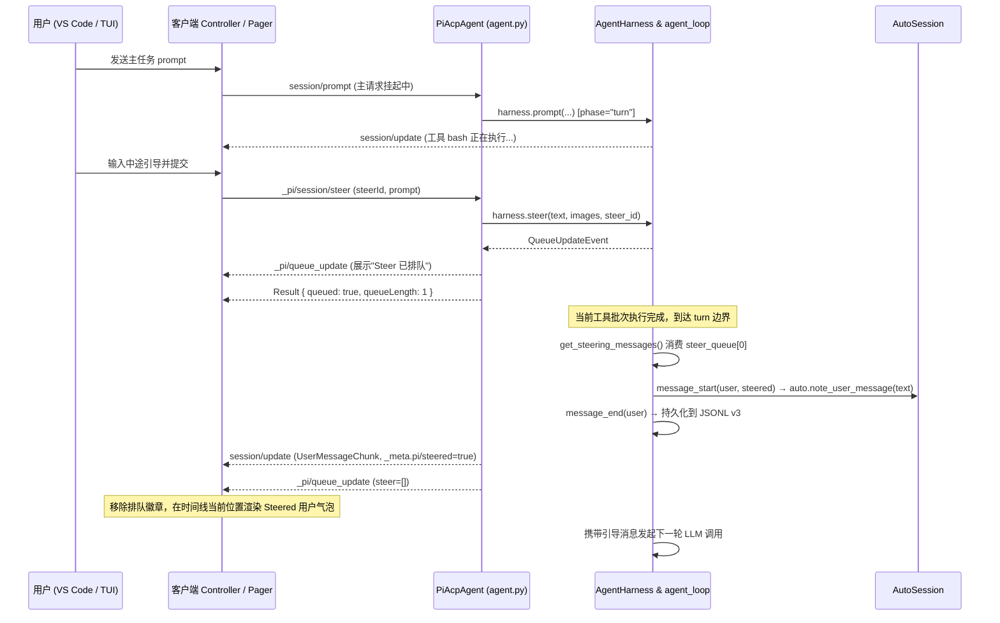
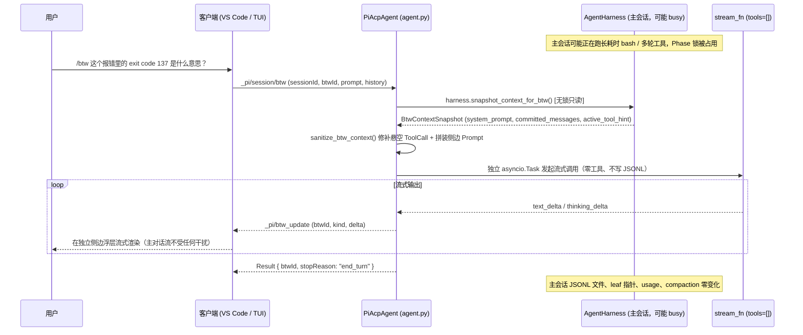

# Pre-Refactor 前置体验优化设计规格：对话 `steer` 与 `/btw` 侧边聊天

> **状态**：设计草案（仅规格设计，暂不修改代码）  
> **日期**：2026-11-26  
> **前置关联**：[zycode 全平台重构方案与 Roadmap](2026-11-25-zycode-refactor-and-roadmap.md)（Pre-Refactor 阶段）、[ACP 扩展登记册](2026-11-05-acp-extension-registry.md)、[Auto 模式设计](2026-11-02-auto-mode-design.md)、[VS Code 插件设计](2026-11-04-vscode-extension-design.md)  
> **覆盖组件**：`pi_agent_harness`、`pi_agent_cli`（ACP Agent）、`vscode/`（VS Code 插件）、`tui/`（`pi-acp-lib` + `pi-pager`）  
> **前瞻兼容**：本文定义的语义、状态机与测试契约将直接复用于 Phase 1 桌面端 ADE App 与 Phase 2 `pi-rust`。

---

## 0. 背景、目标与核心不变量

### 0.1 为什么在全平台重构前先做这两项？

1. **高频刚需痛点**：
   - **`steer`（运行中即时引导）**：当 Agent 正在执行多轮工具调用（跑测试、改多文件、查代码）时，用户发现方向略有偏差，目前只能点 **Stop** 强行中断整轮对话再重新描述，白白浪费已生成的工具调用和上下文；而底层 `AgentHarness` 其实已经实现 `steer()` 队列，只差打通 ACP 与客户端。
   - **`/btw`（无污染侧边聊天）**：在主对话进行中（无论 `idle` 还是 `busy`），用户经常想顺手问一个与当前上下文相关的旁路问题（如「这个报错码什么意思」「刚才改的函数签名是什么」「总结下当前改了哪几个文件」），但不希望这些临时问答污染主对话 JSONL 历史、膨胀 token 或打断正在执行的任务。
2. **零返工复利**：两项能力的协议边界、状态机、安全语义和一致性用例会直接进入 `tests/conformance/`，成为后续桌面端 ADE App、`pi-rust` 及移动端的标准基线。

### 0.2 核心不变量（实现与评审红线）

#### `steer` 不变量（S1–S5）

| 编号 | 不变量 |
|---|---|
| **S1** | **不打断正在执行的工具批次**：`steer` 仅入队 `AgentHarness.steer_queue`，在当前工具批次结束后的 turn 边界由 `agent_loop` 消费并注入下一轮 LLM，不强杀当前运行中的命令。 |
| **S2** | **Auto 分类器安全同步（注入时生效）**：`auto.note_user_message(text)` 仅在被引导消息**真正被 `agent_loop` 消费注入**时记录，而非入队时记录——若用户在消费前取消（`abort`），被丢弃的 steer 文本绝不残留进 Auto 分类器上下文。 |
| **S3** | **无丢失竞态回退**：若用户发送 `steer` 瞬间主 turn 刚好结束（`phase == "idle"`），Agent 明确返回 `queued: false, reason: "idle"`，客户端自动无感回退为常规 `session/prompt`，绝不静默丢消息。 |
| **S4** | **主时间线不重复渲染**：仅对 `steer` 注入的 `UserMessage` 发射带 `_meta["pi/steered"] = true` 的确认事件；普通 `session/prompt` 开场消息保持现行行为不重复广播；`session/load` 重放时按 JSONL 真实落盘顺序还原。 |
| **S5** | **取消回填**：`session/cancel` 触发 `harness.abort()` 清空未消费的 `steer_queue` 时，客户端将未生效的 steer 文本回填到输入框（保留草稿），避免用户重打。 |

#### `/btw` 不变量（B1–B5）

| 编号 | 不变量 |
|---|---|
| **B1** | **主会话零污染（字节级保证）**：`/btw` 的提问、思考、回答与错误**绝不写入主会话 JSONL v3 文件**，不推进 `leaf` 指针，不触发 `DeferredJsonlSessionStorage` 落盘，不触发主会话 `usage_update` 或 `auto_compact`。 |
| **B2** | **无锁并行，绝不阻塞主 turn**：`/btw` 读取主会话只读上下文快照，不获取 `AgentHarness` 的 Phase 锁，主对话处于 `busy`（流式推理或长耗时 `bash` 执行中）时可完全并行发起与流式返回。 |
| **B3** | **零工具副作用、免权限弹窗**：`/btw` 禁止执行任何工具（不会触发 `before_tool_call` 或 `session/request_permission`）；即使模型违规吐出 tool call 块也强制拦截丢弃，绝不执行。 |
| **B4** | **悬空 Tool Call 安全修复**：主对话正在执行工具期间，已落盘历史末尾可能存在尚未配对 `ToolResultMessage` 的 `AssistantMessage(ToolCallContent)`。`/btw` 构造上下文时必须修补未闭合工具调用，严禁向 OpenAI / Anthropic / DeepSeek 发送非法序列导致 HTTP 400。 |
| **B5** | **独立流式通道与生命周期隔离**：`/btw` 流式输出走专属通知 `_pi/btw_update`（带 `btwId`），绝不混入标准 `session/update`；支持单独取消（`_pi/session/btw_cancel`），不影响主 turn；主会话关闭或删除时自动取消挂起的 `/btw` 任务。 |

---

## 1. ACP 线协议设计（新增登记项 `X9` 与 `X10`）

严格遵循 `docs/specs/2026-11-05-acp-extension-registry.md` 第 1.2 节的**五条准入规则**。

### 1.1 `initialize` 能力协商（满足规则 5）

`PiAcpAgent.initialize()` 在 `InitializeResponse.field_meta` 中新增能力声明（第三方客户端不识别 `_meta` 会自动忽略，完全无害）：

```json
{
  "_meta": {
    "pi/capabilities": {
      "steer": true,
      "btw": true
    }
  }
}
```

> **向后兼容策略**：
> - **新客户端连接旧 Agent**（`initialize._meta["pi/capabilities"]` 缺失对应键）：客户端自动关闭运行中 `steer` 发送与 `/btw` 侧边调用（提示「当前 Agent 版本不支持，请升级」或降级回原有等待行为），绝不盲发未知 RPC 触发 `method_not_found`。
> - **旧客户端（含 Zed）连接新 Agent**：忽略 `_meta["pi/capabilities"]`，主流程行为 100% 不变。

### 1.2 登记项 `X9`：`pi/session/steer`（运行中引导）

#### 请求：`pi/session/steer`（wire 名 `_pi/session/steer`，client → agent）

- **Params**：
  ```json
  {
    "sessionId": "550e8400-e29b-41d4-a716-446655440000",
    "steerId": "c1f8b1c4-...",
    "prompt": [
      { "type": "text", "text": "先别改 docs，只修测试里的断言" }
    ]
  }
  ```
  - `sessionId`：必填，活跃会话 UUID。
  - `steerId`：可选（建议客户端传 UUID，用于精确匹配待生效徽章与确认/取消回填）；缺省时由 Agent 生成。
  - `prompt`：必填，标准 ACP `ContentBlock[]`（复用 `_prompt_to_text_images`，支持 `text` 与 `image`）。

- **Result**：
  ```json
  // 场景 A：成功入队（harness 处于 active turn / retry / compaction）
  {
    "sessionId": "550e8400-...",
    "steerId": "c1f8b1c4-...",
    "queued": true,
    "queueLength": 1
  }

  // 场景 B：未入队（竞态：主 turn 刚结束或尚未开始）
  {
    "sessionId": "550e8400-...",
    "steerId": "c1f8b1c4-...",
    "queued": false,
    "reason": "idle" // 或 "waiting_for_trust" | "waiting_for_barriers"
  }
  ```

- **Error**：
  - `sessionId` 缺失或未知会话：`invalid_params` / `resource_not_found`。
  - `prompt` 为空（无有效文本且无图片）：`invalid_params`。

#### 通知 1：`pi/queue_update`（wire 名 `_pi/queue_update`，agent → client）

仅当客户端连接且发生入队、消费或中止清空时发出（不影响未监听的第三方客户端）：

```json
{
  "sessionId": "550e8400-...",
  "steer": [
    { "steerId": "c1f8b1c4-...", "preview": "先别改 docs，只修测试里的断言" }
  ],
  "clearedByAbort": false
}
```

- 当 `harness.abort()` 清空队列时，发出 `steer: []` 且 `clearedByAbort: true`（附带 `clearedSteerIds: [...]`），客户端据此把对应未生效草稿安全回填到输入框。

#### 通知 2：注入确认（标准 `session/update` 承载 `UserMessageChunk`）

当 `agent_loop` 在 turn 边界真正消费某条 steered 消息并触发 `message_start(user)` 时，Agent 通过标准 `session/update` 发出 `UserMessageChunk`，携带 `_meta`：

```json
{
  "sessionUpdate": "user_message_chunk",
  "content": { "type": "text", "text": "先别改 docs，只修测试里的断言" },
  "_meta": {
    "pi/steered": true,
    "pi/steerId": "c1f8b1c4-..."
  }
}
```

- 既让 VS Code / TUI 精确把「排队徽章」切换为正式对话流中的用户消息气泡，又保证仅理解标准 `session/update` 的客户端也能正常显示文本。

---

### 1.3 登记项 `X10`：`pi/session/btw`（无污染侧边聊天）

#### 请求 1：`pi/session/btw`（wire 名 `_pi/session/btw`，client → agent）

- **Params**：
  ```json
  {
    "sessionId": "550e8400-e29b-41d4-a716-446655440000",
    "btwId": "9a7d2e10-...",
    "prompt": [
      { "type": "text", "text": "上面那个报错里的 exit code 137 是什么意思？" }
    ],
    "history": [
      { "role": "user", "text": "可选：同一浮层内上一轮追问" },
      { "role": "assistant", "text": "可选：上一轮侧边回答" }
    ]
  }
  ```
  - `btwId`：必填，客户端生成的 UUID，用于关联 `_pi/btw_update` 流式事件与取消请求。
  - `history`：可选，默认 `[]`，仅用于同一未关闭浮层内的连续追问（硬上限 **10 轮 / 32 KB**，超出报 `invalid_params`），Agent 侧不落盘。

- **Result**（流结束后返回终态结果，与 `session/prompt` 语义对称）：
  ```json
  {
    "sessionId": "550e8400-...",
    "btwId": "9a7d2e10-...",
    "stopReason": "end_turn", // "end_turn" | "cancelled" | "error"
    "error": null
  }
  ```

#### 通知：`pi/btw_update`（wire 名 `_pi/btw_update`，agent → client）

```json
{
  "sessionId": "550e8400-...",
  "btwId": "9a7d2e10-...",
  "kind": "text_delta", // "thought_delta" | "text_delta" | "done" | "error"
  "delta": "Exit code 137 表示进程收到了 SIGKILL (128 + 9)...",
  "error": null
}
```

#### 请求 2：`pi/session/btw_cancel`（wire 名 `_pi/session/btw_cancel`，client → agent）

- **Params**：`{"sessionId": string, "btwId": string}`
- **Result**：`{"sessionId": string, "btwId": string, "cancelled": true}`（幂等：若已完成或不存在也返回成功）。

### 1.4 五条准入规则核查表

| 项 | 规则 1：无标准等价 | 规则 2：Python 侧与测试 | 规则 3：登记在册 | 规则 4：Rust 类型放 `pi-acp-lib` | 规则 5：`initialize` 协商且对第三方无害 |
|---|---|---|---|---|---|
| **X9 (`pi/session/steer`)** | 满足：ACP v1.19 `session/prompt` 不允许并发且无排队引导原语 | 满足（`agent.py` + 契约与单测） | 满足（随 PR 写入登记册） | 满足（`pi-acp-lib/src/extensions/steer.rs`） | 满足（`_meta["pi/capabilities"]["steer"]`） |
| **X10 (`pi/session/btw`)** | 满足：ACP v1.19 无旁路只读快照会话原语 | 满足（`agent.py` + `btw.py` + 契约与单测） | 满足（随 PR 写入登记册） | 满足（`pi-acp-lib/src/extensions/btw.rs`） | 满足（`_meta["pi/capabilities"]["btw"]`） |

---

## 2. `steer`（运行中即时引导）详细实现设计

### 2.1 时序流转



### 2.2 `pi_agent_harness` 改动点

涉及文件：`packages/pi-agent-harness/pi_agent_harness/agent_harness.py`、`types.py`

1. **为 steered 消息附带内存态追踪 ID（不污染 JSONL schema）**：
   - `AgentHarness.steer(self, text: str, images: list[ImageContent] | None = None, *, steer_id: str | None = None) -> str`：
     - 保持现有签名向后兼容（新增关键字参数 `steer_id`）。
     - 在内存中维护 `_steer_ids: dict[int, str]`（以 `id(message)` 或 `WeakKeyDictionary`/轻量映射记录 `steer_id`，在 `message_end` 或 `abort` 清理，**绝不向 `UserMessage` 增加会破坏 pi v3 JSONL 兼容性的新字段**）。
   - 提供只读辅助方法 `harness.steer_id_for(message: AgentMessage) -> str | None` 与 `harness.is_steered_message(message: AgentMessage) -> bool`，供上层 `PiAcpAgent` 在 `on_event` 中识别该 `UserMessage` 是否来自 `steer`。
2. **`AbortEvent` 与 `QueueUpdateEvent` 保持一致**：
   - `harness.abort()` 已清空 `self.steer_queue` 并先后发出 `QueueUpdateEvent` 与 `AbortEvent(clearedSteer=cleared_steer, ...)`。确保在发 `AbortEvent` 后再清理 `_steer_ids` 映射，让订阅方能拿到 `clearedSteerIds`。

### 2.3 `pi_agent_cli`（ACP Agent）改动点

涉及文件：`packages/pi-agent-cli/pi_agent_cli/agent.py`、`events.py`

1. **`ext_method` 新增 `pi/session/steer`**：
   - 参数校验：`sessionId`、`prompt`（空内容拒收）。
   - 状态判定矩阵：
     - 若会话正在等待项目信任（`session_id in self._trust and not self._trust[session_id].settled.is_set()`）→ 返回 `{"queued": false, "reason": "waiting_for_trust"}`。
     - 若 `harness.phase == "idle"`：
       - 若 `self._prompts_in_flight.get(session_id, 0) > 0`（正卡在 `_wait_for_turn_barriers` 等待 MCP 启动）→ 返回 `{"queued": false, "reason": "waiting_for_barriers"}`。
       - 否则 → 返回 `{"queued": false, "reason": "idle"}`（客户端自动回退 `session/prompt`）。
     - 若 `harness.phase != "idle"`（`turn` / `retry` / `compaction`）→ 调用 `await harness.steer(text, images, steer_id=steer_id)` 并返回 `{"queued": true, "steerId": sid, "queueLength": len(harness.steer_queue)}`。
2. **安全关键：Auto 模式在「实际注入」时记录引导文本（不变量 S2）**：
   - 在 `_bind_session` 的 `on_event` 回调中，监听 `message_start`（且 `message.role == "user"` 且 `harness.is_steered_message(message)`）：
     - 提取用户文本，调用 `auto.note_user_message(steered_text)`！
     - 这样，只有真正注入到模型对话里的 steer 才会被 Auto 分类器采信；在队列里就被 `Cancel` 掉的 steer 不会泄露到 Auto 上下文。
3. **事件投影（`events.py` + `agent.py`）**：
   - 在 `on_event` 中：
     - 收到 `QueueUpdateEvent` → 若客户端协商了 `steer`（或无害扩展通知），调用 `conn.ext_notification("pi/queue_update", ...)`。
     - 收到 `AbortEvent` 且 `clearedSteer` 非空 → 发出 `pi/queue_update`（`clearedByAbort: true, clearedSteerIds: [...]`）。
     - 收到 `message_end` 且 `harness.is_steered_message(message)` → 经 `project_steered_user_message(message, steer_id)` 生成 `UserMessageChunk(content=..., field_meta={"pi/steered": True, "pi/steerId": steer_id})` 并经标准 `session_update` 发出。
   - **为什么选 `message_end` 而不是 `message_start` 发给客户端？** 与 `AGENTS.md` / `DESIGN.md` §6.2 的持久化时序不变量完全一致：`message_end` 先落盘 JSONL 再广播，保证客户端看到气泡时数据已落盘！

### 2.4 VS Code 插件改动点（`vscode/`）

涉及文件：`vscode/src/core/acp-connection.ts`、`chat-controller.ts`、`protocol.ts`、`vscode/src/webview/main.ts`、`vscode/media/chat.css`

1. **`AcpConnection`（`acp-connection.ts`）**：
   - 解析 `initialize()` 响应的 `_meta["pi/capabilities"]`，暴露 `capabilities: { steer: boolean; btw: boolean }`。
   - 注册 `.onNotification("_pi/queue_update", ...)` 回调。
   - 新增 `steerSession(sessionId: string, prompt: ContentBlock[], steerId: string): Promise<SteerResponse>`。
2. **`ChatController`（`chat-controller.ts`）**：
   - `StateMessage` 新增 `supportsSteer?: boolean`、`pendingSteers?: { id: string; text: string }[]`。
   - 当 `status === "busy"` 且 `supportsSteer === true` 时：
     - `send(text, mentions, images)` **不再直接 return**！
     - 若文本是 `/btw ...` → 走 §3.4 的 `/btw` 分支；
     - 否则组装 `prompt`（含 `@` mention 展开与图片），乐观写入 `pendingSteers` 队列，调用 `conn.steerSession(...)`：
       - 若返回 `queued: false, reason: "idle"` → 从 `pendingSteers` 移除，自动调用正常 `sendPrompt(...)`（无缝回退，满足不变量 S3）。
       - 若返回 `queued: false, reason: "waiting_for_trust" | "waiting_for_barriers"` → 弹出轻量提示并将文本回填输入框。
   - 收到 `session/update` 带 `_meta["pi/steered"] === true` 时：从 `pendingSteers` 按 `steerId` 移除对应项，并在消息流当前位置追加带 `steered: true` 标记的用户消息气泡。
   - 收到 `pi/queue_update` 且 `clearedByAbort: true` 时：清空 `pendingSteers`，向 Webview 发 `{ type: "restoreDraft", text }` 将未消费的引导内容回填输入框（不覆盖用户正在新打的字）。
3. **Webview UI（`webview/main.ts`）**：
   - `status === "busy"` 且 `supportsSteer` 时：输入框保持可用，placeholder 变为 `"引导当前任务（Steer），或输入 /btw 侧边提问..."`，发送按钮显示 **Steer** 图标/文案，旁边保留 **Stop** 按钮。
   - 输入框上方渲染紧凑的「待注入引导」条（列出 `pendingSteers` 摘要与计数）。

### 2.5 Rust TUI 改动点（`tui/`）

涉及文件：
- `tui/crates/codegen/pi-acp-lib/src/extensions/steer.rs`（新增）与 `mod.rs`
- `tui/crates/codegen/pi-pager/src/acp/{mod.rs, meta.rs, tracker.rs}`
- `tui/crates/codegen/pi-pager/src/app/{effects/mod.rs, dispatch/prompt.rs}`

1. **`pi-acp-lib`**：定义 `PiCapabilities`、`SteerRequest`、`SteerResponse`、`QueueUpdateNotification` 及方法常量 `METHOD_PI_SESSION_STEER = "pi/session/steer"`、`NOTIF_PI_QUEUE_UPDATE = "pi/queue_update"`。
2. **`pi-pager`**：
   - `initialize` 解码 `PiCapabilities` 存入会话连接状态。
   - Turn 进行中提交普通文本时，若 `capabilities.steer == true`，派发 `Effect::SteerSession`；若返回 `queued == false && reason == "idle"` 则无缝转 `Effect::SendPrompt`。
   - 收到 `QueueUpdateNotification` 更新输入区上方的轻量提示栏（如 `↳ 1 steer queued (will inject after current tool)`）；`clearedByAbort == true` 时把未生效文本写回编辑器草稿。
   - 收到 `UserMessageChunk` 且 `_meta["pi/steered"] == true` 时，将其作为用户消息块渲染到当前滚动流对应位置。

---

## 3. `/btw`（无污染侧边聊天）详细实现设计

### 3.1 核心数据流与零污染架构



### 3.2 关键技术难点与解决方案

#### 难点 1：主会话执行工具中途的「悬空 Tool Call 修复」（不变量 B4）

**问题**：当主会话处于 `tool_execution` 阶段时，`session.build_context()` 返回的消息列表末尾是 `AssistantMessage(content=[..., ToolCallContent(id="call_1", name="bash", arguments=...)])`，但对应的 `ToolResultMessage(toolCallId="call_1")` 尚未生成。直接将此历史发给 OpenAI / Anthropic / DeepSeek 会立即触发 **HTTP 400**。

**方案（`pi_agent_cli/btw.py` 中的 `repair_dangling_tool_calls`）**：
1. 遍历快照消息，收集每条 `AssistantMessage` 中的 `ToolCallContent.id` 集合，并检查紧随其后的 `ToolResultMessage` 是否全部覆盖；
2. 对任何缺失结果的 `ToolCallContent`，在内存中紧跟该 `AssistantMessage` 后插入合成的 `ToolResultMessage`：
   ```python
   ToolResultMessage(
       role="toolResult",
       toolCallId=tc.id,
       toolName=tc.name,
       content=[TextContent(text="[Tool is still running in the main session; output not yet available.]")],
       isError=False,
       timestamp=now_ms,
   )
   ```
3. 这样既保证消息文法 100% 合法，又保留了正在执行工具的参数上下文，使用户可以问「你现在正在跑的那条命令是干嘛的？」。

#### 难点 2：无工具限制（不变量 B3）与跨 Provider 兼容性 + Prompt Cache 复用

**问题**：`/btw` 绝对不能执行工具，但快照历史里往往包含大量历史 `ToolCallContent` / `ToolResultMessage`。
- **Anthropic Messages API 限制**：如果请求消息历史里包含 `tool_use` / `tool_result` 块，而顶层请求没有传 `tools`（即 `tools=[]`），Anthropic API 会返回 **HTTP 400**（`tools must be provided when tool_use/tool_result blocks are present`）。
- **OpenAI / DeepSeek / 网关差异**：部分 OpenAI 兼容网关在 `tools=[]` 时接受历史 `tool_calls`，部分网关对 `tool_choice="none"` 的支持不一致。
- **Prompt Cache 收益**：如果 `/btw` 保持 `system_prompt` 和历史消息前缀完全不变，把侧边问答说明放在末尾的新 `UserMessage` 里，就可以直接命中 Anthropic / OpenAI 的 KV Prefix Cache（输入费用降低 80–90%，TTFT 亚秒级）！

**分层解决策略（默认保缓存，安全兜底零 400）**：
1. **统一前置净化（推荐默认实现，最简单且 100% 跨全厂商零 400）**：
   - 首先保留原 `system_prompt` 不变（最大化前缀复用）。
   - 对于历史消息：
     - **策略选择**：
       - **方案 A（推荐首版默认：无工具历史文本投影 `flatten_tool_history_for_btw`）**：将历史中的 `ToolCallContent` 转为紧凑可读文本 `[Tool call: bash(command=...)]`，将 `ToolResultMessage` 合并进紧凑的 user/assistant 观察摘要块，然后以 `tools=[]` 纯文本对话发起请求。**优点**：在 OpenAI / Anthropic / DeepSeek / Gemini / 所有第三方兼容网关上 **100% 零 400 风险**，实现仅 ~60 行，且天然不可能触发任何工具调用！
       - **方案 B（后续 Prompt Cache 深度优化选项）**：当检测到 Anthropic/OpenAI 且支持 `tool_choice="none"` 时，保留原始历史 + 传递原工具定义 + 强制 `tool_choice="none"` + 流式层防御性丢弃任何 `toolcall_*` 块，最大化命中 Prefix Cache。
   - **首版落地建议**：**先用方案 A 确保 100% 跨 Provider（含所有 OpenAI 兼容网关、冻结二进制）零报错**，同时为 `btw` 模块留出干净接口，后续再按需叠加方案 B 的缓存加速。
2. **侧边提示包装（不改动 `system_prompt`）**：
   - 将用户的 `/btw` 问题包装在最后一条 `UserMessage` 中（例如 `<btw_side_question>...</btw_side_question>`），附简短指令：*「这是一条主对话之外的临时侧边提问（`/btw`）。你没有工具调用权限，请仅依据当前已有对话上下文直接、简洁地回答；不要尝试调用工具，也不要假装执行了文件修改或命令。」*
3. **防御性流拦截**：即使模型通过奇怪格式返回了 `ToolCallContent`，`/btw` 的执行器只消费 `text_delta` / `thinking_delta`，**从不调用 `agent_loop` 或任何 `AgentTool.execute`**，从结构上杜绝副作用。

#### 难点 3：空会话与 `DeferredJsonlSessionStorage` 保护（不变量 B1）

- 如果用户刚打开一个新会话（尚未发过任何主消息，`storage.written == False`），直接输入 `/btw 解释一下这个项目的 README`：
  - `snapshot_context_for_btw()` 仅读取 `self.session.build_context()`（内存态为空列表）与只读解析出的 `system_prompt`（**不写 session、不触发 `append_message`**）。
  - `/btw` 完成后，磁盘上仍然不会产生空白 JSONL 会话文件。

### 3.3 `pi_agent_harness` 与 `pi_agent_cli` 改动点

1. **`pi_agent_harness/agent_harness.py`**：
   - 新增 dataclass `BtwContextSnapshot`：`system_prompt: str`, `messages: list[AgentMessage]`, `model: Model`, `thinking_level: ThinkingLevel`。
   - 新增只读方法 `async def snapshot_context_for_btw(self) -> BtwContextSnapshot`：
     - 不检查/不占用 `self.phase` 锁；
     - 调用 `await self.session.build_context()` 获取当前已提交消息浅拷贝；
     - 若 `self._cached_system_prompt` 存在直接复用，否则按 `_create_turn_state` 相同逻辑只读计算一次（不触发任何 session 写入）。
2. **`pi_agent_cli/btw.py`（新增独立模块，保持 `agent.py` 清爽）**：
   - `repair_dangling_tool_calls(messages)`：修补未闭合工具调用。
   - `build_btw_context(snapshot, question, images, history)`：构造纯问答 `AgentContext(system_prompt=..., messages=..., tools=[])`。
   - `run_btw(...)`：通过 `transform_messages` + `stream_fn` 消费 `AssistantMessageEventStream`，将 `text_delta` / `thinking_delta` 转发给回调，支持 `AbortController` 独立取消与默认 120s 超时。
3. **`pi_agent_cli/agent.py`**：
   - 维护 `self._btw_tasks: dict[tuple[str, str], tuple[asyncio.Task[Any], AbortController]]`。
   - 并发限流：同一 `session_id` 同时最多允许 **2 个** 活跃 `/btw` 请求（超出报 `invalid_params: too many concurrent btw requests`）。
   - `ext_method` 新增 `pi/session/btw` 与 `pi/session/btw_cancel`。
   - `_release_session()` / `close_session()` 中取消并清理该会话所有挂起的 `_btw_tasks`。
   - `_advertise_commands()` 中补充 `AvailableCommand(name="btw", description="Ask a quick side question without polluting the main chat", input=AvailableCommandInput(root=UnstructuredCommandInput(hint="<question>")))`。
4. **可选配置（`agent.toml` `[btw]` 节，全部可选有合理默认值）**：
   ```toml
   [btw]
   # 可选：指定更快的侧边模型 id（须在 [[models]] 中声明）；留空则复用当前会话模型
   # model = "deepseek-chat"
   # 默认关闭深度思考以获得极速响应；也可设为 "inherit" 跟随当前会话 thinking_level
   thinking = "off"
   ```

### 3.4 VS Code 插件改动点（`vscode/`）

涉及文件：`vscode/src/core/acp-connection.ts`、`chat-controller.ts`、`protocol.ts`、`composer.ts`、`vscode/src/webview/main.ts`、`vscode/media/chat.css`

1. **`AcpConnection`**：
   - 新增 `askBtw(sessionId, btwId, prompt, history)` 与 `cancelBtw(sessionId, btwId)`。
   - 监听 `_pi/btw_update` 通知，转发给 `ConnectionHandlers.onBtwUpdate`。
2. **`ChatController`**：
   - 拦截输入以 `/btw ` 开头（含大小写归一化、去首尾空白；裸 `/btw` 无参数时提示输入问题）：
     - **即使 `status === "busy"` 也直接放行！**（仅当 `status` 为 `stopped` / `starting` / `needs-setup` / `error` / `no-folder` / `untrusted` 时不可用）。
     - 若 `!capabilities.btw` → 返回提示信息，不发 RPC。
     - 若主会话尚在等待 `newSession`，先确保会话存在（注意空白会话不落盘）。
   - 维护内存态 `btwThread: { id: string; turns: { id: string; question: string; answer: string; thinking: string; status: "streaming" | "done" | "error" | "cancelled"; error?: string }[] } | null`：
     - **纯内存态**：切换会话（`newChat` / `openSession`）或用户点击关闭（× / `Esc`）即清空并取消在途请求。
     - 支持在浮层内继续追问（将前序 `done` 轮次作为 `history` 传给 `askBtw`）。
3. **Webview UI（`webview/main.ts` + `chat.css`）**：
   - 渲染独立的 **BTW 侧边问答浮层**（位于输入框上方、主消息列表之上，带独立滚动区与浅色高亮边框）：
     - 标题栏：`BTW · 侧边问答（不计入主上下文）` + **清空/关闭（Esc）** 按钮 + 流式期间的 **停止** 按钮；
     - 内容区：流式 Markdown 渲染（复用 `core/markdown.ts`）+ 一键 **Copy** 按钮；
     - 底部轻量追问栏（可选，或直接在主输入框继续输入 `/btw ...` 自动追加到当前浮层）。
   - **视觉隔离要求**：主消息滚动区在背后继续接收主 turn 的工具输出与流式文字，两者滚动位置互不干扰。

### 3.5 Rust TUI 改动点（`tui/`）

涉及文件：
- `tui/crates/codegen/pi-acp-lib/src/extensions/btw.rs`（新增）与 `mod.rs`
- `tui/crates/codegen/pi-pager/src/slash/{registry.rs, commands/mod.rs, commands/btw.rs}`
- `tui/crates/codegen/pi-pager/src/views/btw_overlay.rs`（新增）
- `tui/crates/codegen/pi-pager/src/app/{effects/mod.rs, dispatch/router.rs}`

1. **`pi-acp-lib`**：定义 `BtwRequest`、`BtwHistoryTurn`、`BtwResponse`、`BtwUpdateNotification`、`BtwCancelRequest` 及常量 `METHOD_PI_SESSION_BTW`、`METHOD_PI_SESSION_BTW_CANCEL`、`NOTIF_PI_BTW_UPDATE`。
2. **`pi-pager` 斜杠命令**：
   - `slash/registry.rs` 的 `PI_STANDARD_SLASH_NAMES` 与 `builtin_commands()` 新增 `"btw"`（并同步更新对应单测断言），或者作为 builtin 命令在 `capabilities.btw == true` 时生效、不可用时给出清晰提示。
   - **关键**：命令路由在 `is_busy == true` 时对 `/btw <question>` **放行**，不走主 prompt 互斥路径！
3. **`BtwOverlay` 视图**：
   - 复用 `pi-pager` 现有的居中/底部浮动弹窗样式与 `pi-markdown` 渲染器。
   - 打开时显示提问标题、`"Side question · not saved to main chat"` 副标题、流式渲染的回答区（支持 `↑/↓` / `PgUp/PgDn` 滚动、`y` 复制、`Ctrl+C` 仅取消当前 BTW 请求、`Esc` 关闭浮层）。
   - 浮层打开期间，主会话后台事件循环照常处理 `session/update` 并在主视图更新，关闭浮层后立即看到主对话最新进度。

---

## 4. 测试与验收矩阵

遵循 `AGENTS.md` 测试原则（只测真实逻辑、每条测试都对应明确回归、绝不测空壳 stub）：

| 层级 | 测试文件（扩展现有文件为主） | 必测场景 |
|---|---|---|
| **Python Harness 单测** | `packages/pi-agent-harness/tests/test_agent_harness.py` | ① `steer(steer_id=...)` 映射追踪与 `abort()` 清理；② `snapshot_context_for_btw()` 在 `phase == "turn"` 时无锁返回快照且不触发 `DeferredJsonlSessionStorage` 写盘 |
| **Python ACP Agent 单测** | `packages/pi-agent-cli/tests/test_acp_agent.py`、`test_acp_stdio_contract.py` | ① `initialize` 宣告 `pi/capabilities.{steer,btw}`；② 运行中 `pi/session/steer` 成功入队、turn 边界消费发出带 `_meta.pi/steered=true` 的 `UserMessageChunk`、JSONL 正确落盘且 `session/load` 重放顺序正确；③ `idle` / `waiting_for_trust` 竞态返回 `queued: false`；④ **安全测试**：被 `cancel` 清空的 steer 绝不进入 `AutoSession` 上下文，只有已注入的 steer 才通知 `AutoSession`；⑤ **悬空 Tool Call 修复测试**：主 turn 正在执行工具时发 `/btw`，验证发给 `stream_fn` 的消息合法闭合无悬空 `ToolCallContent`；⑥ **零污染断言**：`/btw` 完成后主会话 JSONL 文件内容逐字节不变（空白会话仍无文件）；⑦ `/btw` 与主 turn 并行流式执行、互不阻塞、单独 `btw_cancel` 不影响主 turn |
| **VS Code 单测与无头浏览器测试** | `vscode/test/chat-controller.test.ts`、`vscode/test/webview.test.ts` | ① `busy` 状态下发送普通文本走 `steerSession`，`queued: false (idle)` 自动回退 `prompt`；② `steered` 事件到达后从 `pendingSteers` 移入消息流；③ `cancel` 后未生效 steer 回填输入框；④ `busy` 状态下 `/btw` 放行、独立流式渲染浮层、切换会话或关闭自动取消并销毁；⑤ 连接不含 `steer`/`btw` 能力的旧 Agent 时优雅降级 |
| **Rust 协议与 E2E 测试** | `pi-acp-lib` 单测、`tui/crates/codegen/pi-pager/tests/python_agent_e2e.rs`、`scripts/tui_pty/` | ① `X9`/`X10` 结构体序列化/反序列化往返；② `python_agent_e2e.rs` 对着真实 Python Agent 跑通 `steer` 入队消费与 `/btw` 并行问答；③ `pi-pager` 单测验证 `busy` 时 `/btw` 放行与 `BtwOverlay` 关闭不丢主对话更新 |

---

## 5. 分批实施计划（PR 拆分建议）

建议拆分为 **5 个小而独立的原子 PR**，每个 PR 独立可 Review、独立过 CI：

| PR 序号 | 范围 | 主要改动 | 验收方式 |
|---|---|---|---|
| **PR 1** | 协议登记 + Python `steer` | 更新 `docs/specs/2026-11-05-acp-extension-registry.md`（登记 X9/X10）；`pi_agent_harness` 增加 `steer_id` 追踪；`pi_agent_cli` 实现 `initialize._meta["pi/capabilities"]`、`pi/session/steer`、`pi/queue_update`、Auto 注入联动与全套契约测试 | `pytest` + `ruff` 全绿 |
| **PR 2** | Python `/btw` 引擎 | `pi_agent_harness` 增加 `snapshot_context_for_btw()`；新增 `pi_agent_cli/btw.py`（悬空 ToolCall 修复 + 历史扁平化 + 独立流执行）；`agent.py` 接入 `pi/session/btw` / `btw_cancel` / `_pi/btw_update` 与 `/btw` 命令宣告 | `pytest`（含悬空工具与零污染字节断言）+ `ruff` |
| **PR 3** | VS Code 插件 `steer` + `/btw` | `vscode/src/core/` 协议与状态机接入、`webview/main.ts` 与 `chat.css` 交互实现、完整单测与无头 Chrome 视觉/交互验证 | `cd vscode && npm run check` + `vscode-extension.yml` |
| **PR 4** | Rust `pi-acp-lib` + `pi-pager` `steer` + `/btw` | `pi-acp-lib` 新增 `steer.rs`/`btw.rs`；`pi-pager` 接入 `steer` 排队提示条、`/btw` 斜杠命令与 `BtwOverlay`；补充 `python_agent_e2e.rs` 真实线协议测试 | `tui-ci.yml` + `tui-e2e.yml` 全绿 |
| **PR 5** | 发布与文档同步 | 更新 `CHANGELOG.md`、`README.md`、`vscode/README.md`、TUI 用户指南；发布新版本 `pi-agent-cli-lc` + `zycode-agent` + `zycode.zycode` 插件供实战验收 | 全套 Release / VSIX 流水线 |

---

## 6. 待确认的 4 个交互细节（Open Questions）

在进入 PR 1–PR 4 编码前，建议拍板以下 4 项轻量体验偏好：

| # | 问题 | 推荐默认 | 备选方案 |
|---|---|---|---|
| **Q1** | **VS Code / TUI 在 `busy` 状态下按 `Enter` 的行为** | 直接作为 **Steer** 提交（符合直觉，零记忆负担；保留独立 **Stop** 按钮与 `Esc` 中断） | `Enter` 仅排队到下一轮（Follow-up），需 `Ctrl+Enter` / `Alt+Enter` 才发 Steer |
| **Q2** | **`steer` 消费模式（`steering_mode`）** | 保持 `AgentHarness` 现有默认 `"one-at-a-time"`（每次 turn 边界注入 1 条），避免多条快速连发打乱指令结构 | 改为 `"all"`（到达 turn 边界时一次性合并注入全部已排队引导） |
| **Q3** | **`/btw` 默认思考模式** | 默认 `[btw] thinking = "off"`（追求亚秒/数秒极速回答，且可经 `agent.toml` 改为 `"inherit"`） | 默认继承主会话的 `thinking_level` |
| **Q4** | **`/btw` 浮层是否支持连续多轮追问** | **支持**（仅在当前浮层未关闭前于客户端内存保留最近 10 轮追问历史，关闭即销毁、绝不落盘） | 严格单轮一问一答（每次 `/btw` 均独立无记忆） |
