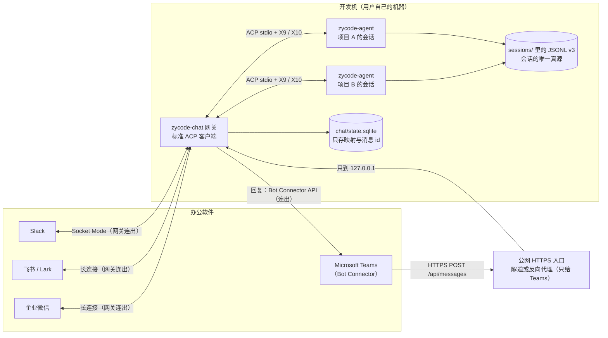

# zycode 聊天应用接入设计（Chat Gateway）

> **状态**：设计草案（第二版）。§9 的决策待确认，确认之前不写代码。
>
> **修订记录**：
> - 2026-11-28 第一版：架构、审批与安全规则。
> - 2026-11-28 第二版：按"需支持主流办公软件（Slack、Teams、Lark/飞书、企业微信等）"修订。改动：平台分级，Slack、Microsoft Teams、飞书/Lark、企业微信为必须支持（§3）；Teams 只能经公网 HTTPS 收消息，新增"入口"一节（§2.5）；一个网关同时连多个平台（§2.6）；实现语言改为 TypeScript（§9 的 CG-D2）；新增企业部署的要求（§7.4）。
>
> **一句话**：`zycode-chat` 是一个常驻的网关进程。它连到办公软件的机器人接口，把聊天里的消息、按钮和命令转成标准 ACP 请求，交给本机的 `zycode-agent`。用户可以在 Slack、Teams、飞书/Lark、企业微信等里面给 agent 派任务、看进度、审批命令、中途补一句（steer）、问旁路问题（`/btw`）。
>
> **关联文档**：[重构路线图](2026-11-25-zycode-refactor-and-roadmap.md) §3（daemon、跨端审批、`clients/core`）与 Phase 4（移动端）；[2026-11-28 审计](../AUDIT/AUDIT-ROADMAP-2026-11-28.md) 的 RM-10、RM-11、RM-12、RM-14、RM-18、RM-19；[ACP 扩展登记](2026-11-05-acp-extension-registry.md) 的 X7、X9、X10；[Auto 模式设计](2026-11-02-auto-mode-design.md)；`AGENTS.md` 的 Invariant 8、9、9b、9c、9d。

---

## 0. 目标与非目标

### 0.1 目标

1. **在主流办公软件里用 zycode。** 必须支持：Slack、Microsoft Teams、飞书/Lark、企业微信。第二批：钉钉、Google Chat。私聊机器人，或在绑定的频道/群里 @ 它，发起一个任务。它在本机的项目目录里工作，回答以流式卡片（或节流编辑的消息）出现。
2. **一个网关同时连多个平台。** 例如海外同事用 Slack、国内用飞书，同一台开发机上的同一个网关都能服务。
3. **手机上审批。** agent 要运行一个需要确认的工具调用时，所有者的手机收到平台推送，看到完整的命令或代码，点"允许一次"或"拒绝"。
4. **复用现有能力，不改 agent。** 网关是又一个标准 ACP 客户端，与 VS Code 插件、`zypi` 同级。它用已登记的 X9（steer）与 X10（`/btw`），不新增必需的线上协议项。
5. **尽量不开公网端口。** 能用长连接的平台（Slack、飞书/Lark、企业微信、钉钉、Google Chat 的 Pub/Sub）一律由网关主动连出。Teams 只能经公网 HTTPS 收消息，网关只在本机开一个入口，公网一侧由用户或组织选隧道或反向代理（§2.5）。
6. **安全边界不放松。** 审批只认所有者；项目信任永远不在聊天里答"是"；永远不进入 `always-approve`；平台凭据不进 agent 进程；发到聊天里的内容尽量少，并关闭链接预览。

### 0.2 非目标（v1 不做）

1. **团队模式**：多个用户各用自己的权限、自己的项目和自己的模型额度。它要按用户隔离进程或容器，另立设计（§12 第 1 条）。v1 是个人模式：一个所有者（可以另列审批人）。
2. **个人微信**：没有官方机器人接口，不做。
3. **在聊天里编辑代码或看完整文件树。** 聊天只用来指挥与审批，与路线图"ADE，不做 IDE"的定位一致。
4. **daemon 模式。** v1 不依赖路线图的 Phase 1。daemon 做出来以后，网关换后端（§2.4）。
5. **端到端加密。** 办公软件能看到发给它的明文（§7.3）。

---

## 1. 用户场景

### 1.1 首次配置与配对

1. 管理员或用户本人在平台上建好机器人（Slack App、Azure Bot 加 Teams 应用包、飞书/Lark 企业自建应用、企业微信智能机器人等），拿到凭据。`zycode-chat setup` 按平台给出步骤，并生成需要的模板（Slack 的 app manifest、Teams 的应用包、飞书要开的权限清单）。
2. 凭据存进 `<home>/chat/credentials.toml`（权限 `0600`）或系统凭据管理器。
3. 用户在 `<home>/chat.toml` 里列出允许使用的项目（名字与绝对路径）和要连的平台。
4. `zycode-chat pair --platform teams` 在终端里打印一个一次性的配对码，10 分钟内有效。用户在 Teams 里私聊机器人：`/pair 4KX9-2M`。网关记下这个平台用户 id（以及 Teams 的会话引用，用来以后主动发审批）。每个平台单独配对一次。
5. `zycode-chat run` 启动网关（之后可以装成用户级服务，§8.4）。

### 1.2 派一个任务，在手机上审批

1. 所有者私聊："在 zycode 项目里跑一下 `tests/test_x.py`，把失败修好。"（只有一个项目时不用写项目名；多个时用 `/project zycode` 或在开头写 `#zycode`。）
2. 网关在这个私聊里开一个新会话，回一张"回合卡片"：状态（思考中 / 运行工具 / 等待审批 / 完成）、流式的回答、每个工具调用一行。
3. agent 要运行 `bash: pytest tests/test_x.py -x`。网关发一张审批卡片：完整的命令、工作目录、Auto 给出的原因（如果是 Auto 问的），两个按钮。所有者的手机收到推送。
4. 所有者点"允许一次"。卡片变成"已允许 · 时间"，按钮消失。agent 继续。
5. 回合结束，网关发最终回答（Markdown 转成平台的格式）和一行摘要：改了哪些文件（`+12 −3`）、用了多少 token、上下文占多少。需要时点"查看 diff"，网关把补丁作为文件发到私聊。

### 1.3 中途补一句（steer）

回合还在跑，所有者又发："顺便把 lint 也修了。"网关调用 `pi/session/steer`（X9），在这条消息上加一个 ⏳ 表情（平台不支持表情时回一行"已排队"）。agent 在下一个回合边界真正读到它时（`user_message_chunk` 带 `pi/steered`），表情换成 ✅。如果回合在读到之前结束了（取消、出错、`max_turns`），网关收到 `pi/queue_update` 里的 `clearedSteerIds`，标 ❌ 并回一句"这条没有送达模型，需要的话请重发"。聊天里没有输入框可以回填，所以明说。

### 1.4 旁路问题（`/btw`）

所有者发：`/btw 刚才改的那个函数签名是什么？` 网关调用 `pi/session/btw`（X10），把回答流式发到一张单独的卡片，标明"BTW：不进入会话"。平台支持"仅自己可见"的消息时用它。同一个话题里 10 分钟内的下一条 `/btw` 带上前几轮（20 轮、32 KiB 以内，网关裁剪）；`/btw end` 或超时清掉。注意：回答不写进会话文件，但它留在平台的聊天记录里。

### 1.5 停止、换会话、恢复

- `/stop`：调用 `session/cancel`。等待中的审批按"取消"结束。
- `/new`：在当前聊天开一个新会话。
- `/resume`：列出当前项目最近的会话（`session/list`，按项目路径过滤），所有者点一个，网关用 `session/resume` 接上（不回放历史，聊天里不会刷屏）。

### 1.6 项目信任问题

项目里有扩展、保存的 workflow、`.pi/SYSTEM.md` 或项目 skills，并且还没被信任时，agent 会问"是否信任这个项目"。网关**不**把它做成按钮，自动答"不信任"，然后告诉所有者："这个项目自带的扩展、skills 和提示文件没有加载。要启用，请在本机用 `zypi` 或 VS Code 打开这个项目并选择信任。"信任决定存在 `<home>/agent/trust.json`，下次网关开的会话直接用它。原因见 §6.3。

---

## 2. 架构

### 2.1 网关是一个 ACP 客户端，不是 agent 扩展

| 方案 | 结论 | 原因 |
|------|------|------|
| **A. 网关是独立进程，作为标准 ACP 客户端启动 `zycode-agent`（推荐）** | 采用 | 符合剥离计划的 P1（ACP 是唯一接缝）、P3（入口由 agent 公布的能力决定）、P5（权限决定走 `session/request_permission`，凭据只在 agent 进程）。VS Code 插件与 `zypi` 已经验证了这条路。agent 不用改 |
| B. 做成 agent 的扩展（`ExtensionAPI`），在 agent 进程里连平台 | 不采用 | 审批要绕过 ACP 在进程内转一圈；平台凭据进入 agent 进程，模型可以用 `bash env` 读到；一个 agent 进程只服务一个客户端连接 |
| C. 用 headless 模式（`-p`）每条消息跑一次 | 不采用 | headless 强制 `always-approve`（`packages/pi-agent-cli/AGENTS.md`），没有审批 |

### 2.2 进程模型



1. **一个项目一个 agent 进程。** 项目是信任域（Invariant 9）。同一个项目的多个会话（不管来自哪个平台）放在同一个进程里；不同项目不共用进程。这是审计 RM-10 的最低要求：受信任项目的扩展代码只和同一个项目的会话在一个进程里。
2. **网关不发 `pi/yolo_mode_changed`（X8）。** X8 会改掉进程里所有会话的模式（审计 RM-10）。网关只用按会话的标准项（`session/set_mode` 或 `mode` 配置项），它们只接受 `ask` 与 `auto`。
3. **空闲回收。** 一个项目的 agent 进程空闲 `idle_agent_minutes`（默认 20）后，网关关闭它的 stdin，agent 按现有的退出路径结束（剥离计划 P6）。下一条消息再启动，并用 `session/resume` 接上。本机测得源码版 agent 空闲时约 74 MiB（审计 §八 8.3），所以要回收。
4. **崩溃。** agent 进程意外退出时，网关把它的等待中的审批按"取消"结束，在受影响的话题里说一句，下一条消息时重启并 `resume`。网关自己退出时，agent 读到 EOF 也会退出；会话已在 JSONL 里，重启后照常 `resume`，正在跑的回合会丢，网关重启后告诉这些话题"上一轮被中断"。

### 2.3 组件（TypeScript）

建议的目录（语言的理由见 §9 的 CG-D2）：

```text
clients/core/                  # 与宿主无关的共享模块（路线图 Phase 1 交付 1 的一部分，先抽这几件）
├── acp-connection.ts          # 从 vscode/src/core/ 搬来：ACP 连接，已有 X9、X10 的客户端调用
├── protocol.ts / tool-calls.ts / version.ts / session-list.ts
└── trust.ts                   # 从 chat-controller.ts 抽出 looksLikeTrustRequest、hasTrustOptions
clients/node/                  # 只在 Node 上用的模块（VS Code 插件与网关共用）
├── agent-process.ts           # 启动 agent 子进程
└── locate.ts                  # 找 zycode-agent（先找本程序旁边，再找 PATH）
apps/chat-gateway/
├── src/cli.ts                 # zycode-chat：setup | pair | run | status | unpair
├── src/config.ts              # chat.toml 与凭据；拒绝 always-approve、相对路径、未知平台
├── src/identity.ts            # 配对码、所有者、白名单、租户检查、每个动作的授权
├── src/backend.ts             # AgentBackend；AgentProcessPool（一个项目一个 agent）；以后的 DaemonBackend
├── src/acp-client.ts          # Client 一侧：sessionUpdate、requestPermission、extNotification
├── src/bindings.ts            # (平台, 租户, 聊天, 话题) ↔ 会话；state.sqlite
├── src/turns.ts               # 每个绑定一个回合状态机：idle / busy / waiting_approval
├── src/approvals.ts           # 等待中的审批、nonce、超时、信任问题的识别与自动拒绝
├── src/render/                # 回合视图；卡片原语；Markdown 方言；拆分；脱敏；链接与图片；节流
├── src/ingress.ts             # 只给 webhook 型平台：绑 127.0.0.1 的 HTTP 入口
└── src/platforms/
    ├── types.ts               # PlatformAdapter 接口与能力表
    ├── fake.ts                # 测试用的内存平台
    ├── slack.ts  teams.ts  lark.ts  wecom.ts  dingtalk.ts  google-chat.ts
```

1. `vscode/src/core/` 里这几件本来就不导入 `vscode`，也不导入 `node:*`（`acp-connection.ts` 只导入 `@agentclientprotocol/sdk` 与两个本地类型；`protocol.ts` 会带上同样不依赖宿主的 `composer.ts` 与 `mentions.ts`；`version.ts` 只从 `locate.ts` 导入一个类型 `AgentSource`，搬的时候把这个类型移进 `clients/core/`）。搬到 `clients/core/` 后，VS Code 插件改为从那里导入，esbuild 照样打进 VSIX，用户看不到变化。
2. 同一个 PR 里要改 CI 的路径（审计 RM-14）：`vscode-extension.yml` 与新的 `chat-gateway.yml` 都在 `clients/**` 变化时运行。
3. 网关用 `@agentclientprotocol/sdk`（VS Code 插件已在用；npm 上的当前版本是 2.12.0）。启动 agent 时显式给出环境变量（§7.2 第 4 条）。

**平台适配器接口**（示意）：

```ts
interface PlatformCaps {
  buttons: boolean;        // 消息里能放按钮
  edit: boolean;           // 能编辑已发的消息
  stream: "native" | "edit" | "none";
  streamScopes: ("dm" | "group" | "channel")[];   // Teams 的流式只在一对一聊天里
  ephemeral: boolean;      // 能发"仅自己可见"的消息
  reactions: boolean;      // 能在用户的消息上加表情
  threads: boolean;        // 群里有话题 / 线程
  files: boolean;          // 能发文件
  proactive: boolean;      // 不在回复上下文里也能主动发消息（企业微信待核实，§3.3）
  maxText: number;         // 单条消息的长度上限
}

interface PlatformAdapter {
  readonly id: string;                         // 例如 "slack:T0123"、"teams:<tenant>"
  readonly caps: PlatformCaps;
  start(sink: InboundSink): Promise<void>;     // 长连接，或注册到 ingress
  send(to: Target, msg: OutMessage): Promise<MessageRef>;
  update(ref: MessageRef, msg: OutMessage): Promise<void>;
  stream?(to: Target): Promise<StreamHandle>;
  sendFile(to: Target, name: string, data: Uint8Array): Promise<MessageRef>;
  react?(msg: InboundRef, emoji: string): Promise<void>;
  sendEphemeral?(to: Target, user: string, msg: OutMessage): Promise<void>;
  stop(): Promise<void>;
}
```

入站事件统一成两种：`InboundMessage`（平台、租户、聊天、话题、消息 id、发送者、文字、图片、是否 @ 机器人、是否私聊）和 `InboundAction`（按钮：绑定 id、审批 id、选项 id、nonce、点按钮的人）。出站内容是与平台无关的"卡片原语"（标题与状态、Markdown 正文、工具列表、按钮、脚注），每个适配器把它转成自己的格式：Slack 的 Block Kit、Teams 的 Adaptive Card、飞书/Lark 的卡片 JSON 2.0、企业微信的模板卡片与 Markdown、钉钉的互动卡片、Google Chat 的 Cards v2。

### 2.4 与路线图的关系

| 路线图阶段 | 网关的形态 |
|------------|------------|
| 现在（Phase 1 之前） | `AgentProcessPool` 后端：网关自己启动 agent。不依赖任何未定的设计 |
| Phase 1（daemon） | 换成 `DaemonBackend`：网关是 daemon 的一个远程客户端，会话可以在桌面端开始、在 Teams 里审批。网关现在的规则（§6）就是 daemon 的"远程客户端权限范围"（审计建议的 D9）的第一份实现。`clients/core` 的抽取在这里提前做了一小步 |
| Phase 4（移动端） | 办公软件已经覆盖"手机上审批、通知、steer、`/btw`"。手机 App 还要不要做、做到什么范围，建议 Phase 1 之后按使用情况再定（CG-D7）。代价：办公软件看得到明文，E2EE 中继看不到 |

网关不需要路线图里任何还没定的决定（D1–D5），也不改变它们。

### 2.5 入口：长连接与 HTTPS 入口

平台把事件送到网关有两种方式：

| 方式 | 平台 | 网关要做的 |
|------|------|------------|
| **网关主动连出**（长连接、Socket Mode、拉取订阅） | Slack（Socket Mode）、飞书/Lark（长连接）、企业微信（智能机器人长连接）、钉钉（Stream 模式）、Google Chat（Pub/Sub 拉取） | 不监听任何端口。凭据在连接时鉴权 |
| **平台推给一个公网 HTTPS 地址** | Microsoft Teams（Bot Connector 向 `/api/messages` 发 POST；证书要受信任） | 只在 `127.0.0.1` 上开一个入口；公网一侧由用户或组织提供；每个请求校验平台的令牌 |

**Teams 的公网入口**，按推荐顺序：

1. **组织的反向代理**：网关跑在一台有公网地址或内网穿透的机器上时，由反向代理终结 TLS，转到网关的本机入口。
2. **Microsoft Dev Tunnels**：微软推荐的本机方案（Teams SDK 文档）。要用"持久隧道"（主机名重启不变，只需在 Azure Bot 上登记一次），并允许匿名访问（Teams 的服务器不是隧道的客户端）。
3. **Cloudflare Tunnel 或 ngrok**：同样可行；ngrok 免费版每次换主机名，每次都要重新登记，不推荐。
4. **以后可选：`zycode-chat-relay`**（§9 的 CG-D10）：组织自己部署的一个很小的无状态中继（例如 Azure Container Apps 或 Cloudflare Workers）。它接收 Teams 的请求、校验令牌，再经网关主动建立的 WebSocket 转给网关。这样开发机完全没有入站路径；代价是要多维护一个服务，中继能看到明文。

**HTTPS 入口的安全规则**（§7.1 也列了）：

1. 只绑 `127.0.0.1`，只接受 `POST /api/messages`，其余路径一律 404；限制请求体大小与速率。
2. 每个请求用 Teams SDK 校验 Bot Connector 的 JWT（签名、颁发者、受众是本机器人的 App ID），再检查租户 id 是配置的租户。配置里**没有**关掉校验的开关。
3. 隧道允许匿名访问，所以令牌校验是唯一的门。入口的日志只记请求 id 与结果，不记正文。

### 2.6 多平台

1. `chat.toml` 的 `[[platforms]]` 是一个列表，每项一个适配器实例（同一种平台可以有多个，例如两个 Slack 工作区）。
2. 适配器互相独立：一个平台断线或出错，不影响别的平台。
3. 所有者在每个平台上单独配对；项目列表共用；会话属于开它的那个平台，审批卡片发在那个平台上。
4. 每个平台可以覆盖全局的输出策略（例如某个公司要求 Teams 里不发 diff，§7.4 第 3 条）。

---

## 3. 平台

### 3.1 分级

| 级别 | 平台 | 说明 |
|------|------|------|
| 必须（v1） | Slack、Microsoft Teams、飞书/Lark、企业微信 | 本次的要求 |
| 第二批 | 钉钉、Google Chat | 都能不开端口接入（Stream 模式、Pub/Sub 拉取） |
| 以后 | Webex、Zoom Team Chat、Mattermost、Rocket.Chat、Telegram、Discord | 本次没有调研细节；适配器接口不变，按需要加 |
| 不做 | 个人微信 | 没有官方机器人接口 |

### 3.2 能力表

下表来自 2026-11-28 的资料检索与 npm、PyPI 上的包信息。标"待核实"的，写代码前要读官方文档或实测。

| 平台 | 收消息 | 按钮与卡片 | 流式输出 | 官方 SDK（Node / Python） | 主要限制 |
|------|--------|------------|----------|---------------------------|----------|
| Slack | Socket Mode（连出） | Block Kit 按钮 | `chat.startStream` / `appendStream` / `stopStream`（2025-10；单个流最长 10 分钟） | `@slack/bolt` 5.1.0 / `slack-bolt` 1.30.0 | 用 Socket Mode 的应用据说不能上架 Slack Marketplace（待核实；内部使用不受影响）；工作区管理员可能要批准安装 |
| Microsoft Teams | Bot Connector 推到公网 HTTPS（§2.5） | Adaptive Card（`Action.Submit`，或 Universal Actions 的 `Action.Execute`） | `streaminfo`（informative / streaming / final），**只在一对一聊天里**，一个聊天同时只能有一个流；informative 不超过 1000 字符；附件只能放在最后一条 | Teams SDK：`@microsoft/teams.apps` 2.2.1 / `microsoft-teams-apps` 2.2.1；另有 Microsoft 365 Agents SDK（JS、Python） | 新建多租户机器人自 2025-07-31 起不再支持，要用单租户或用户分配的托管标识；Bot Framework SDK 已归档；租户策略可能禁止上传自定义应用 |
| 飞书 / Lark | 长连接（连出）。官方文档：建连时鉴权，之后事件推送是明文 | 卡片回传交互（长连接下怎么收：待核实） | CardKit 流式更新（卡片 JSON 2.0、`element_id`、`streaming_mode`；第三方资料称约 10 分钟后自动关闭） | `@larksuiteoapi/node-sdk` 1.77.0（`WSClient`）/ `lark-oapi` 1.9.0（`ws.Client`） | 国内是 `open.feishu.cn`，国际版是 `open.larksuite.com`，SDK 与事件协议相同（Lark 的长连接以第三方资料为准，待核实）；更新的卡片不超过 30 KB；企业自建应用要管理员发布 |
| 企业微信 | 智能机器人长连接（`wss://openws.work.weixin.qq.com`，连上后发认证帧） | 模板卡片（官方 SDK 文档：更新须在收到事件后 5 秒内调用） | `replyStream`；官方文档列有"流式消息 + 模板卡片"回复 | `@wecom/aibot-node-sdk` 1.0.7（WecomTeam 官方）/ 没有官方 Python SDK（PyPI 的 `wecom-aibot-sdk` 是个人项目） | 第三方资料：一个机器人同时只能有一条长连接，新连接会踢掉旧的；流式内容每次发全量，10 分钟内要结束；不在回复上下文里能否主动发消息：待核实（§3.3） |
| 钉钉 | Stream 模式（连出），收消息与卡片回调都走它 | 互动卡片 | AI 卡片流式更新（要单独的权限） | `dingtalk-stream`：Node 版 npm 的 latest 是 2.1.6-beta.1 / Python 版 0.24.3（都出自 open-dingtalk） | 企业内部应用 |
| Google Chat | Pub/Sub 拉取订阅（官方的"防火墙后"方案） | Cards v2 | 没有原生流式；更新卡片要整条 patch | `@google-cloud/pubsub` 6.4.1 / `google-cloud-pubsub` 2.44.0 | 这种方式不能用对话框；要 Google Cloud 项目与服务账号 |

### 3.3 各平台的要点

**Slack**
1. 用 Socket Mode，事件、按钮回调、斜杠命令都经它到达。
2. 回答用流式接口；超过 10 分钟就结束当前流，在同一话题开新的。流式接口在私聊和频道里的可用范围待核实，不可用时退回节流的 `chat.update`。
3. 每条消息设 `unfurl_links: false`、`unfurl_media: false`（§7.1）。
4. 租户检查：`team_id`（Enterprise Grid 再加 `enterprise_id`）。

**Microsoft Teams**
1. 注册：Azure Bot（单租户，或用户分配的托管标识）加 Entra 应用；Teams 应用包（manifest，作用域 personal、team、groupChat），`zycode-chat setup` 生成。安装：允许上传自定义应用时用户自己装，否则由管理员放进组织的应用目录。
2. 入口：§2.5。令牌校验交给 Teams SDK；网关再查租户 id。
3. 主动发消息（例如把频道会话的审批发到所有者的私聊）要用会话引用。配对时网关记下所有者一对一聊天的会话引用，存在 `state.sqlite`（只是标识，不是内容）。
4. 流式只在一对一聊天里用；频道和群聊里用节流的 `updateActivity`，或只发最终结果。
5. 审批卡片优先用 Universal Actions（`Action.Execute`）：点击由机器人处理，并返回更新后的卡片。
6. 机器人消息里的链接会不会出预览、能不能关：待核实；不能关时，回答里的链接一律改成不可点的代码样式（§7.1）。

**飞书 / Lark**
1. 一个适配器，`domain = "feishu" | "lark"` 选开放平台的域名。
2. 回答用 CardKit 流式卡片（卡片 JSON 2.0）；流式被平台关掉或卡片接近 30 KB 时，结束这张卡，开新的一张。
3. 审批用卡片按钮。按钮回调在长连接模式下的接收方式与响应时限：写代码前核实。
4. 租户检查：`tenant_key`。

**企业微信**
1. 用智能机器人的长连接。一个机器人同时只能有一个网关实例在线（第三方资料：新连接踢掉旧的），所以不能为同一个机器人跑两个网关。
2. 回复绑定在用户的某条消息上（`req_id`）。网关把这一回合的流式回答和审批卡片都挂在这条消息的回复里（官方文档列有"流式消息 + 模板卡片"）；按钮被点时，在收到点击事件后 5 秒内更新卡片。
3. **要核实**：智能机器人能否在没有新消息时主动发消息（回合超过约 10 分钟、或审批发生在流式回复结束之后）。不能的话，候选做法：(a) 回复窗口快到时提示"回复任意内容继续"，用下一条消息开新的回复上下文；(b) 另配一个企业自建应用专门主动发消息（要满足企业可信 IP 等要求，配置更重）。G2 之前定下来。
4. 租户检查：企业 id（corpid）与机器人 id。

**钉钉**（第二批）
1. Stream 模式；AI 卡片流式更新要开对应权限。
2. Node SDK 现在只有 beta 版本；按 CG-D2 选 TypeScript 时，要么接受 beta，要么照官方协议自己实现 Stream 客户端。

**Google Chat**（第二批）
1. 用 Pub/Sub：Chat 把事件发到一个主题，网关从拉取订阅里取；回复经 Chat API 发出。不用公网入口。
2. 这种方式不能用对话框，审批用卡片消息；更新卡片要整条替换。

---

## 4. 会话与话题的映射

1. **绑定**：键是 `(平台实例, 租户, 聊天 id, 话题 id)`，值是 `{会话 id, 项目名, 所有者, 创建时间, 最后使用时间}`，存在 `<home>/chat/state.sqlite`。网关只存映射和它发出的消息 id（用来编辑卡片），**不存对话内容**；对话的唯一真源仍是 agent 的 JSONL v3。
2. **各平台里什么算一个会话**：

   | 平台 | 私聊 | 频道 / 群 |
   |------|------|-----------|
   | Slack | DM 里的当前会话 | 频道里的一个 thread |
   | Teams | 个人聊天里的当前会话 | 频道帖子的回复链；群聊没有线程：一个群聊同一时间一个会话 |
   | 飞书 / Lark | 单聊里的当前会话 | 话题群的话题，或消息的回复话题 |
   | 企业微信 | 单聊里的当前会话 | 群聊没有话题：一个群聊同一时间一个会话 |
   | 钉钉 | 单聊里的当前会话 | 同上 |
   | Google Chat | DM 里的当前会话 | space 里的一个 thread |

   "当前会话"可以用 `/new` 与 `/resume` 切换。
3. **群聊**：只在 `chat.toml` 绑定过的群或频道里工作，并且要 @ 机器人。
4. **项目**：会话开始时确定，之后不变。项目只能从 `chat.toml` 的列表里选（名字），聊天里**不能**传路径。
5. **恢复**：网关重启后不主动做任何事；某个绑定收到下一条消息时，再对它的会话调用 `session/resume`。
6. **单一写者**（审计 RM-12）：现在没有跨进程的会话锁，同一个会话在 VS Code 与聊天里同时继续，会话树会悄悄分叉。网关的做法：(a) `/resume` 的列表标出最近 10 分钟内被改过的会话（"可能正在别处使用"），选它时要再确认一次；(b) 文档写明不要两边同时继续；(c) 路线图的 D8 定下锁的约定以后，网关第一个实现它。

---

## 5. 消息管线

### 5.1 入站：聊天 → agent

1. **核对来源**：平台实例与租户和配置一致；私聊的对方是所有者，或群在 `chat.toml` 里且发送者在该群的 `users` 白名单里；群消息要 @ 机器人。不满足的一律不处理（默认不回复，免得泄露信息；可以配置一句固定的拒绝语）。
2. **去重**：按平台的事件 id 或消息 id 去重，平台会重投。先在平台要求的时限内确认收到，再异步处理。
3. **整理内容**：去掉 @ 机器人的部分；图片下载后转成 ACP 的图片内容块（agent 支持图片：`prompt_capabilities.image = true`），限制大小与类型；其他文件 v1 不收，回复说明原因。
4. **命令**（§5.3）在网关处理；不认识的 `/xxx` 原样作为提示词交给 agent（agent 用 `available_commands_update` 公布的 `/skill:<name>` 等命令由 agent 自己处理）。
5. **路由**：
   - 会话空闲：`session/prompt`。
   - 会话忙，agent 在 `initialize` 里宣布了 `pi/capabilities.steer`：`pi/session/steer`。结果是 `queued: false, reason: "idle"` 时改发 `session/prompt`；`aborting`、`waiting_for_trust`、`waiting_for_barriers` 时回复"稍后再发"。
   - 会话忙，agent 没有宣布 steer：在网关里排队，回合结束后发。

### 5.2 出站：agent → 聊天

**回合视图**（与平台无关）：状态、累积的回答文字、累积的思考（默认不显示）、工具调用列表（每个：标题、类型、状态、耗时）、计划、用量。网关把 `session/update` 的各类更新（`agent_message_chunk`、`agent_thought_chunk`、`tool_call`、`tool_call_update`、`plan`、`user_message_chunk`、用量更新等）合进这个视图。

**渲染策略**，按平台能力从上往下选：

1. 平台在这种聊天里有原生流式（`caps.stream = "native"` 且 `streamScopes` 包含它）：用它。碰到平台的时长或大小上限时，结束当前流，在同一话题接着开新的。
2. 平台能编辑消息：节流编辑，默认每条消息最多每秒一次（Teams 的指南建议攒 1.5–2 秒再发一次），合并期间的所有增量；收到限流时按平台的退避要求（例如 `Retry-After`）等待。
3. 都不行：只发最终结果，期间用"输入中"状态或一条状态消息。

**最终消息**：回合结束时发一条普通消息（会留在聊天记录里），Markdown 转成平台的格式；平台不支持的结构（表格等）降级为代码块；超过单条上限时按段落与代码块的边界拆开，或作为 `.md` 文件发送。末尾一行摘要：停止原因、改动的文件与行数、token、上下文占比。

**工具调用**：默认每个调用一行（"🔧 `bash` `npm test` — ✅ 退出码 0，3.2 s"），**不发输出**。`tool_output = "on_request"` 时，行尾有"查看输出"按钮，只有所有者能点，输出作为文件发到私聊。

**改动与 diff**：`write`、`edit` 显示"📝 `src/x.py` +12 −3"。网关与 agent 在同一台机器上，可以像 VS Code 插件那样在审批前读原文件，生成 diff；"查看 diff"按钮把补丁作为文件发出。

**思考**：默认不发。`/thinking show` 打开后，作为可折叠的部分（平台支持时）或单独一条消息。

**Auto 的提示**：agent 自己发的 Auto 进入与询问提示，原样显示。

### 5.3 命令

平台支持原生斜杠命令或菜单的（Slack、Teams 的命令菜单、飞书的机器人菜单等），注册成原生命令；同时都接受以 `/` 开头的文字。

| 命令 | 作用 | 谁能用 |
|------|------|--------|
| `/pair <码>` | 配对所有者 | 任何人（码一次有效，10 分钟过期；连续输错 5 次锁 1 小时） |
| `/new` | 当前聊天开新会话 | 所有者、白名单用户 |
| `/project <名字>` | 选项目（只能是 `chat.toml` 里的） | 所有者 |
| `/resume` | 列出并恢复本项目的会话 | 所有者 |
| `/stop` | `session/cancel` | 所有者、发起该回合的白名单用户 |
| `/btw <问题>`、`/btw end` | X10 旁路问答 | 所有者、白名单用户 |
| `/mode ask` 或 `/mode auto` | 按会话切换模式；`auto` 要配置允许；`always-approve` 永远拒绝 | 所有者 |
| `/model`、`/thinking` | 列出并切换 agent 公布的配置项（`model`、`thought_level`），用 `session/set_config_option` | 所有者 |
| `/status` | 项目、会话、模型、模式、上下文占比、等待中的审批 | 所有者、白名单用户 |
| `/help` | 命令列表，加上 agent 公布的命令 | 任何允许的人 |

---

## 6. 审批、权限模式与项目信任

### 6.1 工具审批

1. agent 的 `session/request_permission` → 审批卡片。卡片内容：
   - 标题与工具类型；Auto 问的时候，标题里有 Auto 的原因。
   - **完整的**命令、路径、代码或脚本：`bash` 的 `command`；`write` 与 `edit` 的路径和 diff 摘要；`codemode` 的 `code`；`workflow` 的 `script`，或内置 workflow 的名字与 `args`；MCP 工具的名字与参数。VS Code 插件的规则是"长文本可以滚动，但从不截断"；聊天里放不下时，正文放前若干行并写明"完整内容见附件"，同时把全文作为文件发出。**不许悄悄截断。**
2. 按钮来自请求里的选项（工具调用是 `allow-once` 与 `reject-once`）。按钮的值里带 `(绑定 id, 审批 id, nonce)`。
3. 点按钮时网关检查四件事：事件来自配置的租户；点的人是所有者或该绑定的 `approvers`；审批仍在等待；nonce 对得上。第一个有效的点击生效，卡片改成"已允许 / 已拒绝 · 谁 · 时间"，按钮去掉。别人点了，平台支持时回一条仅对方可见的"你不能审批这个请求"，并记进审计日志。
4. **超时**：`approval_timeout_minutes`（默认 30）到了还没人答，网关选 `reject-once`，卡片改成"超时，已拒绝"。
5. **频道和群里的审批默认发到所有者的私聊**（`approvals_in_dm = true`）。命令里可能有密钥或内部地址，群里只显示"等待所有者审批"。在 Teams 里这要用配对时记下的会话引用（§3.3）；在企业微信里主动发消息的能力待核实，核实前审批只能挂在当前回复里（§3.3）。
6. `/stop` 或 agent 取消请求时，等待中的审批按"取消"结束，卡片同步更新。

### 6.2 权限模式

1. 新会话的起始模式来自 `chat.toml` 的 `start_mode`，只能是 `ask`（默认）或 `auto`。
2. `auto` 要 `allow_auto = true`。Invariant 9c 说 Auto 不是沙箱：读文件、`grep` 等不问就运行，内容会进模型；在聊天场景里，它们还可能出现在发回聊天的回答里。所以默认不开。
3. **`always-approve` 永远不能从网关进入。** 配置里写它，网关拒绝启动；聊天里要求，网关拒绝。网关也从不发 X8。理由：所有者不在电脑前，正是需要审批的时候；而 X8 还会影响同一进程里的别的会话（审计 RM-10）。

### 6.3 项目信任

agent 的信任问题也走 `session/request_permission`（`pi_agent_cli/trust_prompt.py`）。它的形状是一个现有但没有登记的约定，VS Code 插件靠它识别（`vscode/src/core/chat-controller.ts` 的 `looksLikeTrustRequest` 与 `hasTrustOptions`）：

- 工具调用 id 以 `trust-` 开头；
- `rawInput` 有 `project` 与 `resources` 两个字段；
- 恰好两个选项：`dont-trust-project`（`reject_once`）与 `trust-project`（`allow_always`）。

网关的规则：

1. 符合这个形状的请求：**不显示按钮**，立刻选 `dont-trust-project`，并在话题里说明哪些资源没有加载、怎样在本机信任（§1.6）。
2. 像信任问题但形状对不上（例如 id 以 `trust-` 开头，选项却不同）：同样拒绝，并记进审计日志（失败时关闭）。
3. 理由：信任一个项目，会在开发机上运行该项目的 Python 扩展（Invariant 9）。设计上它特意躲开"顺手批准"的通道（审计 P7-02）。手机上的一个按钮正是那种通道（审计 RM-11）。
4. 识别函数从 `chat-controller.ts` 抽到 `clients/core/trust.ts`，VS Code 插件与网关共用一份。建议把这个形状登记进 ACP 扩展登记（作为在用的项，只补文档），以后再考虑在请求的 `_meta` 里加一个明确的类型键（新项，要过五条准入规则）（CG-D9）。

### 6.4 网关永远不做的事

1. 不让任何会话进入 `always-approve`，不发 X8。
2. 不对信任问题答"是"。
3. 不用 `-p`（headless）启动 agent。
4. 不把自己的凭据传给 agent 进程。
5. 不处理白名单以外的人、配置以外的租户发来的消息。
6. 不让聊天指定文件系统路径。
7. 不在未经所有者请求时发工具输出。
8. 不开链接预览，不渲染远程图片。
9. 不关 webhook 入口的令牌校验，不把入口绑到 `127.0.0.1` 以外的地址。

---

## 7. 安全与隐私

### 7.1 威胁与对策

| 威胁 | 对策 |
|------|------|
| 群里的其他人给 agent 下指令（提示词注入、越权） | 只处理所有者与白名单用户的消息；别人的消息不进 agent；引用转发的内容算所有者自己的输入 |
| 别的租户的人（Slack Connect 共享频道、Teams 外部访问、跨企业群）发消息或点按钮 | 每个事件都核对租户 id；对不上就丢弃 |
| 别人点审批按钮 | 每次点击核对身份；审批默认发到私聊 |
| 旧按钮、重放、平台重投 | 按钮带 nonce 与审批 id；只认等待中的审批；事件按 id 去重 |
| 手机上一键信任恶意仓库 | 信任问题永远自动拒绝（§6.3） |
| 伪造的 Teams 请求打到公网入口 | 入口只绑 `127.0.0.1`，公网一侧经隧道或反向代理；每个请求校验 Bot Connector 的 JWT 与租户；限制请求体与速率；没有关校验的开关（§2.5） |
| 平台凭据泄露给模型 | 凭据不放 `local.env`（agent 启动时把它读进自己的环境：`packages/pi-agent-cli/pi_agent_cli/__main__.py` 第 294 行）；网关启动 agent 时去掉自己的凭据变量；测试覆盖（§10） |
| 模型借链接预览外传数据：回答里放 `https://攻击者/?q=<密钥>`，平台的服务器展开预览时就把数据送出去了，不用人点 | 每条消息都关闭链接与媒体预览（Slack 的 `unfurl_links` 与 `unfurl_media` 设为 false）；Teams、飞书/Lark、企业微信、钉钉能否关闭待核实，不能关时把回答里的链接改成不可点的代码样式 |
| 模型借 Markdown 图片外传数据（``） | 回答里的图片语法一律改成纯文本链接，不渲染 |
| 密钥出现在回答或输出里 | 尽量少发（默认不发工具输出）；发出前做脱敏：已知值精确替换（网关自己的凭据、`local.env` 里的值、`agent.toml` 的 `api_key_env` 指向的变量），再按常见格式匹配（`sk-…`、`AKIA…`、`ghp_…`、`xox?-…`、私钥头等）。这是尽力而为，不是保证 |
| 网关被滥用烧掉模型额度 | 同时进行的回合数上限、每人每小时回合数上限（配置） |
| 手机丢失、聊天账号被盗 | `zycode-chat unpair` 或在本机停掉网关立即生效；可以配置"所有者以外没有任何人"；审计日志可查。企业里，管理员也可以直接停用机器人 |

### 7.2 实现要求（会写成测试）

1. 所有出站消息经过同一个 `render` 出口，出口统一做：脱敏、链接与图片处理、关预览参数、长度拆分。适配器不能绕过它。
2. 每个动作在执行前查一次授权表（§5.3 与 §6.1），授权失败写审计日志。
3. 配置校验失败（`always-approve`、相对路径、项目路径不存在、平台未知、webhook 平台缺少租户或 App ID）时，网关拒绝启动并说明原因。
4. 启动 agent 时用显式的环境：从网关的环境出发，去掉凭据变量（按名字前缀与精确名字两种规则），再加上 agent 需要的（`PI_HOME` 等）。审计 RM-18 指出：作为服务运行时，`PATH` 可能只有系统目录，`bash` 工具会找不到用户装的程序。`chat.toml` 的 `env = "login-shell"` 让网关启动时运行一次用户的登录 shell 取环境（VS Code 也这样做），`env = "inherit"` 直接继承。
5. 凭据文件权限 `0600`，归当前用户；权限不对时拒绝读取（Windows 上检查 ACL，或用系统的凭据管理器）。

### 7.3 隐私说明（写进用户文档）

1. 发到聊天里的一切（回答、工具名、命令、diff、文件）都会存到平台的服务器上，保存多久由平台与所在组织的设置决定（保留策略、电子取证、DLP）。网关删不掉已发出的内容。
2. 聊天网关不是沙箱。它只多加了一道审批与身份的门；Auto 的限制照旧适用（Invariant 9c）。
3. 模型的请求照旧从开发机直接发到模型服务商，网关不经手。
4. 用 Teams 的中继（CG-D10）或组织的反向代理时，它们也能看到明文。

### 7.4 企业部署

1. **管理员的参与**：在多数组织里，机器人要管理员批准或发布：Slack 的应用安装审批、Teams 的自定义应用上传策略或组织应用目录、飞书/Lark 企业自建应用的发布、企业微信与钉钉的企业应用。`zycode-chat setup` 为每个平台输出一页"给管理员的说明"：要开的权限、事件、回调，以及网关会发什么、不会发什么。
2. **凭据归属**：机器人的凭据属于组织。管理员随时可以停用机器人，网关立即失效；这也是"手机丢了"的兜底。
3. **组织的输出策略**：有的组织不允许把代码或 diff 发进聊天。`chat.toml` 的平台级设置可以把 `tool_output`、`diff`、回答的最大长度收紧。注意这只是开发者本机的配置，不是组织能强制的策略；组织能强制的是机器人本身（权限、可用范围、停用）。
4. **数据驻留**：飞书与 Lark 是两套平台（域名不同）；Teams 的数据在组织所在的地域。按组织的要求选平台实例。
5. **网络**：公司代理下，SDK 要走 `HTTPS_PROXY`（WebSocket 也要能过代理）；企业防火墙可能只允许特定域名，setup 的说明里列出每个平台要访问的域名。

---

## 8. 配置、凭据与命令行

### 8.1 `<home>/chat.toml`

`<home>` 是 `pi_home()`（`PI_HOME`，否则 `~/.pi-python`；路线图的 `~/.zycode` 定下来以后跟着走）。只有网关读这个文件，agent 不读。

```toml
[gateway]
agent_command = "zycode-agent"   # 与 zypi 相同：先找本程序旁边，再找 PATH
start_mode = "ask"               # ask | auto；写 always-approve 会拒绝启动
allow_auto = false
approval_timeout_minutes = 30
approvals_in_dm = true
idle_agent_minutes = 20
max_active_turns = 3
show_thinking = false
tool_output = "none"             # none | on_request
env = "login-shell"              # login-shell | inherit
language = "zh"                  # 网关自己的文字：zh | en

[[projects]]
name = "zycode"
path = "/home/me/work/zycode"    # 必须是绝对路径

[[platforms]]
id = "slack-main"
type = "slack"                   # slack | teams | lark | wecom | dingtalk | google-chat
tenant = "T0123ABC"              # Slack 的 team_id
owner = ""                       # 由 zycode-chat pair 写入

[[platforms]]
id = "teams-corp"
type = "teams"
tenant = "<Entra 租户 id>"
app_id = "<Azure Bot 的 App ID>"
listen = "127.0.0.1:3978"        # 只能是本机地址；公网一侧见 §2.5
tool_output = "none"             # 平台级覆盖
owner = ""

[[platforms]]
id = "feishu-cn"
type = "lark"
domain = "feishu"                # feishu | lark
tenant = "<tenant_key>"
owner = ""

[[platforms]]
id = "wecom-corp"
type = "wecom"
tenant = "<corpid>"
owner = ""

[[channels]]                     # 可选：把群或频道绑定到一个项目
platform = "slack-main"
chat_id = "C0456DEF"
project = "zycode"
users = []                       # 除所有者外，谁能在这里给 agent 发消息
approvers = []                   # 除所有者外，谁能审批这里的会话
```

### 8.2 凭据

存在 `<home>/chat/credentials.toml`（`0600`），或系统的凭据管理器（macOS 钥匙串、Windows 凭据管理器、Linux Secret Service），按 `[[platforms]]` 的 `id` 分组。**不放进 `local.env`**，因为 agent 启动时会把 `local.env` 读进自己的环境，模型就能用 `bash` 读到。

```toml
[slack-main]
bot_token = "xoxb-…"
app_token = "xapp-…"             # Socket Mode

[teams-corp]
client_secret = "…"              # 或用证书、托管标识

[feishu-cn]
app_id = "cli_xxx"
app_secret = "…"

[wecom-corp]
bot_id = "…"
secret = "…"
```

### 8.3 网关自己的数据

| 路径 | 内容 |
|------|------|
| `<home>/chat/state.sqlite` | 绑定、网关发出的消息 id、Teams 的会话引用、`/resume` 的缓存。没有对话内容 |
| `<home>/chat/audit.log` | 配对、审批（谁、什么、何时、结果）、被拒绝的授权与租户 |
| `<home>/chat/logs/` | 运行日志（不写消息正文，只写 id 与类型） |

### 8.4 安装与命令行

1. 分发：npm 包（`npm i -g zycode-chat`，或 `npx zycode-chat`），要求 Node.js 22 以上。以后视需要再出单文件程序。
2. agent：沿用 VS Code 插件的办法，在包里写明 `zycode-agent` 的版本与 sha256（同 `vscode/agent-assets.json`），首次运行时下载并校验；也可以用 `agent_command` 指向已装好的 agent。

```text
zycode-chat setup [--platform <type>]   # 选平台、填凭据、测连接、生成给管理员的说明与模板
zycode-chat pair --platform <id>        # 打印配对码
zycode-chat unpair --platform <id>      # 清掉所有者
zycode-chat run                         # 前台运行
zycode-chat status                      # 各平台的连接、绑定、正在跑的回合、等待中的审批
```

v1 只在前台运行，文档给出 systemd 用户单元、launchd 与 Windows 计划任务的示例；以后再加 `install-service`。

---

## 9. 待确认的决策

| # | 决策点 | 推荐 | 备选 |
|---|--------|------|------|
| CG-D1 | 平台的先后 | **G1：Slack 与飞书/Lark**（都是长连接、SDK 成熟、有卡片按钮与流式，正好是两类不同的卡片格式，能尽早验证适配器接口）；**G2：Teams 与企业微信**（Teams 要公网入口，企业微信有待核实的限制）；之后钉钉、Google Chat | 先做 Teams（如果它是最主要的用户群） |
| CG-D2 | 实现语言与位置 | **TypeScript：`apps/chat-gateway/`，共享模块抽到 `clients/core/` 与 `clients/node/`**。理由：四个必须的平台在 Node 上都有官方 SDK，企业微信长连接的官方 SDK 只有 Node 版；能直接复用 VS Code 插件的 `acp-connection.ts`（已有 X9、X10 的客户端调用）与信任问题的识别；与路线图 Phase 1 的 `clients/core` 方向一致 | Python：`packages/pi-chat-gateway/`。Slack、Teams、飞书/Lark、钉钉、Google 都有官方 Python SDK，也能直接用 pytest 与 `tests/_tool_agent.py` 测；但企业微信要用个人项目的 SDK 或自己实现协议，ACP 客户端一侧要再写一份 |
| CG-D3 | v1 范围 | **个人模式**：一个所有者（可另列审批人），私聊为主，群和频道要绑定 | 一开始就做团队模式（要按用户隔离进程与额度，工作量大很多） |
| CG-D4 | 权限模式 | **默认 `ask`；`auto` 要配置允许；`always-approve` 永远不行** | 允许 `auto` 作为默认 |
| CG-D5 | 项目信任 | **聊天里永远自动拒绝**，本机信任后生效（建议作为固定规则，不做成选项） | — |
| CG-D6 | 工具输出 | **默认不发**；按钮取，只给所有者，进私聊 | 默认发摘要（前若干行） |
| CG-D7 | 与 Phase 4 的关系 | 办公软件先覆盖手机上的审批与通知；**手机 App 的范围在 Phase 1 之后按使用情况再定** | 照原计划同时做手机 App |
| CG-D8 | 分发 | **npm 包**，agent 按版本与 sha256 下载 | 单文件程序；或者走 Python 路线时并进冻结的 `zycode-agent` |
| CG-D9 | 信任问题的协议 | **先把现有形状登记**（只补文档），识别函数抽成共享的一份；以后视需要加 `_meta` 类型键（新项，过准入规则） | 不登记，继续靠形状猜 |
| CG-D10 | Teams 的公网入口 | **v1：用户或组织提供隧道（Dev Tunnels 持久隧道）或反向代理**，网关只开本机入口 | 一开始就做组织自托管的 `zycode-chat-relay`，开发机完全不需要入站路径 |
| CG-D11 | 企业微信的主动消息 | **G2 之前核实智能机器人能否主动发消息**；不能时先用"回复窗口内挂审批卡片 + 到时提示继续"，需要时再加企业自建应用 | 一开始就同时配智能机器人与自建应用 |

---

## 10. 测试计划

1. **单元测试**（vitest，与 `vscode/` 相同；不联网，不启动 agent）：
   - 配置：拒绝 `always-approve`、相对路径、不存在的项目、未知平台、`listen` 不是本机地址、webhook 平台缺少租户或 App ID。
   - 身份：配对码一次有效、10 分钟过期、输错锁定；白名单；租户不对时丢弃；每个命令的授权表。
   - 审批：nonce、第一次点击生效、重复点击无效、非审批人被拒、超时选 `reject-once`。
   - 信任：形状完全符合时自动选 `dont-trust-project`；形状不全时也拒绝（这部分测试放在 `clients/core/`，VS Code 插件也跑）。
   - 渲染：卡片原语到 Block Kit、Adaptive Card、飞书卡片 JSON 2.0、企业微信模板卡片的转换；Markdown 方言；拆分边界；图片语法改成纯文本；链接处理；脱敏；每条出站消息都带关预览的参数。
   - 节流：增量合并、限流退避、流式的时长或大小到上限时换新流；Teams 在群聊里不用流式。
   - 入口：只接受 `POST /api/messages`；JWT 签名、颁发者、受众、租户任何一项不对都拒绝（用测试自签的密钥与伪造的元数据端点）。
2. **对着真实 agent 的集成测试**（不联网，用内存平台 `fake.ts`；CI 里装好 Python 与 `pi-agent-cli`，像 VSIX 冒烟测试那样）：
   - `python -m pi_agent_cli`，`PI_USE_MOCK=1`：文字回合的流式与最终消息。
   - `packages/pi-agent-cli/tests/_tool_agent.py`，`PI_TEST_PERMISSION=ask`，`PI_TEST_TOOL_CALL` 设成 `write` 或 `bash`：允许则运行、拒绝则不运行、超时拒绝、审批中 `/stop` 得到取消。
   - steer：回合进行中发消息，走 `pi/session/steer`；被读到时标 ✅；回合在读到前结束时，`clearedSteerIds` 里的消息标 ❌ 并提示重发。
   - `/btw`：走 X10；会话文件前后逐字节相同。
   - 信任：项目里放一个 `.pi-python/extensions/x.py`、信任存储为空，确认网关自动拒绝、会话继续、扩展没有加载。
   - 环境：在 Linux 上读 `/proc/<agent pid>/environ`，确认没有网关的凭据变量。
   - 生命周期：网关重启后 `session/resume`；杀掉 agent 进程后，等待中的审批被取消、下一条消息重启 agent。
   - 隔离：两个项目的会话在两个 agent 进程里；网关从不发 X8（在测试里拦截所有出站的扩展通知）。
   - 多平台：两个内存平台同时连着，一个断开不影响另一个；会话的审批只发到它所在的平台。
3. **适配器测试**：每个平台用录下来的事件与接口载荷做回放，不联网。
4. **手工清单**（每个平台、每次发布，用真实的租户）：配对；私聊里一个完整回合；手机上审批；流式；steer；`/btw`；链接确实没有预览；发文件；断网后自动重连；Teams 经隧道的入口；企业微信的回复窗口到时的提示。
5. **CI**：新增 `.github/workflows/chat-gateway.yml`，在 `apps/chat-gateway/**`、`clients/**` 或它自己变化时运行 `npm run check` 与集成测试；`vscode-extension.yml` 的路径加上 `clients/**`（审计 RM-14）。

---

## 11. 里程碑

| 里程碑 | 内容 | 退出门禁 |
|--------|------|----------|
| G0：共享模块 | 把 `acp-connection.ts` 等几件抽到 `clients/core/`，`agent-process.ts`、`locate.ts` 抽到 `clients/node/`，信任识别抽成 `trust.ts`；VS Code 插件改为从那里导入；CI 路径 | VS Code 插件 `npm run check` 与 VSIX 冒烟测试通过，行为不变 |
| G1：个人模式 MVP | 核心、内存平台、Slack 与飞书/Lark 适配器；私聊；`ask`；审批；steer；`/stop`、`/new`、`/resume`、`/status`；图片输入；节流编辑与原生流式 | §10 第 1、2 组全部通过；两个平台的手工清单通过 |
| G2：Teams 与企业微信 | Teams 适配器与本机入口（Dev Tunnels 的文档）、Adaptive Card 审批、一对一流式；企业微信适配器（先核实主动消息）；`/btw`；`auto`（可选）；群与频道绑定、审批进私聊；`tool_output = "on_request"` | 新增功能的测试与手工清单通过；入口的安全测试通过 |
| G3：第二批与推广 | 钉钉、Google Chat；可选的 `zycode-chat-relay`；服务安装的文档；给管理员的说明；README 的 Status 表与网站（`en.ts`、`zh.ts`）同步；ACP 扩展登记补上网关这个客户端（X9、X10 的"Sent by / Read by"）和信任问题的形状 | 文档与网站的说法和 README 一致 |
| G4：接 daemon（路线图 Phase 1 之后） | `DaemonBackend`；会话在各端之间共享；daemon 对远程客户端的权限范围沿用 §6 | daemon 的一致性用例：远程客户端不能信任项目、不能进入 `always-approve` |

---

## 12. 未决问题与要核实的平台细节

1. **团队模式**（v1 不做）：要按用户隔离进程或容器、按用户的模型凭据与额度、按用户的项目信任与审计。届时另写设计。
2. **Teams**：机器人消息里的链接会不会出预览、能不能关；单条消息与 Adaptive Card 的大小上限；一对一流式在 iOS 上的支持（微软文档的新旧两版说法不同）；单租户机器人在个人模式下的注册步骤；Universal Actions 在所有客户端上的表现。
3. **飞书 / Lark**：卡片按钮在长连接模式下怎么收（新版卡片回传交互）、响应时限；CardKit 流式的时长上限；Lark 国际版的长连接与 CardKit 是否与飞书完全一致（现有资料是第三方的）；链接预览能不能关。
4. **企业微信**：智能机器人能否主动发消息（CG-D11）；"一个机器人一条长连接"与"10 分钟内结束流式"的官方出处；链接预览能不能关。
5. **Slack**：流式接口在私聊与频道里的可用范围；Socket Mode 应用能否上架 Marketplace（只影响公开分发）。
6. **钉钉**：Node SDK 只有 beta 版本时的取舍（CG-D2）。
7. **断线期间的消息**：各平台会不会重投、重投多久，不同。网关重连后不补拉，文档写明。
8. **单一写者**：路线图 D8 定下来之前，同一会话两边同时继续的风险，只能靠 §4 第 6 条的提醒。
9. **语音消息**：平台能转文字的是否收，v1 不做。
10. **包名**：npm 包名（`zycode-chat` 是否可用）与路线图 D1 一起定。

---

## 参考

- Slack：[chat streaming 的更新说明（2025-10-07）](https://docs.slack.dev/changelog/2025/10/7/chat-streaming)；[`chat.startStream`](https://docs.slack.dev/reference/methods/chat.startStream/)；[`chat.stopStream`](https://docs.slack.dev/reference/methods/chat.stopStream)；[`slack_sdk` 的 `chat_stream`](https://docs.slack.dev/tools/python-slack-sdk/reference/web/chat_stream.html)。
- Microsoft Teams：[Stream bot messages](https://learn.microsoft.com/en-us/microsoftteams/platform/bots/streaming-ux)；[Teams SDK](https://learn.microsoft.com/en-us/microsoftteams/platform/teams-sdk/)；[Teams SDK：本机隧道](https://microsoft.github.io/teams-sdk/developer-tools/local-tunnels)；[Teams AI Library 更名与更新（2025-11-18）](https://devblogs.microsoft.com/microsoft365dev/announcing-the-updated-teams-ai-library-and-mcp-support/)；[Bot Framework 的支持状态](https://learn.microsoft.com/en-us/bot-framework/resources-support)；[从 Bot Framework 迁移到 Agents SDK](https://learn.microsoft.com/en-us/microsoft-365/agents-sdk/bf-migration-guidance)；[多租户机器人弃用的问答](https://learn.microsoft.com/en-gb/answers/questions/2282177/what-impact-will-the-deprecation-of-multi-tenant-c)。
- 飞书 / Lark：[步骤三：接收事件（含长连接的鉴权说明）](https://open.feishu.cn/document/ukTMukTMukTM/uYDNxYjL2QTM24iN0EjN/event-subscription-configure-/encrypt-key-encryption-configuration-case.md)；[卡片交互机器人的示例代码说明](https://open.feishu.cn/document/uAjLw4CM/uMzNwEjLzcDMx4yM3ATM/develop-a-card-interactive-bot/explanation-of-example-code.md)；[CardKit：配置卡片变量](https://open.feishu.cn/document/feishu-cards/feishu-card-cardkit/configure-card-variables.md)；[更新已发送的消息卡片](https://open.larkoffice.com/document/server-docs/im-v1/message-card/patch.md)；[`lark-oapi`（PyPI）](https://pypi.org/project/lark-oapi/1.6.0/)；第三方的 Lark 接入说明：[chat-sdk.dev：Lark / Feishu](https://chat-sdk.dev/adapters/vendor-official/lark)。
- 企业微信：[`@wecom/aibot-node-sdk` 的 README](https://cdn.jsdelivr.net/npm/@wecom/aibot-node-sdk@1.0.7/README.md)；[被动回复消息](https://developer.work.weixin.qq.com/document/path/101031)；[阿里云 DataWorks：接入企业微信（长连接与回调两种模式）](https://help.aliyun.com/zh/dataworks/user-guide/dataclaw-integrates-enterprise-wechat)。
- 钉钉：[`dingtalk-stream`（PyPI）](https://pypi.org/project/dingtalk-stream)；[阿里云：AgentRun 接入钉钉（AI 卡片流式更新的权限）](https://help.aliyun.com/zh/functioncompute/connect-agentrun-to-dingtalk)。
- Google Chat：[Build a Google Chat app behind a firewall with Pub/Sub](https://developers.google.com/chat/how-tos/pub-sub)。
- 链接预览与图片外传的攻击：[Embrace The Red：The dangers of AI agents unfurling hyperlinks](https://embracethered.com/blog/posts/2024/the-dangers-of-unfurling-and-what-you-can-do-about-it)；[Simon Willison：Data exfiltration from Slack AI](https://simonwillison.net/2024/Aug/20/data-exfiltration-from-slack-ai/)。
